# Castle Siege — CS5001 Final Project Report

| | |
|---|---|
| **Project** | Castle Siege: a turn-based artillery battle game in Python and Pygame |
| **Course** | CS5001 Final Project (games-based project) |
| **Author** | *[student name]* |
| **Code version** | Source files as in commit `a4ceef8` (see Appendix B) |
| **Requirements** | Python 3 (tested with 3.11.9 on Windows) and Pygame 2.6.1; nothing else |
| **Run** | `pip install -r requirements.txt`, then `python main.py` |
| **Tests** | `python -m unittest discover tests` (411 tests) |

*Text in [square brackets] is still to be completed by the student.*

**Contents**
1. Project details (above)
2. Explanation of how the code works (300–500 words)
3. Gameplay, characters and attributes
4. Game algorithms
5. Object-oriented design and class diagrams
6. Testing methods and results
7. Screenshots
8. Final results and conclusion
9. AI assistance disclosure
10. References
- Appendix A — Complete class diagram
- Appendix B — Complete Python source code

---

## 2. Explanation of how the code works (300–500 words)

*Word count: **435**, counted automatically as whitespace-separated words between the two
markers in this file. A stricter count, which splits names like `pygame.event.get()` into
parts, gives 455. Re-count after any edit.*

<!-- explanation:start -->
Castle Siege is a turn-based artillery battle written in Python with Pygame. Each team has one
to three characters (Knight, Archer, Engineer) with HP, ATK, DEF, EXP and a level, and a team
wins by defeating every enemy character. This section explains how the code works.

The program runs one main loop in main.py, sixty times per second. First it calls
pygame.event.get(), which returns everything the user did since the last frame: mouse clicks,
key presses and closing the window. Game.handle_event() passes each event to the current
screen: team selection, cover placement, battle or result. In the battle, the arrow keys aim
the team's cannon, a click or a number key chooses a character, and the ATTACK, DEFEND and
SPECIAL buttons choose the action. Second, the loop calls Game.update(), which advances the
game by one frame. Third, it calls Game.draw(), which draws the current screen from the current
state, and pygame.display.flip() shows it.

The rules live in a Battle object that never uses Pygame. Every action, whether from a button,
a key or the computer opponent, goes through Battle.perform_action(). It first asks
why_not_allowed(); a refused action changes nothing. Defend, Rally and Repair take effect at
once. For an attack, the interface first shows the character running to the cannon, and the
Projectile is launched when it arrives. Each frame, Game.update() calls Battle.update(), which
moves the projectile one physics step: gravity changes its vertical speed, then its position
moves. The whole path of each step is checked against enemy blocks, enemy characters and the
ground. On impact, the explosion damages nearby enemy blocks and every nearby enemy character
that no block shields, with damage ATK minus DEF, at least 1, halved for a defender.

When an action has finished, the Battle gives EXP, checks whether a team has been eliminated,
checks the 30-round limit, and passes the turn to the other team; a new round also counts down
the special-ability cooldowns. On the computer's turn, Game.update() waits briefly, then asks
the AIController to choose, which it does by trying shots on a copy of the battle.

The GUI learns what happened through events. The Battle adds small dictionaries, such as an
explosion with its damage, to a list, and once per frame Game.update() collects them with
take_events(). For each event the GUI adds a combat-log line, shows explosions and floating
damage numbers, plays a sound such as attack, defend, victory or defeat, and opens the result
screen when the game ends. Health bars, buttons and the turn banner are drawn from the Battle's
current state, and a button is enabled only when why_not_allowed() allows that action.
<!-- explanation:end -->

---

## 3. Gameplay, characters and attributes

**Goal.** Two teams of one to three characters face each other. **A team wins by defeating
every enemy character.**

**Modes.** *Player vs AI*: you play the LEFT team against the computer at Easy, Normal or Hard.
*Two players*: both teams are played on one computer, taking turns.

**One match.**
1. **Team selection:** mode, difficulty, team size (1 v 1, 2 v 2 or 3 v 3) and characters (a
   team can't have the same role twice).
2. **Cover placement:** each team places 0–6 cover blocks (100 HP each) on 8 fixed slots in front
   of its characters; the computer places its own.
3. **Battle:** the teams alternate. On its turn a team picks one living character, aims the
   team's cannon (angle 5°–80°, power 10–100) and chooses **Attack**, **Defend** or **Special**.
4. **Result:** the winner or DRAW, the reason and the final round; **Rematch** (the other side
   moves first) or **Change teams**.

**Characters.**

| | Knight | Archer | Engineer |
|---|---|---|---|
| HP / ATK / DEF | 140 / 30 / 12 | 90 / 40 / 4 | 110 / 34 / 8 |
| Damage to each block | 50 | 50 | 60 |
| Special (cooldown) | **Rally** (4 rounds): every living ally defends until the team's next turn | **Power Shot** (3): an aimed shot, ATK × 1.5, ignores DEF, 75 per block | **Repair** (4): up to 150 HP back to damaged standing blocks |

**Damage to a character** (`characters.calculate_damage`):
damage = int(ATK × multiplier) − DEF (DEF is skipped for Power Shot), at least 1, and halved
(rounded down, still at least 1) if the target is defending. The multiplier is 1.0 for Attack,
1.5 for Power Shot and 1.25 for Guarded Strike. For example, an Archer's Attack on a Knight does
40 − 12 = 28, or 14 if the Knight is defending. These are our own numbers; the course's damage
and EXP numbers are examples that allow student-defined values.

**EXP and levels.**
- +10 EXP when a character's shot damages an enemy block or character, +20 for each enemy it
  defeats, +5 for Rally or Repair. Defend and misses earn nothing.
- The next level needs 30 × the current level (30, 60, 90, 120). Each level-up gives +10 max HP
  and HP, +3 ATK and +1 DEF, up to Level 5.

**Rules in short.**
- **Shots** fly under gravity and explode where they first touch an enemy block, an enemy
  character or the ground. The explosion damages enemy blocks and characters within 50 px.
  A standing block between the explosion and a character shields that character. There is no
  friendly fire.
- **Defend:** the character takes half damage until its team's next turn, and the team's blocks
  take half damage too (Cover Guard).
- **Guarded Strike:** a Defend also makes that character's normal Attack in the team's next turn
  use ATK × 1.25. It is used up or lost at the end of that turn.
- **Anti-stall:** a team can't Defend two turns in a row (Rally doesn't count).
- **Cooldowns** are counted in rounds: a special used in round *r* is ready again in round
  *r + cooldown*.
- **End:** elimination wins at once. If round 30 ends with both teams alive, it is a draw.

**Course requirements and our additions.**

| Course requirement | In Castle Siege |
|---|---|
| Python and Pygame turn-based battle game | Teams alternate turns; one character and one action per turn |
| Character selection | Team-selection screen |
| HP, Attack, Defend, Special | Every character; three action buttons; Defend halves damage |
| AI opponent | `AIController` plays the RIGHT team |
| Health bars, buttons, combat log | All on the battle screen |
| Victory by eliminating enemy units | The only way to win |
| Background; sounds for attack, defence, victory and defeat | Drawn background; sounds made in code: `fire`, `defend`, `victory`, `defeat` (and five more) |

| Our own additions (not required, not approved by the instructor) |
|---|
| Artillery aiming with gravity (shots can miss); one shared cannon per team that the acting character runs to |
| Cover placement; cover shields characters; Cover Guard; Engineer's Repair |
| Guarded Strike and the anti-stall rule |
| A 30-round limit that ends in a draw |
| Easy / Normal / Hard; local two-player mode; the first mover alternates on every rematch |

## 4. Game algorithms

**4.1 Main loop and events.** `main.main()` repeats `pygame.event.get()` →
`Game.handle_event()` → `Game.update()` → `Game.draw()` → `pygame.display.flip()` →
`clock.tick(60)`.
- `handle_event` sends key presses and clicks to the current screen (`"select"`, `"cover"`,
  `"battle"`, `"result"`). Esc and M work everywhere; R restarts.
- During a battle, aiming and action input is ignored while `controls_locked()` is True: a
  character is running, a shot is flying, the game is over, or it is the computer's turn.
- Before every click and every frame, `refresh_buttons()` asks `Battle.why_not_allowed()` about
  each action, so a button is enabled exactly when the rules allow it.

**4.2 Character selection and cover validation.**
- `TeamSelection.toggle()` adds or removes a role and refuses duplicates or a full team.
- One function, `castle.layout_problem()`, decides whether a cover layout is legal:
  - slots 0–7, each used once;
  - at most 6 blocks;
  - no raised block without a block under it.
- Clicks (`place_block`, `remove_block`), the computer's layout and the `Castle` constructor all
  use it, so an illegal layout can't reach a battle. All 76 legal layouts are tested.

**4.3 Turns.** Every action goes through `Battle.perform_action(actor_index, action)`, which
checks `why_not_allowed()` first.
- **A refused action** records an `"invalid"` event and changes nothing.
- **Defend, Rally and Repair** take effect at once.
- **An attack** first shows the character running to the cannon (`animation.CannonRun`, 20
  frames). It calls `perform_action` on the arrival frame, which launches a `Projectile`.
  `Battle.update()` then moves it once per frame until it lands (`_end_shot`).
- **Afterwards, `_finish_turn()`:**
  1. gives EXP;
  2. drops an unused Guarded Strike;
  3. checks for an elimination;
  4. checks the round-30 limit;
  5. passes the turn to the other team. A new round counts down the cooldowns
     (`_start_round`); the new turn ends that team's old Defend and readies its Guarded Strike
     (`_start_turn`).

**4.4 Projectile physics.** Speed = power × 7 px/s. With direction +1 (LEFT) or −1 (RIGHT):
vx = direction × speed × cos(angle) and vy = −speed × sin(angle). Every step (1/60 s):
vy += 400 × 1/60, then x += vx × 1/60 and y += vy × 1/60. This is the semi-implicit Euler
method with a fixed step, so the same aim always gives the same flight. A shot still flying
after 600 steps is a miss.

**4.5 Collision.** `segment_entry()` tests the whole straight segment a shot moves along in one
step against each enemy block and character rectangle. It finds when the segment is inside the
rectangle's x range and its y range; if those overlap, the segment enters where the later one
starts. All touches (blocks, characters, the ground, the field's edge) are sorted, and the first
one is the hit. So a fast shot can't pass through a thin target.

**4.6 Explosion and damage** (`Battle._end_shot`).
1. **Read everything before any damage:** is Cover Guard on, which enemy characters are within
   50 px (a direct hit always counts), and which of them a standing block shields
   (`Team.is_covered`).
2. **Damage the blocks** in range (`Castle.apply_blast`), halved under Cover Guard.
3. **Damage the unshielded characters** (`Character.take_hit` → `calculate_damage`).
4. **Record** an `"explosion"` event and give EXP.

**4.7 Defend and Guarded Strike.**
- `defend()` sets a private flag that `calculate_damage` reads; `_start_turn` clears it when the
  defender's team moves again.
- Guarded Strike is a small state machine on each character: none → pending (Defend) → ready
  (the team's next turn starts) → none (used by the Attack, or expired at the end of that turn).
- `Battle._defended_last_turn` enforces the anti-stall rule.

**4.8 The computer's choice** (`AIController.choose`).
1. **Defend?** It never defends right after its own defensive turn. If any of its characters is
   below half HP, it defends with probability 40 / 50 / 60 % (Easy / Normal / Hard); otherwise
   10 / 5 / 0 %.
2. **Otherwise attack:**
   - it imagines shots at 30°, 45° and 60° with many powers, each on a copy of the battle
     (`copy.deepcopy`) that runs the real rules;
   - it scores each shot by the enemy HP removed, defeats and a win, plus half the value of
     breaking cover that hides an enemy;
   - it rates each aim by the average over its own power error;
   - it picks one of the best 4 / 3 / 1 options;
   - it adds an aiming error of up to ±4° / ±5, ±3° / ±4 or ±1° / ±2.
3. **Safety net:** a plan the rules would refuse is replaced by an allowed Defend, or an Attack,
   so the computer's turn never gets stuck. It acts only through `perform_action`, like a
   player.

**4.9 Cooldowns and winning.**
- `start_cooldown()` sets a special's counter, and `_start_round()` lowers every counter by 1
  (never below 0). The special is ready at 0.
- `check_winner()` runs after every action: a team with no living character loses
  (`Team.has_lost`).

**4.10 GUI and events.**
- The Battle records what happens as small dictionaries (`fire`, `action`, `explosion`, `exp`,
  `turn`, `game_over`, ...). Each frame, `Game.update()` collects them with `take_events()` and
  `show_event()` reacts to each one: a combat-log line, floating damage numbers, an explosion,
  a sound, and the result screen at the end.
- Health bars, buttons and the turn banner are drawn every frame from the Battle's state.
- Sounds are made in code (`sound.py`); without an audio device the game is silent but works.

## 5. Object-oriented design and class diagrams

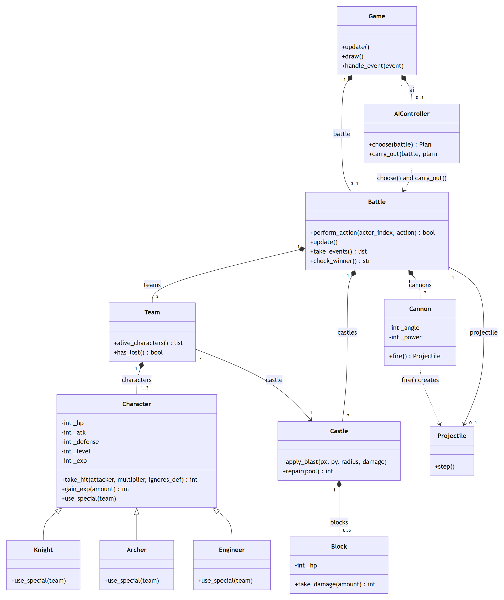

**Figure 1.** The main classes and how they relate. The complete diagram, with every class and
its main members, is Appendix A. Editable Mermaid sources: `docs/M5_class_diagram_main.mmd` and
`docs/M5_class_diagram.mmd`. Both images were rendered with Mermaid 11.4.1 in a browser and
checked by eye.

**How to read the arrows:**
- hollow triangle: inheritance;
- filled diamond: composition (the owner creates and keeps the part);
- plain arrow: association (a reference the class doesn't own);
- dashed arrow: dependency (uses or creates, doesn't keep).

- **Inheritance.** `Knight`, `Archer` and `Engineer` inherit from `Character`. Health, damage,
  Defend, cooldowns, EXP and levels are written once in `Character`; each subclass sets its own
  numbers and its special ability.
- **Encapsulation.** Private attributes (a leading underscore) change only through methods that
  keep them valid:
  - `Character`'s `_hp`, `_level`, `_exp` and `_special_cooldown` (HP never below 0, levels only
    through `gain_exp`);
  - `Block._hp` (never below 0 or above the maximum; a destroyed block can't be restored);
  - `Cannon`'s `_angle` and `_power` (always clamped to the legal range);
  - `Battle._events` (emptied only by `take_events`).

  Other code reads them through read-only properties.
- **Polymorphism.** `Battle.perform_action` calls `actor.use_special(team)` for every role. A
  Knight makes its allies defend, an Archer returns a stronger shot to fire, and an Engineer
  repairs the cover. `Engineer` also extends `special_blocked_reason` with `super()`.
- **Composition and associations.**
  - A `Battle` owns two `Team`s, two `Castle`s and two `Cannon`s, and refers to the
    `Projectile` in flight.
  - A `Team` owns its 1–3 characters and refers to its `Castle`.
  - A `Castle` owns its 0–6 `Block`s.
  - `Game` owns the current `Battle` and, against the computer, an `AIController`. The
    `AIController` receives the `Battle` as an argument and doesn't store it.
- **Rules separated from the GUI.** `battle.py`, `castle.py`, `characters.py`, `ai.py` and
  `animation.py` never import Pygame (a test checks this). Only `main.py`, `drawing.py` and
  `sound.py` use it.

## 6. Testing methods and results

**Methods.**
- **Automated tests:** 411 `unittest` tests in 8 files. They call the real classes. The rule
  and AI tests don't need Pygame. The interface tests click and press keys through the real
  `Game` without a visible window or sound.
- **Repeatable randomness:** the computer opponent takes a seed, so AI tests give the same
  result every time.
- **Scripted complete matches:** throwaway scripts drove the real game through whole matches
  by clicking and pressing keys, with the built-in AI choosing the moves. **These are automated
  checks, not human play-testing.**
- **Human acceptance tests** were done on earlier versions; the final version is listed for a
  human check (section 8).

| Test file | Tests | Main areas |
|---|---|---|
| `test_characters.py` | 45 | Stats, damage formula and minimum, Defend, cooldowns, levels, specials, inheritance |
| `test_castle.py` | 28 | Cover rules (all 76 layouts), blasts, Repair |
| `test_battle.py` | 32 | Physics, collision along the path, events, no Pygame in the rules |
| `test_combat.py` | 78 | Whole turns, cover, Cover Guard, specials, EXP, victory, round limit, Guarded Strike, anti-stall |
| `test_ai.py` | 54 | The computer's choices, difficulty, whole AI-vs-AI matches |
| `test_animation.py` | 16 | The run to the cannon |
| `test_sound.py` | 9 | The sound effects (including attack, defence, victory and defeat) and the silent fallback |
| `test_main.py` | 149 | Screens, buttons, keys, the computer's turn, the result screen, sounds for events |

**Results.**
- **Automated tests (final code):** 411 run, 411 passed with Pygame. Without Pygame, the 158
  interface tests (`test_main`, `test_sound`) are skipped and the other 253 pass.
- **Complete matches (M4.3):** 72 scripted matches through the interface covering every mode,
  team size, cover type and first mover. No error, refused action or stuck turn; 71 ended by
  elimination, 1 by the round limit. 11 of 11 critical interaction checks passed (for example R
  during a shot, M mute, rematch resets).
- **Complete matches (M5.2-A):** 12 more unmodified Player vs AI matches (3 v 3), used for the
  screenshots. A player controlled by the Hard AI beat the Easy computer 6 times out of 6; one
  controlled by the Easy AI lost to the Hard computer 6 times out of 6. No invalid action.
- **Difficulty (M4.3, 200 seeded computer-vs-computer matches):** Normal beat Easy 28–9 (3 draws)
  and Hard beat Normal 37–3.
- **Boundary cases tested:**
  - damage at least 1, and HP never below 0;
  - the Level 5 cap, and several levels from one award;
  - defeated characters earn nothing;
  - Repair never overheals or rebuilds;
  - an elimination on the last turn of round 30 still wins;
  - a timeout is a draw even when one team is far ahead;
  - Defend refused right after a Defend;
  - no audio device.
- **Defend sound (M5.2-A):** tests check that a successful Defend (or Rally) plays the defend
  sound once, the computer's Defend plays it too, refused actions and Repair are silent, M mutes
  it, and a rematch stops all sounds.

Test output of the final run (Pygame installed):

```
Ran 411 tests in 261.188s

OK
```

## 7. Screenshots

Every picture is a real frame of the running game (`main.Game`), saved by a script on a hidden
display (no picture was edited). Figures 2–7 come from complete, unmodified Player vs AI
matches: the script only entered the LEFT side's moves through the game's own mouse and keyboard
handling, choosing them with the built-in AI. No HP, cooldown or other value was changed.
Figures 8–13 were taken with scripted moves to show particular screens, as each caption says.

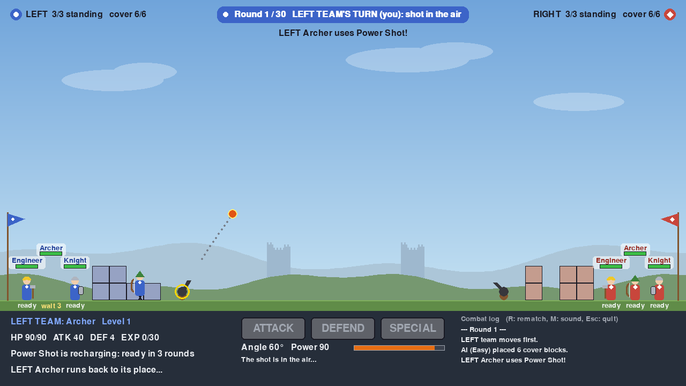
**Figure 2. Special ability.** Round 1: the LEFT Archer's Power Shot (orange) in flight; the
Archer runs back from the cannon. (Match A: 3 v 3 against the Easy computer.)

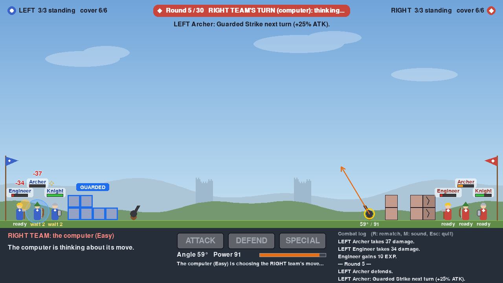
**Figure 3. Defend.** Round 5 of match A: the LEFT Archer defends (blue bubble), its cover shows
GUARDED, a hollow gold star marks its Guarded Strike, and the log explains it. The computer is
thinking.

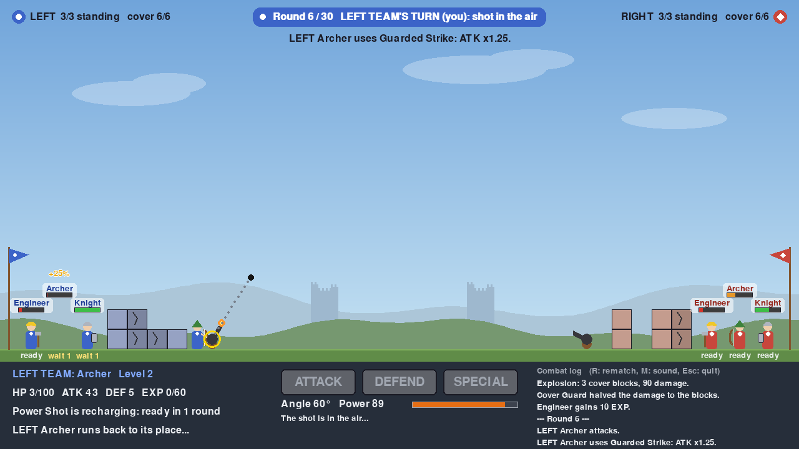
**Figure 4. Guarded Strike.** Round 6 of match A: the same Archer attacks with its Guarded Strike
("+25%" over its name; "ATK x1.25" in the log), and the shot is in the air.

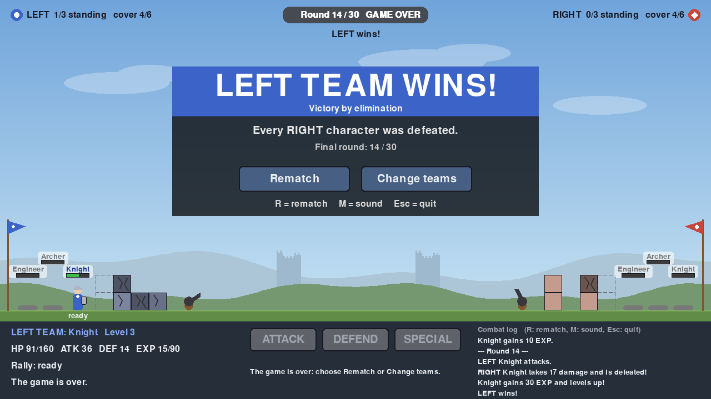
**Figure 5. Natural victory.** Match A ends in round 14: every RIGHT character was defeated.

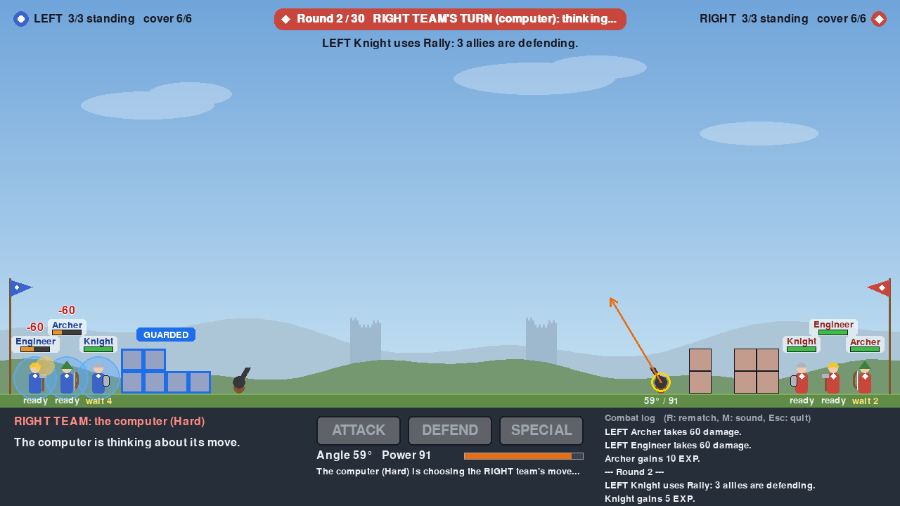
**Figure 6. Special ability (Rally).** Round 2 of match B (3 v 3 against the Hard computer): the
LEFT Knight's Rally makes all three LEFT characters defend, after the Archer and the Engineer
each took 60 damage.

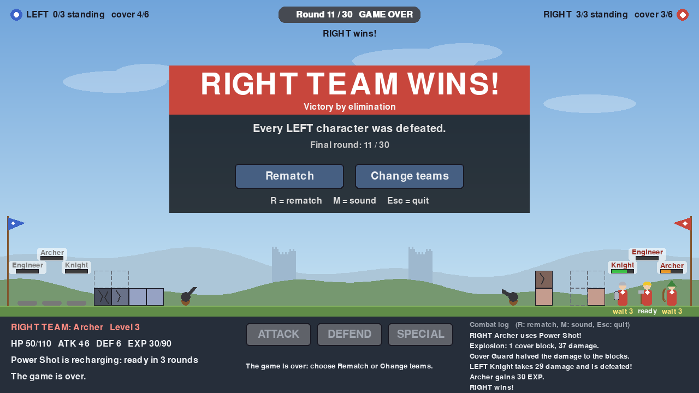
**Figure 7. Defeat.** Match B ends in round 11: the computer (RIGHT) has defeated every LEFT
character.

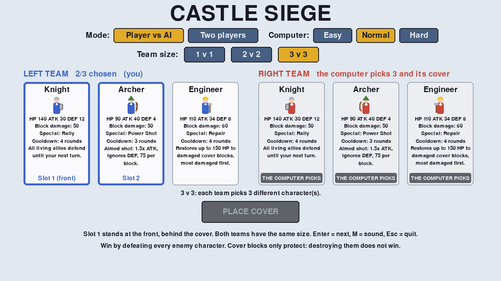
**Figure 8. Character selection** (Player vs AI, 3 v 3; the computer picks its own team).

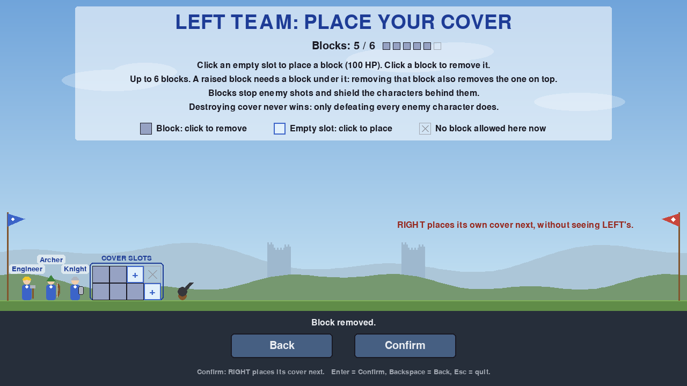
**Figure 9. Cover placement** (two-player mode, LEFT team): 5 of 6 blocks, an open slot ("+") and
a slot that can't take a block ("×").

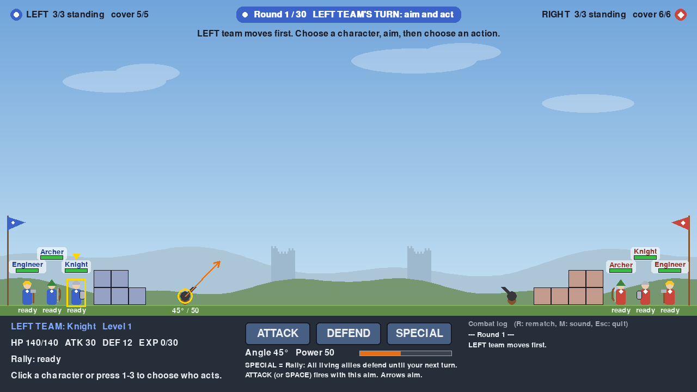
**Figure 10. The battle screen:** turn banner, health bars, the chosen character, the aim, the
action buttons and the combat log.

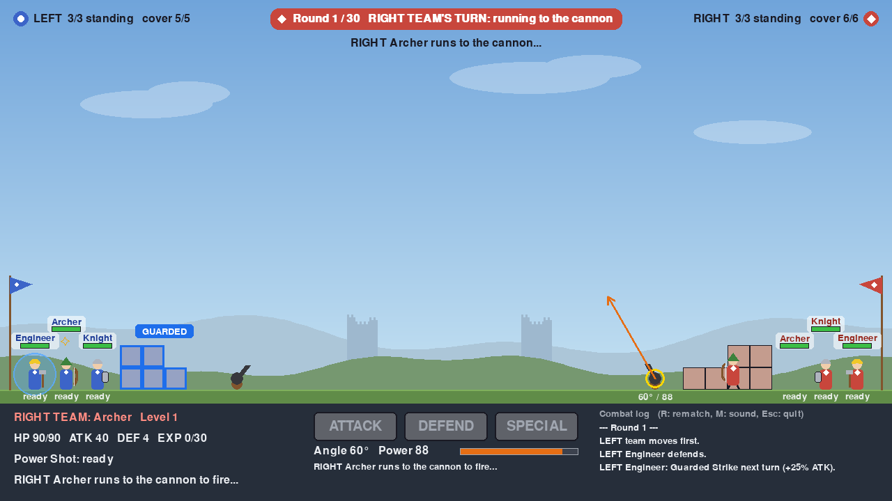
**Figure 11. Attack animation:** the RIGHT Archer runs to its team's cannon (scripted moves).

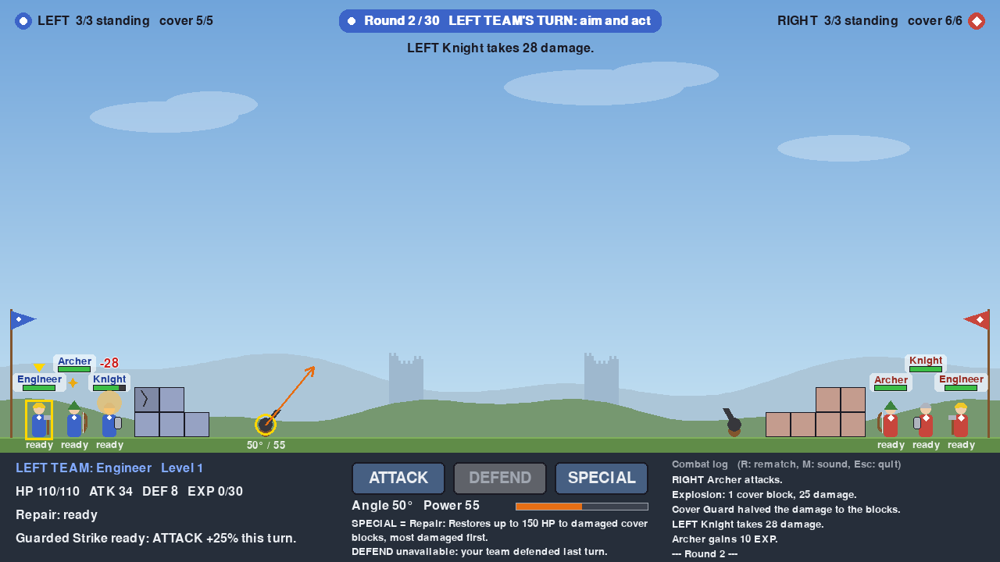
**Figure 12. Explosion and damage:** "-28" over the LEFT Knight, a cracked block, and the log
(scripted moves).

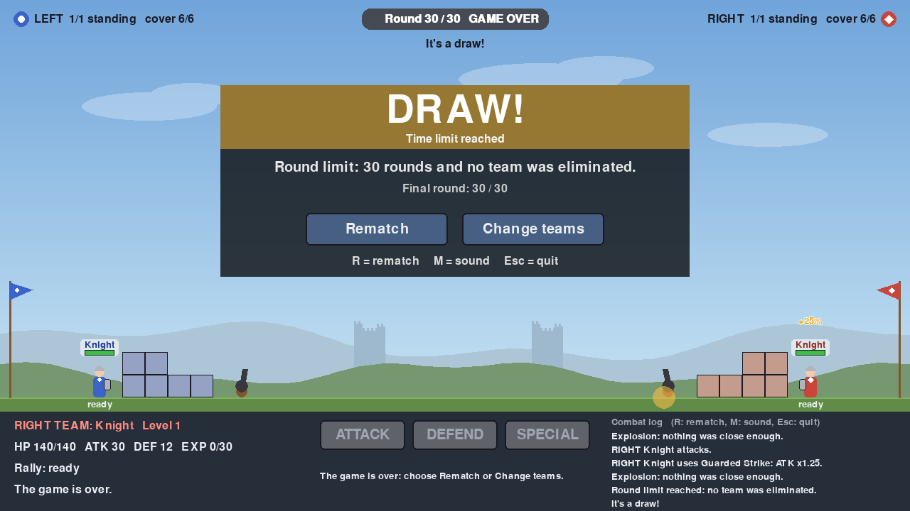
**Figure 13. Draw after the round limit.** To reach round 30 the script passed every turn
(Defend, or a harmless shot when Defend wasn't allowed).

*[Testing screenshot: the student adds a screenshot of a terminal showing
`python -m unittest discover tests` ending with "Ran 411 tests ... OK".]*

## 8. Final results and conclusion

**What was achieved:**
- Castle Siege meets the confirmed course requirements: a Python and Pygame turn-based battle
  with character selection, HP, Attack, Defend and Special.
- It has an AI opponent, health bars, buttons, a combat log and victory by eliminating the
  enemy.
- It has a background and sounds for attack, defence, victory and defeat.
- The rules are separate from the interface and covered by 411 automated tests.

**Limitations:**
- Our additions (cover, Cover Guard, Guarded Strike, the anti-stall rule, the round-30 draw)
  have not been approved by the instructor.
- `main.py` is long (about 1,400 lines).
- Balance was measured with the built-in AI, not with people.
- Still to be done by a person on the final version:
  - listen to every sound, including the new defend sound;
  - check M mute and R during a shot;
  - play one match at each difficulty and one two-player match.

**Possible improvements:** a beginner's aiming hint, splitting `main.py` into one class per
screen, and saving match statistics.

*[Student's own reflection, if the course asks for one.]*

## 9. AI assistance disclosure

*[Draft. The student checks the course's policy on AI tools and adjusts this section; the policy
is not known to us.]*

This project was developed with AI assistance. ChatGPT acted as a project manager: it wrote the
milestone plans and reviewed each step. Claude Code (an AI coding assistant) wrote the code,
tests and documentation according to those plans. The work was checked through automated tests
and human play-testing at several milestones. *[Add what the student designed, decided
or wrote personally.]*

## 10. References

- Pygame documentation: https://www.pygame.org/docs/
- Python documentation (`unittest`, `copy`, `random`, `math`, `array`): https://docs.python.org/3/
- [ryonsherman/pygame-rebound](https://github.com/ryonsherman/pygame-rebound) (MIT License):
  studied for ideas only. No code or assets were copied.
- Mermaid (used only to draw the class diagrams): https://mermaid.js.org/

---

## Appendix A — Complete class diagram

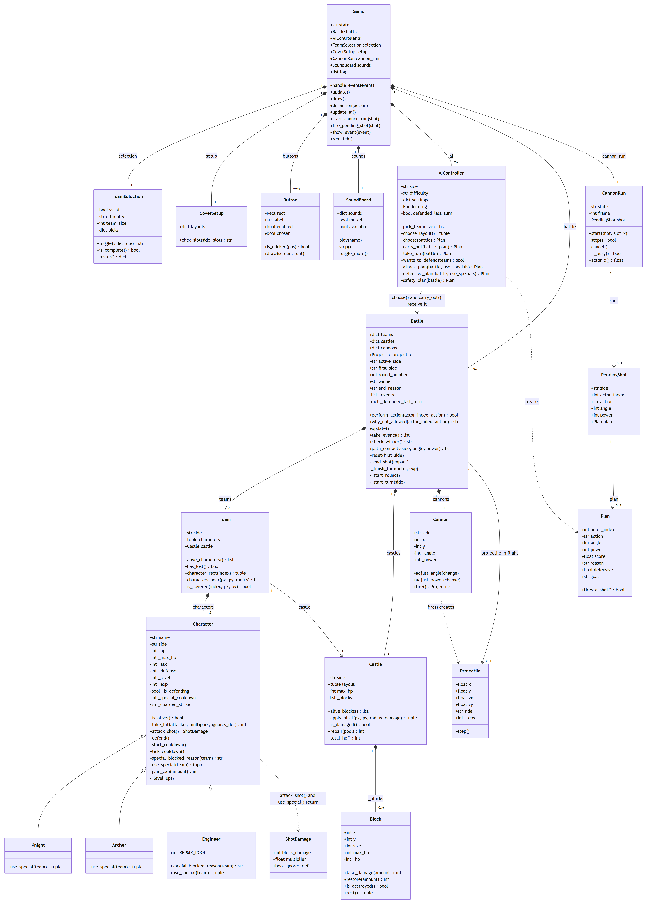

**Figure 14.** All 20 classes with their main attributes and methods (source:
`docs/M5_class_diagram.mmd`). Functions that are not methods, such as `calculate_damage`,
`layout_problem` and `segment_entry`, are not drawn.

---

<!-- source-appendix:start -->
## Appendix B — Complete Python source code

The eight game source files, 3620 lines in total, copied automatically from the submitted code (commit `a4ceef8`, `a4ceef8ad30aae6f9e697c6ce6b1cbb58c942b0e`) by a script, not by hand. Every comment and every space of indentation is kept. The tests (`tests/`, 8 files) are submitted with the code but not printed here. A second script checked each block below against the files in git: same bytes, same line count, same SHA-256.

| | File | Lines | SHA-256 of the file | Contents |
|---|---|---|---|---|
| B.1 | `main.py` | 1423 | `83ed91068a5fa44468fa974bfc98f3b3a72f4f0c964660b2436791d7db687f3f` | Pygame window, screens, input, the computer's turn, drawing and the main loop |
| B.2 | `battle.py` | 575 | `723e7bc92ebd65c3fbeeff7478fb47459f248cc576f94b8b0a399e6fb3a701a6` | Battle, Team, Cannon, Projectile: physics, collision, explosions, turns, victory |
| B.3 | `characters.py` | 331 | `93a1879c118ba84cb73a5be9f34c10c8d19c92091165150296b209e229512a1b` | Character and its subclasses Knight, Archer, Engineer; the damage formula |
| B.4 | `castle.py` | 213 | `b5fbb7ac9c2854825933773bf270f5ecdc6acf4c51d70f04c6506094fc844adb` | Block, Castle and the cover-layout rules |
| B.5 | `ai.py` | 485 | `a49bf1b6ef27c5a1df0a1435a3701d7a6a76cd571d00890f8b47be1b3b011952` | AIController and Plan: the computer opponent |
| B.6 | `animation.py` | 130 | `56f2e3cd3d343d18bdb81f919a6305f89eed65d00a39035aea5455cf438bef20` | CannonRun and PendingShot: the run to the cannon |
| B.7 | `drawing.py` | 299 | `7d7da70f5f65e0a3d2ee96a911d03f9783fbd994d6b6002ef5c88e9c4f592f97` | Colours, figures, cover blocks, the background and Button |
| B.8 | `sound.py` | 164 | `9559b6174fadc8e55f60b78bf64c19f36152c0144c096e6674870419dd0bc045` | Sound effects made in code and SoundBoard |

### B.1 `main.py` (1423 lines)

```python
"""Castle Siege - the Pygame interface (the only module that uses Pygame).

Screens (Game.state):
  "select"  team selection: mode (Player vs AI or two players), AI level, team size
            (1v1, 2v2 or 3v3) and the characters
  "cover"   cover placement (M3.4-B): one team at a time clicks its 8 cover slots to
            place up to 6 blocks (Game.placing says which team)
  "battle"  the battlefield: pick a character, aim the cannon, pick an action
  "result"  the battlefield with the winner (or DRAW), plus Rematch / Change teams buttons
Each team has its cover blocks in front of its characters and one cannon in front of
the cover.

Setup flow:  Player vs AI:  select -> LEFT cover -> battle (the computer places RIGHT's cover)
             Two players:   select -> LEFT cover -> RIGHT cover -> battle
Back on a cover screen returns to the previous step; nothing chosen is lost.

Player vs AI: the human plays LEFT and the computer (ai.py) picks, places and plays RIGHT.
Two players: both teams play on this computer and take turns ("hot seat").
All game rules live in battle.py, castle.py and characters.py: this file reads
the mouse and keyboard, calls Battle methods and draws what the Battle reports.

An attack (ATTACK or Power Shot, by a person or the computer) is not fired at once (M3.4-C):
the character first runs to its team's cannon (animation.py), the shot is fired with
Battle.perform_action() when it gets there, and it runs back while the shot flies. Combat
input and the computer wait until it is back. Defend, Rally and Repair still happen at once.

Sound (M4.2-A, sound.py): effects made in code play for Battle events (a shot, an explosion,
cover hit or destroyed, a Defend or Rally (M5.2-A), a level-up, the result). M turns the sound off and on; without an audio
device the game is silent and works the same.

Run from the project folder:   python main.py
"""
import math

import pygame

from ai import DIFFICULTY_SETTINGS, AIController, aim_cannon
from animation import FIRE, FIRE_FRAMES, RUN_TO_CANNON, CannonRun, PendingShot, fires_the_cannon
from battle import (BLAST_RADIUS, CHARACTER_HEIGHT, FIELD_WIDTH, MAX_POWER, MAX_TEAM_SIZE, MIN_POWER,
                    ROUND_LIMIT, SLOT_X, Battle, Cannon, direction, other_side)
from castle import (BLOCK_SIZE, COLUMN_X, DEFAULT_LAYOUT, GROUND_Y, MAX_BLOCKS, SLOT_COUNT,
                    layout_problem, place_block, remove_block, slot_position)
from characters import ARCHETYPES, MAX_LEVEL, Archer, Knight
from drawing import (ACTIVE_RING_COLOR, AIM_COLOR, BUTTON_OFF, CANNON_COLOR, CLOSED_SLOT_COLOR,
                     COOLDOWN_COLOR, DAMAGE_COLOR, DEFEATED_COLOR, DEFEND_COLOR, DIM_TEXT, DRAW_COLOR,
                     FLASH_COLOR, FLASH_EDGE, GROUND_COLOR, GUARD_COLOR, LABEL_COLORS, LIGHT_TEXT,
                     MENU_COLOR, OPEN_SLOT_COLOR, PANEL_COLOR, POWER_SHOT_COLOR, READY_COLOR, SHOT_COLOR,
                     SKY_COLOR, TEAM_COLORS, TEXT_COLOR, TRAIL_COLOR, WOOD, Button, block_color, draw_block,
                     draw_figure, draw_firing_figure, draw_outlined_text, draw_rubble_outline,
                     draw_running_figure, draw_text, hp_bar_color, hp_bar_width, wrap_text)
from drawing import EMBLEM_COLOR, EMBLEM_Y, draw_badge, draw_emblem, draw_plate, make_background   # M4.2-A
from drawing import EXPIRED_COLOR, GUARD_STRIKE_COLOR, draw_guard_mark   # M4.2-B
from sound import BUFFER, SAMPLE_RATE, SoundBoard

WINDOW_WIDTH = FIELD_WIDTH        # 1280
WINDOW_HEIGHT = 720
FPS = 60
AI_DELAY_FRAMES = 40              # the computer waits this long (2/3 s) before it acts
EXPLOSION_FRAMES = 20             # how long an explosion stays on screen
EXPLOSION_ALPHA = 160             # explosions are see-through (0-255), so the target stays visible
FLOAT_FRAMES = 60                 # a floating damage number stays 1 s, rising slowly
TRAIL_LENGTH = 12                 # dots behind a flying shot
LOG_LINES = 6                     # combat-log lines shown at once
PANEL_TOP = 580                   # the control panel fills the bottom of the window
COVER_HELP_TOP = 122              # the placement screen's instructions start at this y ...
COVER_HELP_STEP = 26              # ... one line every 26 px


# ----- small helpers -------------------------------------------------------------

def slot_rect(side, slot):
    """The clickable square of cover slot `slot` (0-7) of `side`: exactly where its block stands."""
    return pygame.Rect(slot_position(side, slot), (BLOCK_SIZE, BLOCK_SIZE))


def guard_badge_rect(side):
    """Where the GUARDED badge of `side`'s cover is drawn: just above the higher cover row,
    centred over the four slot columns, clear of the characters and their HP bars, the
    cannon and the HUD. The two sides are mirror images."""
    center_x = COLUMN_X["left"][0] + 2 * BLOCK_SIZE                 # 236: the middle of the columns
    if side == "right":
        center_x = WINDOW_WIDTH - center_x                          # 1044
    badge = pygame.Rect(0, 0, 84, 20)
    badge.center = (center_x, GROUND_Y - 2 * BLOCK_SIZE - 20)       # y 476: above the raised row
    return badge


def result_banner_rect():
    """The coloured title band of the result overlay: the winner's colour, or DRAW_COLOR."""
    return pygame.Rect(310, 120, 660, 90)


def muzzle_point(cannon):
    """Centre of the muzzle flash: just past the tip of the 24 px barrel, along its angle."""
    radians = math.radians(cannon.angle)
    return (round(cannon.x + direction(cannon.side) * 30 * math.cos(radians)),
            round(cannon.y - 30 * math.sin(radians)))


def describe_event(event):
    """Turn one battle event into combat-log lines (an empty list if it isn't worth logging)."""
    kind = event["type"]
    if kind == "action" and event["action"] != "special":
        verb = "attacks" if event["action"] == "attack" else "defends"
        return [f"{event['side'].upper()} {event['name']} {verb}."]
    if kind == "special":
        return [f"{event['side'].upper()} {event['message']}"]
    if kind == "explosion":
        lines = []
        if event["blocks_hit"]:
            plural = "s" if event["blocks_hit"] != 1 else ""
            lines.append(f"Explosion: {event['blocks_hit']} cover block{plural}, "
                         f"{event['damage']} damage.")
            if event.get("guarded"):
                lines.append("Cover Guard halved the damage to the blocks.")
        target_side = other_side(event["side"]).upper()
        for name in event["covered"]:
            lines.append(f"{target_side} {name} was shielded by cover.")
        for hit in event["characters_hit"]:
            ending = " and is defeated!" if hit["defeated"] else "."
            lines.append(f"{target_side} {hit['name']} takes {hit['damage']} damage{ending}")
        return lines or ["Explosion: nothing was close enough."]
    if kind == "miss":
        return ["The shot flew off the battlefield."]
    if kind == "exp":
        if event["levels"] == 0:
            return [f"{event['name']} gains {event['amount']} EXP."]
        return [f"{event['name']} gains {event['amount']} EXP and levels up!"]
    if kind == "round":
        return [f"--- Round {event['number']} ---"]
    if kind == "invalid":
        return [f"Not allowed: {event['reason']}."]
    if kind == "guard_granted":
        return [f"{event['side'].upper()} {event['name']}: Guarded Strike next turn (+25% ATK)."]
    if kind == "guard_used":
        return [f"{event['side'].upper()} {event['name']} uses Guarded Strike: ATK x1.25."]
    if kind == "guard_expired":
        return [f"{event['side'].upper()} {event['name']}'s Guarded Strike expired unused."]
    if kind == "game_over":
        lines = []
        if event["reason"] == "timeout":
            lines.append("Round limit reached: no team was eliminated.")
        if event["winner"] == "draw":
            return lines + ["It's a draw!"]
        return lines + [f"{event['winner'].upper()} wins!"]
    return []    # "fire" and "turn" are shown by the HUD instead


class TeamSelection:
    """The choices made on the team-selection screen. (No drawing happens here.)

    Each team picks `team_size` different roles. The order of the picks is the
    slot order: the first pick stands at the front, behind the team's cover. Against the
    computer (vs_ai) only the LEFT team is picked here; the AI builds its own.
    """

    def __init__(self):
        self.vs_ai = True               # Player vs AI is the main mode
        self.difficulty = "normal"
        self.team_size = 1
        self.picks = {"left": [], "right": []}

    def set_mode(self, vs_ai):
        self.vs_ai = vs_ai

    def set_team_size(self, size):
        if not 1 <= size <= MAX_TEAM_SIZE:
            raise ValueError(f"team size must be 1 to {MAX_TEAM_SIZE}")
        self.team_size = size
        for picks in self.picks.values():
            del picks[size:]                    # a smaller team keeps its first picks

    def toggle(self, side, role):
        """Add `role` to the team, or remove it if it is already there.

        Returns None, or a message if the pick is refused (the team is full, or it
        is the computer's team). A role can't be picked twice, so there are never duplicates.
        """
        if side == "right" and self.vs_ai:
            return "The computer picks the RIGHT team when the battle starts."
        picks = self.picks[side]
        if role in picks:
            picks.remove(role)
            return None
        if len(picks) >= self.team_size:
            return (f"{side.upper()} team already has {self.team_size} - "
                    f"click a chosen character to remove it first.")
        picks.append(role)
        return None

    def is_complete(self):
        """True when every team picked here has exactly team_size characters."""
        sides = ["left"] if self.vs_ai else ["left", "right"]
        return all(len(self.picks[side]) == self.team_size for side in sides)

    def roster(self):
        """The picks in the form Battle(roster=...) expects."""
        return {side: list(picks) for side, picks in self.picks.items()}


class CoverSetup:
    """The cover layouts chosen on the placement screens (no drawing happens here).

    Each side keeps its own layout: a tuple of slot numbers, so the two sides can never
    share one list. Both start as DEFAULT_LAYOUT. Clicks go through castle.place_block()
    and castle.remove_block(), which check with castle.layout_problem(), so a layout
    stays legal and no rule is repeated here. Cover slots never depend on the team size
    or roles (no character stands on one), so the layouts are kept when teams change.
    """

    def __init__(self):
        self.layouts = {"left": DEFAULT_LAYOUT, "right": DEFAULT_LAYOUT}

    def click_slot(self, side, slot):
        """A click on cover slot `slot` of `side`: place a block on an empty slot, or remove
        the block on an occupied one. Returns a short message for the status line."""
        layout = self.layouts[side]
        if slot in layout:
            self.layouts[side], removed = remove_block(layout, slot)
            if len(removed) > 1:
                return ("Block removed, and the raised block on top of it too "
                        "(a raised block needs a block under it).")
            return "Block removed."
        self.layouts[side], problem = place_block(layout, slot)
        if problem is not None:
            return f"No block there: {problem}."
        return "Block placed."


class Game:
    """Connects the mouse, keyboard and screen to the team selection, the cover placement
    and one Battle.

    ai_seed: a number makes the computer's choices (team, cover, moves) repeatable; the
    tests use it. None (the real game) gives a different computer opponent every time.
    """

    def __init__(self, screen, ai_seed=None):
        self.screen = screen
        self.ai_seed = ai_seed
        # Font(None, size) uses Pygame's built-in font. (SysFont scans the system's
        # installed fonts, and on some Windows machines that scan crashes.)
        self.big_font = pygame.font.Font(None, 80)
        self.title_font = pygame.font.Font(None, 54)
        self.font = pygame.font.Font(None, 30)
        self.small_font = pygame.font.Font(None, 24)
        self.tiny_font = pygame.font.Font(None, 19)
        self.banner_font = pygame.font.Font(None, 24)
        self.banner_font.set_bold(True)           # the turn banner stands out from the other HUD text
        self.background = make_background(WINDOW_WIDTH, PANEL_TOP, GROUND_Y)   # M4.2-A: drawn once
        self.running = True
        self.space_released = True    # fire only once per SPACE press (see handle_key)
        self.state = "select"
        self.selection = TeamSelection()
        self.setup = CoverSetup()
        self.placing = "left"         # the team whose cover is being placed (state "cover")
        self.battle = None
        self.ai = None                # the AIController playing RIGHT, or None (two players)
        self.ai_wait = 0              # frames the computer has waited on this turn
        self.cannon_run = CannonRun()  # an attacking character's run to the cannon and back (M3.4-C)
        self.sounds = SoundBoard()     # sound effects (M4.2-A); silent if there is no audio device
        self.standing_blocks = {}      # standing blocks per side, to hear when one is destroyed
        self.selected = {"left": 0, "right": 0}   # slot of the character chosen to act
        self.explosions = []          # each one is [x, y, age in frames]
        self.floaters = []            # floating damage numbers: [x, y, text, colour, age in frames]
        self.trail = []               # the last positions of the flying shot (drawn as dots)
        self.shot_style = "attack"    # "power" while a Power Shot flies (drawn bigger and orange)
        self.log = []                 # combat-log lines, newest last
        self.message = "Click characters to add them to a team (click again to remove)."
        self.make_buttons()
        self.refresh_buttons()

    def make_buttons(self):
        # Team selection screen.
        self.mode_buttons = {"ai": Button(290, 72, 180, 38, "Player vs AI"),
                             "pvp": Button(480, 72, 180, 38, "Two players")}
        self.difficulty_buttons = {level: Button(800 + i * 110, 72, 100, 38, level.capitalize())
                                   for i, level in enumerate(DIFFICULTY_SETTINGS)}
        self.size_buttons = [Button(470 + i * 120, 120, 105, 40, f"{n} v {n}")
                             for i, n in enumerate(range(1, MAX_TEAM_SIZE + 1))]
        self.card_rects = {}
        for side, first_x in (("left", 60), ("right", 660)):
            for i, role in enumerate(ARCHETYPES):
                self.card_rects[(side, role)] = pygame.Rect(first_x + i * 190, 210, 170, 265)
        self.start_button = Button(515, 515, 250, 56, "PLACE COVER")
        # Cover placement screen.
        self.back_button = Button(430, PANEL_TOP + 42, 190, 46, "Back")
        self.confirm_button = Button(660, PANEL_TOP + 42, 190, 46, "Confirm")
        # Battle screen.
        self.action_buttons = {
            "attack": Button(450, PANEL_TOP + 12, 120, 42, "ATTACK"),
            "defend": Button(580, PANEL_TOP + 12, 120, 42, "DEFEND"),
            "special": Button(710, PANEL_TOP + 12, 120, 42, "SPECIAL"),
        }
        # Result overlay.
        self.rematch_button = Button(430, 300, 200, 46, "Rematch")
        self.change_teams_button = Button(650, 300, 200, 46, "Change teams")

    # ----- starting matches ------------------------------------------------------

    def start_battle(self, roster, layouts, ai=None):
        """Start a match. `ai` is the AIController playing RIGHT, or None if two people play."""
        self.battle = Battle(roster=roster, layouts=layouts)
        self.ai = ai
        self.begin_match()
        if ai is not None:
            self.log.append(f"AI ({ai.difficulty.capitalize()}) placed {len(layouts['right'])} cover blocks.")

    def rematch(self):
        """Play again with the same teams and cover (the Rematch button or R). The side that
        moves first swaps every time: LEFT, then RIGHT, then LEFT... A new choice of teams
        starts with LEFT again."""
        self.battle.reset(first_side=other_side(self.battle.first_side))
        if self.ai is not None:
            self.ai.new_match()
        self.begin_match()

    def begin_match(self):
        self.state = "battle"
        self.cannon_run.cancel()          # a rematch (R) mid-run: nothing is fired later
        self.sounds.stop()                # nothing from the last match keeps playing
        self.standing_blocks = {side: len(castle.alive_blocks()) for side, castle in self.battle.castles.items()}
        self.selected = {"left": 0, "right": 0}
        self.ai_wait = 0
        self.explosions = []
        self.floaters = []
        self.trail = []
        first = f"{self.battle.first_side.upper()} team moves first."
        self.log = ["--- Round 1 ---", first]
        if self.ai is not None and self.battle.first_side == self.ai.side:
            self.message = f"The computer ({self.ai.side.upper()}) moves first."   # nothing to do yet
        else:
            self.message = first + " Choose a character, aim, then choose an action."
        self.refresh_buttons()

    def try_start(self):
        """PLACE COVER (or Enter) on the selection screen: go on to the LEFT cover screen."""
        if not self.selection.is_complete():
            size = self.selection.team_size
            self.message = f"Each team needs exactly {size} character{'s' if size > 1 else ''}."
        else:
            self.begin_cover("left")

    # ----- cover placement -----------------------------------------------------------

    def begin_cover(self, side):
        self.state = "cover"
        self.placing = side
        self.message = f"{side.upper()} team: click the slots to place or remove blocks, then press Confirm."

    def click_cover(self, pos):
        for slot in range(SLOT_COUNT):
            if slot_rect(self.placing, slot).collidepoint(pos):
                self.message = self.setup.click_slot(self.placing, slot)
                return
        if self.back_button.is_clicked(pos):
            self.back_from_cover()
        elif self.confirm_button.is_clicked(pos):
            self.confirm_cover()

    def back_from_cover(self):
        """Back: RIGHT's cover screen returns to LEFT's, LEFT's to team selection. Nothing is lost."""
        if self.placing == "right":
            self.begin_cover("left")
        else:
            self.state = "select"
            self.message = "Change the teams, then press PLACE COVER."

    def confirm_cover(self):
        """Confirm: RIGHT places its cover next (two players), or the battle starts."""
        layout = self.setup.layouts[self.placing]
        problem = layout_problem(layout)
        if problem is not None:        # clicks always keep the layout legal; this is a safety net
            self.message = f"This cover can't be used: {problem}."
            return
        if self.placing == "left" and not self.selection.vs_ai:
            self.begin_cover("right")
        elif self.selection.vs_ai:
            ai = AIController("right", self.selection.difficulty, seed=self.ai_seed)
            roster = {"left": list(self.selection.picks["left"]),
                      "right": ai.pick_team(self.selection.team_size)}
            self.start_battle(roster, {"left": layout, "right": ai.choose_layout()}, ai)
        else:
            self.start_battle(self.selection.roster(), dict(self.setup.layouts))

    def is_ai_turn(self):
        """True while it is the computer's turn to act (it acts by itself in update())."""
        return (self.state == "battle" and self.ai is not None
                and self.battle.active_side == self.ai.side and self.battle.can_fire())

    def controls_locked(self):
        """True while nobody may aim or act in the battle: a character is running to or from
        the cannon (M3.4-C), a shot is flying, the game is over, or it is the computer's turn."""
        return (self.state != "battle" or self.cannon_run.is_busy() or not self.battle.can_fire()
                or self.is_ai_turn())

    # ----- the character who acts --------------------------------------------------

    def selected_index(self):
        """Slot of the active team's chosen character (moved to a living one if needed)."""
        side = self.battle.active_side
        team = self.battle.teams[side]
        if not team.characters[self.selected[side]].is_alive():
            for index, character in enumerate(team.characters):
                if character.is_alive():
                    self.selected[side] = index
                    break
        return self.selected[side]

    def selected_character(self):
        if self.battle is None:
            return None
        return self.battle.teams[self.battle.active_side].characters[self.selected_index()]

    def select_actor(self, index):
        """Choose who acts. Only living characters of the team whose turn it is can be chosen."""
        team = self.battle.teams[self.battle.active_side]
        if not 0 <= index < len(team.characters):
            return
        character = team.characters[index]
        if not character.is_alive():
            self.message = f"{character.name} has been defeated and can't act."
            return
        self.selected[self.battle.active_side] = index
        self.message = f"{character.name} is ready. Aim, then choose an action."

    def do_action(self, action):
        """Ask the Battle to carry out an action for the chosen character.

        ATTACK and Power Shot first send the character to the cannon (start_cannon_run): the
        shot is fired when it gets there. Defend, Rally and Repair happen at once."""
        if self.cannon_run.is_busy():
            return                        # one action per turn: a character is already on its way
        index = self.selected_index()
        reason = self.battle.why_not_allowed(index, action)
        if reason is not None:
            self.message = reason
            return
        side = self.battle.active_side
        if fires_the_cannon(self.battle.teams[side].characters[index], action):
            cannon = self.battle.cannons[side]
            self.start_cannon_run(PendingShot(side, index, action, cannon.angle, cannon.power))
        else:
            self.battle.perform_action(index, action)

    # ----- the run to the cannon (M3.4-C) -------------------------------------------

    def start_cannon_run(self, shot):
        """Send the character of `shot` (a PendingShot) from its slot to the cannon. The
        controls stay locked until it is back; nothing is fired yet."""
        team = self.battle.teams[shot.side]
        self.cannon_run.start(shot, team.slot_center(shot.actor_index)[0])
        self.message = f"{shot.side.upper()} {team.characters[shot.actor_index].name} runs to the cannon..."

    def update_cannon_run(self):
        """One frame of the run. On the frame the character reaches the cannon, the one real
        shot of this attack is fired (fire_pending_shot)."""
        shot = self.cannon_run.shot
        if not self.battle.teams[shot.side].characters[shot.actor_index].is_alive():
            self.cannon_run.cancel()      # not possible in play, but never leave a ghost runner
            return
        if self.cannon_run.step():
            self.fire_pending_shot(shot)

    def fire_pending_shot(self, shot):
        """Fire the shot the character carried to the cannon, through the Battle like every
        action. The computer's plan is carried out by its AIController (it aims, then calls
        Battle.perform_action); a person's shot uses the aim it had when the action was chosen."""
        if shot.plan is not None:
            fired = self.ai.carry_out(self.battle, shot.plan) is not None
        else:
            aim_cannon(self.battle.cannons[shot.side], shot.angle, shot.power)
            fired = self.battle.perform_action(shot.actor_index, shot.action)
        if not fired:
            self.cannon_run.cancel()      # not possible in play; the log says why it was refused
        self.shot_style = "power" if shot.action == "special" else "attack"   # only how it is drawn

    # ----- input -------------------------------------------------------------------

    def quit(self):
        """Esc or closing the window: stop the main loop, and any run with it."""
        self.cannon_run.cancel()
        self.sounds.stop()
        self.running = False

    def toggle_sound(self):
        """M (on every screen): sound off, or back on."""
        if not self.sounds.available:
            self.message = "No sound: the audio device could not be opened."
            return
        self.sounds.toggle_mute()
        self.message = "Sound off. Press M to turn it back on." if self.sounds.muted else "Sound on."

    def handle_event(self, event):
        if event.type == pygame.QUIT:
            self.quit()
        elif event.type == pygame.KEYUP and event.key == pygame.K_SPACE:
            self.space_released = True
        elif event.type == pygame.KEYDOWN:
            self.handle_key(event.key, event.mod)
        elif event.type == pygame.MOUSEBUTTONDOWN and event.button == 1:
            self.handle_click(event.pos)

    def handle_key(self, key, mods):
        if key == pygame.K_ESCAPE:
            self.quit()
        elif key == pygame.K_m:
            self.toggle_sound()
        elif self.state == "select":
            if key in (pygame.K_RETURN, pygame.K_KP_ENTER):
                self.try_start()
        elif self.state == "cover":
            if key in (pygame.K_RETURN, pygame.K_KP_ENTER):
                self.confirm_cover()
            elif key == pygame.K_BACKSPACE:
                self.back_from_cover()
        elif key == pygame.K_r:
            self.rematch()                # also cancels a run (begin_match)
        elif not self.controls_locked():
            self.handle_battle_key(key, mods)
        self.refresh_buttons()

    def handle_battle_key(self, key, mods):
        """Keys during a turn: aim, choose a character (1-3) and SPACE to attack."""
        step = 5 if mods & pygame.KMOD_SHIFT else 1
        cannon = self.battle.cannons[self.battle.active_side]
        if key == pygame.K_UP:
            cannon.adjust_angle(step)
        elif key == pygame.K_DOWN:
            cannon.adjust_angle(-step)
        elif key == pygame.K_RIGHT:
            cannon.adjust_power(step)
        elif key == pygame.K_LEFT:
            cannon.adjust_power(-step)
        elif key in (pygame.K_1, pygame.K_2, pygame.K_3):
            self.select_actor(key - pygame.K_1)
        elif key == pygame.K_SPACE and self.space_released:
            # Holding SPACE produces repeated key presses (key repeat is on for the
            # arrow keys). Requiring a release stops a held SPACE from also acting
            # for the next team as soon as its turn starts.
            self.space_released = False
            self.do_action("attack")

    def handle_click(self, pos):
        self.refresh_buttons()                     # decide using the situation right now
        if self.state == "select":
            self.click_selection(pos)
        elif self.state == "cover":
            self.click_cover(pos)
        elif self.state == "battle":
            self.click_battle(pos)
        elif self.rematch_button.is_clicked(pos):
            self.rematch()
        elif self.change_teams_button.is_clicked(pos):
            self.cannon_run.cancel()      # a character may still be walking back
            self.sounds.stop()
            self.state = "select"
            self.message = "Change the teams, then press PLACE COVER."
        self.refresh_buttons()

    def click_selection(self, pos):
        for mode, button in self.mode_buttons.items():
            if button.is_clicked(pos):
                self.selection.set_mode(vs_ai=(mode == "ai"))
                self.message = ("You play LEFT; the computer picks and plays RIGHT." if mode == "ai"
                                else "Two players: pick both teams, then take turns.")
        for level, button in self.difficulty_buttons.items():
            if button.is_clicked(pos):
                self.selection.difficulty = level
                self.message = f"Computer level: {level.capitalize()}."
        for size, button in enumerate(self.size_buttons, start=1):
            if button.is_clicked(pos):
                self.selection.set_team_size(size)
                self.message = f"{size} v {size}: each team picks {size} different character(s)."
        for (side, role), rect in self.card_rects.items():
            if rect.collidepoint(pos):
                refusal = self.selection.toggle(side, role)
                if refusal:
                    self.message = refusal
        if self.start_button.rect.collidepoint(pos):
            self.try_start()                       # explains what is missing if incomplete

    def click_battle(self, pos):
        if self.cannon_run.is_busy():
            return                                 # wait until the character is back in its slot
        if self.is_ai_turn():
            self.message = "The computer is playing the RIGHT team's turn."
            return
        for action, button in self.action_buttons.items():
            if button.is_clicked(pos):
                self.do_action(action)
                return
            if button.rect.collidepoint(pos):     # greyed out: say why (M4.2-B)
                reason = self.battle.why_not_allowed(self.selected_index(), action)
                if reason is not None:
                    self.message = reason[0].upper() + reason[1:] + "."
                return
        if not self.battle.can_fire():
            return                                 # can't change who acts while a shot flies
        active = self.battle.active_side
        for side, team in self.battle.teams.items():
            for index in range(len(team.characters)):
                if pygame.Rect(team.character_rect(index)).collidepoint(pos):
                    if side == active:
                        self.select_actor(index)
                    else:
                        self.message = f"It is the {active.upper()} team's turn."
                    return

    def refresh_buttons(self):
        """Enable or disable buttons to match the current situation."""
        for mode, button in self.mode_buttons.items():
            button.chosen = (mode == "ai") == self.selection.vs_ai
        for level, button in self.difficulty_buttons.items():
            button.chosen = (level == self.selection.difficulty)
            button.enabled = self.selection.vs_ai
        for size, button in enumerate(self.size_buttons, start=1):
            button.chosen = (size == self.selection.team_size)
        self.start_button.enabled = self.selection.is_complete()
        if self.battle is not None:
            index = self.selected_index()
            for action, button in self.action_buttons.items():
                button.enabled = (not self.controls_locked()
                                  and self.battle.why_not_allowed(index, action) is None)

    # ----- update ------------------------------------------------------------------

    def update(self):
        if self.cannon_run.is_busy():
            self.update_cannon_run()      # the controls and the computer wait for it
        elif self.is_ai_turn():
            self.update_ai()
        if self.battle is not None and self.state in ("battle", "result"):
            self.battle.update()
            for event in self.battle.take_events():
                self.show_event(event)
            for explosion in self.explosions:
                explosion[2] += 1
            self.explosions = [e for e in self.explosions if e[2] < EXPLOSION_FRAMES]
            for floater in self.floaters:             # rise slowly, then disappear
                floater[1] -= 0.5
                floater[4] += 1
            self.floaters = [f for f in self.floaters if f[4] < FLOAT_FRAMES]
            shot = self.battle.projectile
            self.trail = (self.trail + [(shot.x, shot.y)])[-TRAIL_LENGTH:] if shot is not None else []
        self.refresh_buttons()

    def update_ai(self):
        """On the computer's turn: wait AI_DELAY_FRAMES (so the player can see the turn
        change), then let the AIController choose. Defend, Rally and Repair are carried out
        at once. An attack or Power Shot takes the same run to the cannon as a person's and is
        carried out (AIController.carry_out -> Battle.perform_action) when the character gets
        there. Its events are shown as usual."""
        self.ai_wait += 1
        if self.ai_wait < AI_DELAY_FRAMES:
            return
        self.ai_wait = 0
        plan = self.ai.choose(self.battle)
        if plan is None:
            return
        self.selected[self.ai.side] = plan.actor_index             # the panel shows who acts
        self.log = (self.log + [f"AI ({self.ai.difficulty.capitalize()}): {plan.reason}."])[-50:]
        if plan.fires_a_shot():
            # The barrel turns to the aim now, while the character runs; the shot waits for it.
            aim_cannon(self.battle.cannons[self.ai.side], plan.angle, plan.power)
            self.start_cannon_run(PendingShot(self.ai.side, plan.actor_index, plan.action,
                                              plan.angle, plan.power, plan))
        else:
            self.ai.carry_out(self.battle, plan)

    def show_event(self, event):
        """React to one battle event: effects, sounds, the log, and the end of the game."""
        self.play_event_sound(event)
        if event["type"] == "explosion":
            self.explosions.append([event["x"], event["y"], 0])
            target = other_side(event["side"])
            for name in event["covered"]:
                self.add_floater(target, name, "shielded", GUARD_COLOR)
            for hit in event["characters_hit"]:
                self.add_floater(target, hit["name"], f"-{hit['damage']}", DAMAGE_COLOR)
                if hit["defeated"]:
                    self.add_floater(target, hit["name"], "DEFEATED", DAMAGE_COLOR, below=True)
        elif event["type"] == "guard_used":            # M4.2-B: the bonus, where the player looks
            self.add_floater(event["side"], event["name"], "+25%", GUARD_STRIKE_COLOR)
        elif event["type"] == "guard_expired":
            self.add_floater(event["side"], event["name"], "expired", EXPIRED_COLOR)
        elif event["type"] == "game_over":
            self.state = "result"
        lines = describe_event(event)
        if lines:
            self.log = (self.log + lines)[-50:]
            # The HUD keeps the outcome of the action: a new round or EXP is only in the log.
            if event["type"] not in ("round", "exp"):
                self.message = lines[-1]

    def play_event_sound(self, event):
        """The sound for one battle event (M4.2-A). Each event is read once, so each sound plays
        once. A Defend, and a Knight's Rally (the whole team defends), play the defend sound
        (M5.2-A). A refused action is an "invalid" event and makes no sound; nor does Repair."""
        kind = event["type"]
        if kind == "fire":
            self.sounds.play("fire")
        elif (kind == "action" and event["action"] == "defend") or (kind == "special" and self.is_rally(event)):
            self.sounds.play("defend")
        elif kind == "explosion":
            self.sounds.play("explosion")
            target = other_side(event["side"])
            standing = len(self.battle.castles[target].alive_blocks())
            if standing < self.standing_blocks.get(target, standing):
                self.sounds.play("cover_destroyed")
            elif event["blocks_hit"]:
                self.sounds.play("cover_hit")
            self.standing_blocks[target] = standing
        elif kind == "exp" and event["levels"] > 0:
            self.sounds.play("level_up")
        elif kind == "game_over":
            self.sounds.stop()
            if event["winner"] == "draw":
                self.sounds.play("draw")
            elif self.ai is not None and event["winner"] == self.ai.side:
                self.sounds.play("defeat")     # against the computer, its win is your defeat
            else:
                self.sounds.play("victory")

    def is_rally(self, event):
        """True if a "special" event is a Knight's Rally (characters are named after their role)."""
        return any(character.name == event["name"] and isinstance(character, Knight)
                   for character in self.battle.teams[event["side"]].characters)

    def add_floater(self, side, name, text, color, below=False):
        """A word or number floating up from above a character (M4.1): "-28", "DEFEATED", "shielded"."""
        team = self.battle.teams[side]
        index = next(i for i, character in enumerate(team.characters) if character.name == name)
        rect = pygame.Rect(team.character_rect(index))
        top = rect.top - 48 - (24 if index == 1 else 0)            # above its name and HP bar
        floater = [rect.centerx, top + (18 if below else 0), text, color, 0]
        # M4.2-A: move it up until it overlaps no other floating word (quick hits on one character).
        for _ in range(8):
            if not any(self.floater_rect(floater).colliderect(self.floater_rect(other)) for other in self.floaters):
                break
            floater[1] -= 16
        self.floaters.append(floater)

    def floater_font(self, text):
        return self.small_font if text.startswith("-") else self.tiny_font

    def floater_rect(self, floater):
        """The area a floating word covers (its text plus the 1 px outline)."""
        x, y, text = floater[0], floater[1], floater[2]
        width, height = self.floater_font(text).size(text)
        rect = pygame.Rect(0, 0, width + 2, height + 2)
        rect.center = (x, round(y))
        return rect

    # ----- text shown on the battle screen --------------------------------------------

    def ai_thinking(self):
        """True while it is the computer's turn and it has not chosen yet (its 2/3 s pause)."""
        return self.is_ai_turn() and not self.cannon_run.is_busy()

    def selected_info_lines(self):
        """The panel text about the character chosen to act."""
        if self.ai_thinking():                   # nobody is chosen yet: don't show a character
            return [f"{self.battle.active_side.upper()} TEAM: the computer ({self.ai.difficulty.capitalize()})",
                    "The computer is thinking about its move.", "", ""]
        character = self.selected_character()
        team = self.battle.teams[self.battle.active_side]
        if character.level == MAX_LEVEL:
            exp_text = "EXP max"
        else:
            exp_text = f"EXP {character.exp}/{character.exp_to_next_level()}"
        if character.special_ready():
            special_text = f"{character.SPECIAL_NAME}: ready"
        else:
            special_text = character.special_blocked_reason(team)
        if self.battle.is_over():
            status = "The game is over."
        elif character.is_defending:
            status = "Defending until your next turn."
        elif self.ai is not None and self.battle.active_side == self.ai.side:
            status = "Played by the computer."
        elif self.cannon_run.is_busy():
            status = self.cannon_run_text()      # the controls wait for the runner
        elif character.guarded_strike_ready:
            status = "Guarded Strike ready: ATTACK +25% this turn."
        else:
            status = "Click a character or press 1-3 to choose who acts."
        stats = (f"HP {character.hp}/{character.max_hp}   ATK {character.atk}   "
                 f"DEF {character.defense}   {exp_text}")
        return [f"{self.battle.active_side.upper()} TEAM: {character.name}   Level {character.level}",
                stats, special_text, status]

    def action_hint_lines(self):
        """The panel text under the aim line: what SPECIAL would do, or what is happening.
        (The aim itself is shown by aim_text, in a bigger font, with a power bar.)"""
        character = self.selected_character()
        if self.battle.is_over():
            return ["The game is over: choose Rematch or Change teams."]
        if self.cannon_run.is_busy() and self.battle.projectile is None:
            return [self.cannon_run_text()]
        if self.is_ai_turn():
            return [f"The computer ({self.ai.difficulty.capitalize()}) is choosing the RIGHT team's move..."]
        if self.battle.projectile is not None:
            return ["The shot is in the air..."]
        reason = self.battle.why_not_allowed(self.selected_index(), "special")
        if reason is None:
            lines = [f"SPECIAL = {character.SPECIAL_NAME}: {character.SPECIAL_DESCRIPTION}"]
        else:
            lines = [f"SPECIAL unavailable: {reason}."]
        # One last line (the panel has room for three): the most useful of these (M4.2-B).
        if self.battle.why_not_allowed(self.selected_index(), "defend") is not None:
            lines.append("DEFEND unavailable: your team defended last turn.")
        elif character.guarded_strike_ready:
            lines.append("ATTACK (or SPACE) uses Guarded Strike: +25% ATK.")
        elif isinstance(character, Archer):
            lines.append("ATTACK, SPACE and Power Shot use this aim. Arrows aim.")
        else:
            lines.append("ATTACK (or SPACE) fires with this aim. Arrows aim.")
        return lines

    def aim_text(self):
        """The active cannon's aim, shown large in the panel."""
        cannon = self.battle.cannons[self.battle.active_side]
        return f"Angle {cannon.angle}°   Power {cannon.power}"

    @staticmethod
    def cannon_label(cannon):
        """The short aim label drawn under the active cannon."""
        return f"{cannon.angle}° / {cannon.power}"

    def phase_text(self):
        """What is happening in this turn, for the turn banner."""
        if self.battle.is_over():
            return "game over"
        if self.battle.projectile is not None:
            return "shot in the air"
        if self.cannon_run.is_busy():
            if self.cannon_run.shot.side != self.battle.active_side:
                return "waiting"                    # the last shooter is still running back
            return "running to the cannon" if self.cannon_run.state == RUN_TO_CANNON else "running back"
        if self.is_ai_turn():
            return "thinking..."
        return "aim and act"

    def hud_turn_text(self):
        """The turn banner: the round, whose turn it is (and who plays it) and the phase."""
        heading = f"Round {self.battle.round_number} / {ROUND_LIMIT}   "
        if self.battle.is_over():
            return heading + "GAME OVER"
        side = self.battle.active_side
        player = ""
        if self.ai is not None:
            player = " (computer)" if side == self.ai.side else " (you)"
        return f"{heading}{side.upper()} TEAM'S TURN{player}: {self.phase_text()}"

    def cannon_run_text(self):
        """The panel line while a character runs to the cannon or back to its slot."""
        shot = self.cannon_run.shot
        name = f"{shot.side.upper()} {self.battle.teams[shot.side].characters[shot.actor_index].name}"
        if self.cannon_run.state == RUN_TO_CANNON:
            return f"{name} runs to the cannon to fire..."
        return f"{name} runs back to its place..."

    def log_header(self):
        """The combat log's heading, with the keys that work at any time."""
        if not self.sounds.available:
            sound = "no sound"
        else:
            sound = "M: sound off" if self.sounds.muted else "M: sound"
        return f"Combat log   (R: rematch, {sound}, Esc: quit)"

    def result_title(self):
        if self.battle.winner == "draw":
            return "DRAW!"
        return f"{self.battle.winner.upper()} TEAM WINS!"

    def result_reason(self):
        """One line: why the match ended (from Battle.end_reason)."""
        reason = self.battle.end_reason
        if reason == "timeout":
            return f"Round limit: {ROUND_LIMIT} rounds and no team was eliminated."
        if reason == "both_lost":
            return "Both teams were defeated at the same time."
        loser = other_side(self.battle.winner).upper()
        return f"Every {loser} character was defeated."

    def result_rounds(self):
        """The round in which the match ended (it can end in the middle of a round)."""
        return f"Final round: {self.battle.round_number} / {ROUND_LIMIT}"

    def result_subtitle(self):
        """A few words under the result title, so a win and a draw read differently."""
        if self.battle.end_reason == "timeout":
            return "Time limit reached"
        if self.battle.end_reason == "both_lost":
            return "Both teams fell together"
        return "Victory by elimination"

    # ----- drawing: team selection ---------------------------------------------------------

    def draw(self):
        if self.state == "select":
            self.draw_selection()
            return
        if self.state == "cover":
            self.draw_cover_screen()
            return
        self.draw_battlefield()
        self.draw_hud()
        self.draw_panel()
        if self.state == "result":
            self.draw_result()

    def draw_selection(self):
        self.screen.fill(MENU_COLOR)
        draw_text(self.screen, "CASTLE SIEGE", self.big_font, TEXT_COLOR, center=(WINDOW_WIDTH // 2, 36))
        draw_text(self.screen, "Mode:", self.font, TEXT_COLOR, midright=(280, 91))
        for button in self.mode_buttons.values():
            button.draw(self.screen, self.font)
        draw_text(self.screen, "Computer:", self.font, TEXT_COLOR, midright=(790, 91))
        for button in self.difficulty_buttons.values():
            button.draw(self.screen, self.font)
        draw_text(self.screen, "Team size:", self.font, TEXT_COLOR, midright=(455, 140))
        for button in self.size_buttons:
            button.draw(self.screen, self.font)
        size = self.selection.team_size
        draw_text(self.screen, f"LEFT TEAM   {len(self.selection.picks['left'])}/{size} chosen"
                  + ("   (you)" if self.selection.vs_ai else ""),
                  self.font, TEAM_COLORS["left"], topleft=(60, 180))
        if self.selection.vs_ai:
            right_title = f"RIGHT TEAM   the computer picks {size} and its cover"
        else:
            right_title = f"RIGHT TEAM   {len(self.selection.picks['right'])}/{size} chosen"
        draw_text(self.screen, right_title, self.font, TEAM_COLORS["right"], topleft=(660, 180))
        for (side, role), rect in self.card_rects.items():
            self.draw_card(side, role, rect)
        draw_text(self.screen, self.message, self.small_font, TEXT_COLOR, center=(WINDOW_WIDTH // 2, 495))
        self.start_button.draw(self.screen, self.font)
        draw_text(self.screen, "Slot 1 stands at the front, behind the cover. Both teams have the same size. "
                  "Enter = next, M = sound, Esc = quit.", self.small_font, TEXT_COLOR,
                  center=(WINDOW_WIDTH // 2, 600))
        draw_text(self.screen, "Win by defeating every enemy character. Cover blocks only protect: "
                  "destroying them does not win.", self.small_font, TEXT_COLOR,
                  center=(WINDOW_WIDTH // 2, 630))

    def draw_card(self, side, role, rect):
        """One character card on the selection screen, with its stats."""
        picks = self.selection.picks[side]
        computer_team = side == "right" and self.selection.vs_ai
        chosen = role in picks and not computer_team
        background = (236, 238, 242) if computer_team else (250, 250, 252)   # greyed: not clickable
        pygame.draw.rect(self.screen, background, rect, border_radius=8)
        border = TEAM_COLORS[side] if chosen else DIM_TEXT
        pygame.draw.rect(self.screen, border, rect, 5 if chosen else 2, border_radius=8)
        draw_text(self.screen, role.__name__, self.font, TEXT_COLOR, center=(rect.centerx, rect.top + 20))
        draw_figure(self.screen, role, rect.centerx, rect.top + 38, direction(side), TEAM_COLORS[side], side)
        lines = [f"HP {role.BASE_HP}  ATK {role.BASE_ATK}  DEF {role.BASE_DEF}",
                 f"Block damage: {role.BLOCK_DAMAGE}",
                 f"Special: {role.SPECIAL_NAME}",
                 f"Cooldown: {role.SPECIAL_COOLDOWN} rounds",
                 role.SPECIAL_DESCRIPTION]
        y = rect.top + 94
        for line in lines:
            for part in wrap_text(line, self.tiny_font, rect.width - 14):   # never wider than the card
                draw_text(self.screen, part, self.tiny_font, TEXT_COLOR, center=(rect.centerx, y))
                y += 19
        if chosen:
            slot = picks.index(role) + 1
            label = f"Slot {slot}" + (" (front)" if slot == 1 else "")
            draw_text(self.screen, label, self.small_font, TEAM_COLORS[side],
                      center=(rect.centerx, rect.bottom - 18))
        elif computer_team:                       # M4.1: say plainly that these cards can't be clicked
            band = pygame.Rect(rect.left + 6, rect.bottom - 32, rect.width - 12, 26)
            pygame.draw.rect(self.screen, BUTTON_OFF, band, border_radius=4)
            draw_text(self.screen, "THE COMPUTER PICKS", self.tiny_font, LIGHT_TEXT, center=band.center)

    # ----- drawing: cover placement ------------------------------------------------

    def cover_title(self):
        return f"{self.placing.upper()} TEAM: PLACE YOUR COVER"

    def cover_title_color(self):
        return LABEL_COLORS[self.placing]

    def cover_text_plate_rect(self):
        """The light plate behind the placement screen's title, instructions and legend."""
        return pygame.Rect(140, 12, WINDOW_WIDTH - 280, self.cover_text_bottom() + 10 - 12)

    def cover_count_text(self):
        return f"Blocks: {len(self.setup.layouts[self.placing])} / {MAX_BLOCKS}"

    def budget_pip_rects(self):
        """MAX_BLOCKS small squares right of "Blocks: n / 6", one per block of the budget (M4.1)."""
        first_x = WINDOW_WIDTH // 2 + self.font.size(self.cover_count_text())[0] // 2 + 14
        return [pygame.Rect(first_x + i * 19, 79, 14, 14) for i in range(MAX_BLOCKS)]

    def cover_help_lines(self):
        return ["Click an empty slot to place a block (100 HP). Click a block to remove it.",
                f"Up to {MAX_BLOCKS} blocks. A raised block needs a block under it: "
                "removing that block also removes the one on top.",
                "Blocks stop enemy shots and shield the characters behind them.",
                "Destroying cover never wins: only defeating every enemy character does."]

    def cover_legend_y(self):
        """y of the middle of the legend row, just under the instructions."""
        return COVER_HELP_TOP + COVER_HELP_STEP * len(self.cover_help_lines()) + 14

    def cover_text_bottom(self):
        """The lowest y the placement screen's title, instructions and legend reach."""
        return self.cover_legend_y() + 12

    def cover_next_step(self):
        if self.placing == "right":
            return "Confirm: the battle starts."
        if self.selection.vs_ai:
            return "Confirm: the battle starts (the computer places its own cover)."
        return "Confirm: RIGHT places its cover next."

    def draw_cover_screen(self):
        """One team's side of the battlefield: its characters, its cannon and its 8 cover
        slots, drawn exactly where they stand in the battle. The other team's cover stays hidden."""
        side = self.placing
        self.screen.blit(self.background, (0, 0))   # sky, scenery and ground (M4.2-A)
        draw_plate(self.screen, self.cover_text_plate_rect())   # the text stays readable on the sky
        draw_text(self.screen, self.cover_title(), self.title_font, self.cover_title_color(),
                  center=(WINDOW_WIDTH // 2, 42))
        draw_text(self.screen, self.cover_count_text(), self.font, TEXT_COLOR, center=(WINDOW_WIDTH // 2, 86))
        used = len(self.setup.layouts[side])
        for i, pip in enumerate(self.budget_pip_rects()):
            if i < used:
                pygame.draw.rect(self.screen, block_color(side, 1, 1), pip)
            pygame.draw.rect(self.screen, TEXT_COLOR if i < used else DIM_TEXT, pip, 1)
        for i, line in enumerate(self.cover_help_lines()):
            draw_text(self.screen, line, self.small_font, TEXT_COLOR,
                      center=(WINDOW_WIDTH // 2, COVER_HELP_TOP + i * COVER_HELP_STEP))
        self.draw_cover_legend(side)
        for index, role in enumerate(self.selection.picks[side]):
            center_x, top = SLOT_X[side][index], GROUND_Y - CHARACTER_HEIGHT
            draw_figure(self.screen, role, center_x, top, direction(side), TEAM_COLORS[side], side)
            label = pygame.Rect(0, 0, self.tiny_font.size(role.__name__)[0] + 10, 18)
            label.center = (center_x, top - 14 - (18 if index == 1 else 0))
            draw_plate(self.screen, label)
            draw_text(self.screen, role.__name__, self.tiny_font, LABEL_COLORS[side], center=label.center)
        self.draw_cannon(Cannon(side), is_active=False)
        # A frame around the 8 slots, so the small area to click stands out on the big screen.
        frame = pygame.Rect(min(COLUMN_X[side]) - 5, GROUND_Y - 2 * BLOCK_SIZE - 6, 4 * BLOCK_SIZE + 10,
                            2 * BLOCK_SIZE + 6)
        pygame.draw.rect(self.screen, LABEL_COLORS[side], frame, 2, border_radius=6)
        for slot in range(SLOT_COUNT):
            self.draw_slot(side, slot, self.setup.layouts[side])
        draw_text(self.screen, "COVER SLOTS", self.tiny_font, LABEL_COLORS[side],
                  center=(frame.centerx, frame.top - 9))
        other = other_side(side)
        if side == "right":
            note = "LEFT's cover stays hidden until the battle starts."
        elif self.selection.vs_ai:
            note = "The computer places the RIGHT cover when the battle starts."
        else:
            note = "RIGHT places its own cover next, without seeing LEFT's."
        draw_text(self.screen, note, self.small_font, LABEL_COLORS[other],
                  center=(WINDOW_WIDTH // 4 * (3 if other == "right" else 1), 420))
        pygame.draw.rect(self.screen, PANEL_COLOR, (0, PANEL_TOP, WINDOW_WIDTH, WINDOW_HEIGHT - PANEL_TOP))
        draw_text(self.screen, self.message, self.small_font, LIGHT_TEXT, center=(WINDOW_WIDTH // 2, PANEL_TOP + 22))
        self.back_button.draw(self.screen, self.font)
        self.confirm_button.draw(self.screen, self.font)
        draw_text(self.screen, f"{self.cover_next_step()}   Enter = Confirm, Backspace = Back, Esc = quit.",
                  self.tiny_font, DIM_TEXT, center=(WINDOW_WIDTH // 2, PANEL_TOP + 114))

    def draw_cover_legend(self, side):
        """One row under the instructions: what the three kinds of slot look like."""
        items = [("block", "Block: click to remove"), ("open", "Empty slot: click to place"),
                 ("closed", "No block allowed here now")]
        widths = [30 + self.small_font.size(text)[0] for _, text in items]
        x = (WINDOW_WIDTH - sum(widths) - 50 * (len(items) - 1)) // 2
        y = self.cover_legend_y()
        for (kind, text), width in zip(items, widths):
            sample = pygame.Rect(x, y - 11, 22, 22)
            if kind == "block":
                pygame.draw.rect(self.screen, block_color(side, 1, 1), sample)
                pygame.draw.rect(self.screen, TEXT_COLOR, sample, 1)
            elif kind == "open":
                pygame.draw.rect(self.screen, OPEN_SLOT_COLOR, sample)
                pygame.draw.rect(self.screen, TEAM_COLORS[side], sample, 2)
            else:
                self.draw_closed_slot(sample)
            draw_text(self.screen, text, self.small_font, TEXT_COLOR, midleft=(x + 30, y))
            x += width + 50

    def draw_slot(self, side, slot, layout):
        """An occupied slot shows its block; a slot that can take a block is light with a "+";
        a slot that can't take one right now (castle.place_block says why) is only outlined."""
        rect = slot_rect(side, slot)
        if slot in layout:
            pygame.draw.rect(self.screen, block_color(side, 1, 1), rect)
            pygame.draw.rect(self.screen, TEXT_COLOR, rect, 1)
        elif place_block(layout, slot)[1] is None:
            pygame.draw.rect(self.screen, OPEN_SLOT_COLOR, rect)
            pygame.draw.rect(self.screen, TEAM_COLORS[side], rect, 2)
            draw_text(self.screen, "+", self.font, TEAM_COLORS[side], center=rect.center)
        else:
            self.draw_closed_slot(rect)

    def draw_closed_slot(self, rect):
        """A slot that can't take a block right now: an outline with an "x" (M4.1: it was
        only a faint outline)."""
        pygame.draw.rect(self.screen, DIM_TEXT, rect, 1)
        inset = rect.width // 4
        pygame.draw.line(self.screen, CLOSED_SLOT_COLOR, (rect.left + inset, rect.top + inset),
                         (rect.right - 1 - inset, rect.bottom - 1 - inset), 2)
        pygame.draw.line(self.screen, CLOSED_SLOT_COLOR, (rect.right - 1 - inset, rect.top + inset),
                         (rect.left + inset, rect.bottom - 1 - inset), 2)

    # ----- drawing: the battlefield --------------------------------------------------

    def draw_battlefield(self):
        self.screen.blit(self.background, (0, 0))   # sky, scenery and ground (M4.2-A)
        for side, castle in self.battle.castles.items():
            for block in castle.blocks:
                if block.is_destroyed():              # M4.1: show where cover used to be
                    draw_rubble_outline(self.screen, block.x, block.y, block.size)
                else:
                    draw_block(self.screen, side, block.x, block.y, block.size, block.hp, block.max_hp)
            # Asked from the Battle on every frame, so it can never be out of date.
            if self.battle.castle_guarded(side):
                self.draw_castle_guard(side, castle)
        self.draw_characters()
        for side, cannon in self.battle.cannons.items():
            self.draw_cannon(cannon, is_active=(side == self.battle.active_side and not self.battle.is_over()))
        if self.cannon_run.state == FIRE:            # starts on the frame the shot is launched
            self.draw_muzzle_flash(self.battle.cannons[self.cannon_run.shot.side])
        if self.battle.can_fire():
            cannon = self.battle.cannons[self.battle.active_side]
            self.draw_aim_arrow(cannon)
            draw_text(self.screen, self.cannon_label(cannon), self.tiny_font, READY_COLOR,
                      center=(cannon.x, GROUND_Y + 10))
        for x, y in self.trail[:-1]:                 # dots where the shot has just been
            pygame.draw.circle(self.screen, TRAIL_COLOR, (round(x), round(y)), 2)
        if self.battle.projectile is not None:
            shot = (round(self.battle.projectile.x), round(self.battle.projectile.y))
            if self.shot_style == "power":           # a Power Shot: bigger and orange
                pygame.draw.circle(self.screen, FLASH_COLOR, shot, 9)
                pygame.draw.circle(self.screen, POWER_SHOT_COLOR, shot, 7)
            else:
                pygame.draw.circle(self.screen, SHOT_COLOR, shot, 5)
        # An explosion is a circle that grows to the blast radius while fading from yellow to red.
        # It is see-through (M4.1), so the character it hits can still be seen.
        for x, y, age in self.explosions:
            progress = age / EXPLOSION_FRAMES
            radius = int(8 + (BLAST_RADIUS - 8) * progress)
            color = (255, int(220 - 150 * progress), int(80 - 60 * progress))
            alpha = int(EXPLOSION_ALPHA * (1 - 0.5 * progress))
            circle = pygame.Surface((2 * radius + 2, 2 * radius + 2), pygame.SRCALPHA)
            pygame.draw.circle(circle, color + (alpha,), (radius + 1, radius + 1), radius,
                               0 if progress < 0.5 else 4)
            self.screen.blit(circle, (round(x) - radius - 1, round(y) - radius - 1))
        for x, y, text, color, _ in self.floaters:   # "-28", "DEFEATED", "shielded"
            draw_outlined_text(self.screen, text, self.floater_font(text), color, (255, 255, 255),
                               center=(x, round(y)))

    def draw_castle_guard(self, side, castle):
        """Cover Guard is on: a blue outline on every standing block, and a GUARDED badge."""
        for block in castle.alive_blocks():
            pygame.draw.rect(self.screen, GUARD_COLOR, (block.x, block.y, block.size, block.size), 3)
        badge = guard_badge_rect(side)
        pygame.draw.rect(self.screen, GUARD_COLOR, badge, border_radius=5)
        draw_text(self.screen, "GUARDED", self.tiny_font, (255, 255, 255), center=badge.center)

    def draw_characters(self):
        """Each character at its Team slot, with its name, HP bar and special cooldown. A
        character running to or from the cannon is drawn where it runs instead (draw_runner)."""
        acting_side = self.battle.active_side
        chosen = self.selected_index() if self.state == "battle" else None
        for side, team in self.battle.teams.items():
            for index, character in enumerate(team.characters):
                rect = pygame.Rect(team.character_rect(index))
                # Neighbours stand 45 px apart, so the middle slot's label sits higher.
                label_y = rect.top - 30 - (24 if index == 1 else 0)
                running = character.is_alive() and self.cannon_run.moves(side, index)
                if character.is_alive():
                    if character.is_defending:
                        bubble = pygame.Surface((64, 64), pygame.SRCALPHA)
                        pygame.draw.circle(bubble, DEFEND_COLOR + (90,), (32, 32), 31)
                        pygame.draw.circle(bubble, DEFEND_COLOR + (220,), (32, 32), 31, 2)
                        self.screen.blit(bubble, bubble.get_rect(center=rect.center))
                    if running:
                        self.draw_runner(type(character), side, rect.top)
                    else:
                        draw_figure(self.screen, type(character), rect.centerx, rect.top,
                                    direction(side), TEAM_COLORS[side], side)
                    name_color = LABEL_COLORS[side]
                else:
                    # Defeated: a grey shape lying on the ground.
                    pygame.draw.rect(self.screen, DEFEATED_COLOR, (rect.left - 4, rect.bottom - 9, rect.width + 8, 9),
                                     border_radius=4)
                    name_color = DEFEATED_COLOR
                draw_plate(self.screen, self.label_plate_rect(side, index))   # M4.2-A: readable on any scenery
                if character.is_alive() and (character.guarded_strike_pending or character.guarded_strike_ready):
                    draw_guard_mark(self.screen, self.guard_mark_rect(side, index), character.guarded_strike_ready)
                draw_text(self.screen, character.name, self.tiny_font, name_color,
                          center=(rect.centerx, label_y))
                bar = pygame.Rect(rect.centerx - 20, label_y + 8, 40, 6)
                pygame.draw.rect(self.screen, (60, 60, 60), bar)
                pygame.draw.rect(self.screen, hp_bar_color(character),
                                 (bar.left, bar.top, hp_bar_width(character, bar.width), bar.height))
                pygame.draw.rect(self.screen, TEXT_COLOR, bar.inflate(2, 2), 1)      # outline
                if character.is_alive():                        # special cooldown, under the feet
                    if character.special_cooldown > 0:
                        draw_text(self.screen, f"wait {character.special_cooldown}", self.tiny_font,
                                  COOLDOWN_COLOR, center=(rect.centerx, GROUND_Y + 10))
                    else:
                        draw_text(self.screen, "ready", self.tiny_font, READY_COLOR,
                                  center=(rect.centerx, GROUND_Y + 10))
                if (side == acting_side and index == chosen and character.is_alive() and not running
                        and not self.ai_thinking()):     # the computer hasn't chosen anyone yet
                    pygame.draw.rect(self.screen, ACTIVE_RING_COLOR, rect.inflate(8, 8), 3)
                    tip_y = label_y - 10
                    pygame.draw.polygon(self.screen, ACTIVE_RING_COLOR,
                                        [(rect.centerx - 7, tip_y - 10), (rect.centerx + 7, tip_y - 10),
                                         (rect.centerx, tip_y)])

    def draw_runner(self, role, side, top):
        """The attacking character on its way to the cannon, firing it, or on its way back.
        Only the figure moves: its name, HP bar and cooldown stay over its slot, where the
        Battle keeps the character (and where a shot could hit it)."""
        run = self.cannon_run
        x = round(run.actor_x())
        if run.state == FIRE:
            draw_firing_figure(self.screen, role, x, top, run.facing(), TEAM_COLORS[side], side)
        else:
            draw_running_figure(self.screen, role, x, top, run.facing(), TEAM_COLORS[side], run.frame, side)

    def guard_mark_rect(self, side, index):
        """Where a character's Guarded Strike mark goes (M4.2-B): beside its name plate, on the
        side toward the middle of the field."""
        plate = self.label_plate_rect(side, index)
        mark = pygame.Rect(0, 0, 13, 13)
        mark.centery = plate.centery
        if side == "left":
            mark.left = plate.right + 2
        else:
            mark.right = plate.left - 2
        return mark

    def label_plate_rect(self, side, index):
        """The light plate behind a character's name and HP bar (M4.2-A)."""
        team = self.battle.teams[side]
        rect = pygame.Rect(team.character_rect(index))
        label_y = rect.top - 30 - (24 if index == 1 else 0)
        plate = pygame.Rect(0, 0, max(52, self.tiny_font.size(team.characters[index].name)[0] + 12), 24)
        plate.midtop = (rect.centerx, label_y - 8)
        return plate

    def draw_muzzle_flash(self, cannon):
        """A short flash at the barrel's tip while the shot leaves it, shrinking over FIRE_FRAMES.
        The cannon itself never moves."""
        radius = round(12 - 7 * self.cannon_run.frame / FIRE_FRAMES)
        if self.shot_style == "power":
            radius = round(radius * 1.5)          # M4.1: a Power Shot gets a bigger flash
        center = muzzle_point(cannon)
        pygame.draw.circle(self.screen, FLASH_EDGE, center, radius)
        pygame.draw.circle(self.screen, FLASH_COLOR, center, max(2, radius // 2))

    def draw_cannon(self, cannon, is_active):
        # A wheel on the ground under the pivot; the barrel points along the cannon's angle.
        pygame.draw.circle(self.screen, WOOD, (cannon.x, GROUND_Y - 8), 8)
        radians = math.radians(cannon.angle)
        tip = (cannon.x + direction(cannon.side) * 24 * math.cos(radians),
               cannon.y - 24 * math.sin(radians))       # minus: up is smaller y
        pygame.draw.line(self.screen, CANNON_COLOR, (cannon.x, cannon.y), tip, 8)
        pygame.draw.circle(self.screen, CANNON_COLOR, (cannon.x, cannon.y), 9)
        if is_active:
            pygame.draw.circle(self.screen, ACTIVE_RING_COLOR, (cannon.x, cannon.y), 14, 3)

    def draw_aim_arrow(self, cannon):
        """An arrow in the aiming direction; a longer arrow means more power."""
        length = 30 + cannon.power * 1.2
        radians = math.radians(cannon.angle)
        dx = direction(cannon.side) * math.cos(radians)
        dy = -math.sin(radians)
        end = (cannon.x + dx * length, cannon.y + dy * length)
        pygame.draw.line(self.screen, AIM_COLOR, (cannon.x, cannon.y), end, 3)
        back = math.atan2(-dy, -dx)                       # arrowhead: two short lines
        for offset in (-0.5, 0.5):
            wing = (end[0] + 12 * math.cos(back + offset), end[1] + 12 * math.sin(back + offset))
            pygame.draw.line(self.screen, AIM_COLOR, end, wing, 3)

    def hud_team_line(self, side):
        """'LEFT  2/3 standing   cover 5/6': living characters, and standing / placed blocks."""
        team, castle = self.battle.teams[side], self.battle.castles[side]
        return (f"{side.upper()}  {len(team.alive_characters())}/{len(team.characters)} standing"
                f"   cover {len(castle.alive_blocks())}/{len(castle.blocks)}")

    def draw_hud(self):
        # Each team's line, after its badge (M4.2-A: the emblem tells the teams apart by shape).
        for side, centre in self.hud_emblem_centres().items():
            draw_badge(self.screen, side, centre, 11)
            draw_text(self.screen, self.hud_team_line(side), self.small_font, TEXT_COLOR,
                      **self.hud_side_position(side))
        # The turn banner (M4.1): white text on the colour of the team whose turn it is, saying
        # what is happening ("aim and act", "shot in the air", "thinking..."); grey once it's over.
        banner = self.hud_banner_rect()
        if self.battle.is_over():
            pygame.draw.rect(self.screen, (70, 74, 82), banner, border_radius=12)
        else:
            pygame.draw.rect(self.screen, TEAM_COLORS[self.battle.active_side], banner, border_radius=12)
            draw_emblem(self.screen, self.battle.active_side, (banner.left + 16, banner.centery), 5)
        draw_text(self.screen, self.hud_turn_text(), self.banner_font, (255, 255, 255),
                  center=(banner.centerx + 9, banner.centery))
        draw_text(self.screen, self.message, self.small_font, TEXT_COLOR, center=(WINDOW_WIDTH // 2, 62))

    def hud_banner_rect(self):
        """Where the turn banner is drawn: centred at the top, sized to its text and emblem."""
        width, height = self.banner_font.size(self.hud_turn_text())
        banner = pygame.Rect(0, 0, width + 46, height + 14)
        banner.center = (WINDOW_WIDTH // 2, 27)
        return banner

    @staticmethod
    def hud_emblem_centres():
        """Where each team's badge is drawn in the HUD, before its line."""
        return {"left": (30, 27), "right": (WINDOW_WIDTH - 30, 27)}

    @staticmethod
    def hud_side_position(side):
        return {"midleft": (48, 27)} if side == "left" else {"midright": (WINDOW_WIDTH - 48, 27)}

    def hud_side_rects(self):
        """The area of each team's HUD line, badge included (the banner must stay clear of it)."""
        rects = {}
        for side, (x, y) in self.hud_emblem_centres().items():
            text = self.small_font.render(self.hud_team_line(side), True, TEXT_COLOR)
            rects[side] = text.get_rect(**self.hud_side_position(side)).union(pygame.Rect(x - 11, y - 11, 22, 22))
        return rects

    def draw_panel(self):
        pygame.draw.rect(self.screen, PANEL_COLOR, (0, PANEL_TOP, WINDOW_WIDTH, WINDOW_HEIGHT - PANEL_TOP))
        # Left: the character chosen to act.
        for i, line in enumerate(self.selected_info_lines()):
            color = TEAM_COLORS[self.battle.active_side] if i == 0 else LIGHT_TEXT
            if i == 0:
                color = tuple(min(255, c + 70) for c in color)      # brighter on the dark panel
            draw_text(self.screen, line, self.small_font, color, topleft=(20, PANEL_TOP + 12 + i * 30))
        # Middle: the three action buttons, the aim (M4.1: large, with a power bar) and what
        # the buttons will do.
        for button in self.action_buttons.values():
            button.draw(self.screen, self.font)
        if not self.battle.is_over():
            draw_text(self.screen, self.aim_text(), self.small_font, LIGHT_TEXT, topleft=(450, PANEL_TOP + 60))
            power = self.battle.cannons[self.battle.active_side].power
            bar = pygame.Rect(660, PANEL_TOP + 64, 170, 10)
            pygame.draw.rect(self.screen, (60, 66, 78), bar)
            filled = round(bar.width * (power - MIN_POWER) / (MAX_POWER - MIN_POWER))
            pygame.draw.rect(self.screen, AIM_COLOR, (bar.left, bar.top, filled, bar.height))
            pygame.draw.rect(self.screen, DIM_TEXT, bar, 1)
        y = PANEL_TOP + 84
        for line in self.action_hint_lines():
            for part in wrap_text(line, self.tiny_font, 390):
                draw_text(self.screen, part, self.tiny_font, LIGHT_TEXT, topleft=(450, y))
                y += 18
        # Right: the combat log.
        draw_text(self.screen, self.log_header(), self.tiny_font, DIM_TEXT,
                  topleft=(860, PANEL_TOP + 8))
        lines = []                                 # long lines (the AI's reasons) are wrapped
        for line in self.log[-LOG_LINES:]:
            lines.extend(wrap_text(line, self.tiny_font, WINDOW_WIDTH - 870))
        for i, line in enumerate(lines[-LOG_LINES:]):
            draw_text(self.screen, line, self.tiny_font, LIGHT_TEXT, topleft=(860, PANEL_TOP + 28 + i * 19))

    def draw_result(self):
        banner = result_banner_rect()
        panel = pygame.Surface((banner.width, 270), pygame.SRCALPHA)
        panel.fill((0, 0, 0, 190))                                 # semi-transparent black
        self.screen.blit(panel, banner.topleft)
        # M4.1: the title band has the winner's colour, or DRAW_COLOR, so a win and a draw
        # can't be mistaken for each other.
        fill = DRAW_COLOR if self.battle.winner == "draw" else TEAM_COLORS[self.battle.winner]
        pygame.draw.rect(self.screen, fill, banner)
        draw_text(self.screen, self.result_title(), self.big_font, (255, 255, 255),
                  center=(WINDOW_WIDTH // 2, banner.top + 36))
        draw_text(self.screen, self.result_subtitle(), self.small_font, (245, 245, 245),
                  center=(WINDOW_WIDTH // 2, banner.bottom - 14))
        draw_text(self.screen, self.result_reason(), self.font, (230, 230, 230),
                  center=(WINDOW_WIDTH // 2, 236))
        draw_text(self.screen, self.result_rounds(), self.small_font, (200, 200, 200),
                  center=(WINDOW_WIDTH // 2, 266))
        self.rematch_button.draw(self.screen, self.font)
        self.change_teams_button.draw(self.screen, self.font)
        draw_text(self.screen, "R = rematch     M = sound     Esc = quit", self.small_font, (220, 220, 220),
                  center=(WINDOW_WIDTH // 2, 368))


def open_window():
    """Start Pygame, open the game window and set up the keyboard. Returns the screen."""
    pygame.mixer.pre_init(SAMPLE_RATE, -16, 1, BUFFER)   # small buffer: sounds start without delay
    pygame.init()                     # a missing audio device is not an error here (see sound.py)
    screen = pygame.display.set_mode((WINDOW_WIDTH, WINDOW_HEIGHT))
    pygame.display.set_caption("Castle Siege")
    pygame.key.set_repeat(250, 40)    # holding an arrow key keeps changing the aim
    # Pygame starts in "text input" mode, which sends key presses through the
    # operating system's input method. With a Chinese input method active, R was
    # captured to type Chinese, and while it was waiting for more letters it also
    # captured the arrow keys and SPACE. The game only needs plain key presses,
    # so text input is switched off.
    pygame.key.stop_text_input()
    return screen


def main():
    screen = open_window()
    clock = pygame.time.Clock()
    game = Game(screen)
    while game.running:
        for event in pygame.event.get():
            game.handle_event(event)
        game.update()
        game.draw()
        pygame.display.flip()
        clock.tick(FPS)
    pygame.quit()


if __name__ == "__main__":
    main()
```

### B.2 `battle.py` (575 lines)

```python
"""Cannons, projectiles, teams and the rules of a Castle Siege match.

Each side has a Team of 1-3 characters, the cover blocks it placed (its Castle) and
one shared cannon standing in front of the cover. On its turn a team picks one
living character and one action ("attack", "defend" or "special") with
perform_action(). Attack (and Archer's Power Shot) fire the team's cannon with the
acting character's stats.

Shots fly under gravity and explode on the first enemy block or enemy character
they touch, or on the ground. The explosion damages the enemy blocks and characters
within the blast radius, except that a standing block between the explosion and a
character shields that character (cover). The only way to win is to defeat every
enemy character. The LEFT side moves first unless the Battle is told otherwise
(first_side). A match that reaches the end of ROUND_LIMIT complete rounds without
an elimination is a draw.

M4.2-B adds two rules about Defend (each can be switched off): Guarded Strike (a basic Defend
makes the defender's normal Attack in its team's next turn use ATK x 1.25) and the anti-stall
rule (a team can't Defend two turns in a row). Defend itself still halves damage.

Like castle.py and characters.py, this module uses only the standard library,
so the rules can be tested without opening a window. main.py draws the battle
and reads its events.
"""
import math

from castle import Castle, DEFAULT_LAYOUT, GROUND_Y

FIELD_WIDTH = 1280            # a shot that leaves 0..FIELD_WIDTH sideways is a miss

# Physics (docs/M0_design.md §4.6). Screen y grows downward, so gravity is positive.
GRAVITY = 400.0               # pixels per second, per second
SPEED_PER_POWER = 7           # launch speed in pixels per second for each point of power
DT = 1 / 60                   # seconds per physics step (one step per frame at 60 FPS)
MAX_STEPS = 600               # a shot still flying after 600 steps (10 s) is a miss

BLAST_RADIUS = 50             # blocks and characters whose centre is this close are hit

MIN_ANGLE, MAX_ANGLE, DEFAULT_ANGLE = 5, 80, 45      # degrees above horizontal
MIN_POWER, MAX_POWER, DEFAULT_POWER = 10, 100, 50

# Each team's cannon stands on the ground in front of its cover (the cover slots end at
# x 300 on the left and start at x 980 on the right), facing the enemy.
CANNON_PIVOT = {"left": (340, 544), "right": (940, 544)}

# Team combat.
MAX_TEAM_SIZE = 3
ACTIONS = ("attack", "defend", "special")
CHARACTER_WIDTH = 28          # each character is a 28 x 44 px rectangle standing on the ground
CHARACTER_HEIGHT = 44
# Centre x of each character slot. Slot 0 is the front one, nearest the team's cover,
# so the two sides are mirror images (left x = 1280 - right x).
SLOT_X = {"left": (140, 95, 50), "right": (1140, 1185, 1230)}
EXP_FOR_HIT = 10              # the shot damaged at least one enemy block or character
EXP_FOR_DEFEAT = 20           # extra, for each enemy character the shot defeated
EXP_FOR_SUPPORT_SPECIAL = 5   # Rally or Repair (a basic Defend earns nothing)
# Cover Guard (M3.2, called Castle Guard until M3.4): while one of a team's characters is
# defending (Defend or Rally), enemy shots do this much less damage to each of that team's
# blocks, rounded down (50 -> 25, 60 -> 30, 75 -> 37). It ends with the Defend, at the
# team's next turn.
CASTLE_GUARD_PERCENT = 50
# Round limit (our safety rule, not a course requirement): a match that reaches the end of
# this many COMPLETE rounds (both teams have acted) without an elimination is a draw.
ROUND_LIMIT = 30
# M4.2-B (approved after the design review in docs/M4.2-B_defend_design_review.md). Both are on
# in the game; a Battle can switch either off (the balance comparison does).
GUARDED_STRIKE = True         # a basic Defend gives Guarded Strike (characters.GUARDED_STRIKE_MULTIPLIER)
ANTI_STALL = True             # a team can't Defend two turns in a row (Rally doesn't count)


def clamp(value, low, high):
    """Keep value inside the range low..high."""
    return max(low, min(high, value))


def other_side(side):
    return "right" if side == "left" else "left"


def direction(side):
    """+1 if this side shoots toward larger x (the left side), -1 otherwise."""
    return 1 if side == "left" else -1


def segment_entry(x0, y0, x1, y1, rect):
    """How far along the straight move from (x0, y0) to (x1, y1) it first touches `rect`
    (left, top, width, height): a fraction from 0 (the start) to 1 (the end), or None if
    the move never touches the rectangle.

    For x, work out the part of the move during which x is inside the rectangle's
    left..right range; do the same for y. The move touches the rectangle exactly when
    those two parts overlap, and it enters where the later of the two parts begins.
    Because the whole move is checked, not only where it ends, a fast shot can't jump
    over a thin target between two steps.
    """
    left, top, width, height = rect
    enter, leave = 0.0, 1.0
    for start, change, low, high in ((x0, x1 - x0, left, left + width),
                                     (y0, y1 - y0, top, top + height)):
        if change == 0:                     # not moving along this axis
            if start < low or start > high:
                return None
            continue
        fraction_a = (low - start) / change
        fraction_b = (high - start) / change
        enter = max(enter, min(fraction_a, fraction_b))
        leave = min(leave, max(fraction_a, fraction_b))
    return enter if enter <= leave else None


class Projectile:
    """A cannonball flying under gravity."""

    def __init__(self, x, y, angle, power, side):
        speed = power * SPEED_PER_POWER
        radians = math.radians(angle)
        self.x = x
        self.y = y
        self.vx = direction(side) * speed * math.cos(radians)
        self.vy = -speed * math.sin(radians)     # negative = upward on screen
        self.side = side                         # the side that fired it
        self.steps = 0

    def step(self):
        """Move forward by one time step DT.

        Gravity first changes the vertical speed, then the position moves with
        the new speed (the "semi-implicit Euler" method). The horizontal speed
        never changes, because there is no wind or air resistance.
        """
        self.vy += GRAVITY * DT
        self.x += self.vx * DT
        self.y += self.vy * DT
        self.steps += 1


class Cannon:
    """A team's fixed cannon. Its angle and power always stay inside the legal limits."""

    def __init__(self, side):
        self.side = side
        self.x, self.y = CANNON_PIVOT[side]
        self._angle = DEFAULT_ANGLE
        self._power = DEFAULT_POWER

    @property
    def angle(self):
        return self._angle

    @property
    def power(self):
        return self._power

    def adjust_angle(self, change):
        self._angle = clamp(self._angle + change, MIN_ANGLE, MAX_ANGLE)

    def adjust_power(self, change):
        self._power = clamp(self._power + change, MIN_POWER, MAX_POWER)

    def fire(self):
        """Return a new projectile launched from the pivot with the current aim."""
        return Projectile(self.x, self.y, self._angle, self._power, self.side)


class Team:
    """One side's characters (1 to 3, all different roles) and its cover (castle).

    A character's position in `characters` is its slot number on the battlefield.
    """

    def __init__(self, side, characters, castle):
        if not 1 <= len(characters) <= MAX_TEAM_SIZE:
            raise ValueError(f"a team needs 1 to {MAX_TEAM_SIZE} characters")
        roles = [type(character) for character in characters]
        if len(set(roles)) != len(roles):
            raise ValueError("a team can't have two characters of the same role")
        if any(character.side != side for character in characters):
            raise ValueError("every character must belong to the team's side")
        self.side = side
        self.characters = tuple(characters)
        self.castle = castle

    def alive_characters(self):
        return [character for character in self.characters if character.is_alive()]

    def has_lost(self):
        """True once every character is defeated (the only way to lose)."""
        return not self.alive_characters()

    def slot_center(self, index):
        """Centre point of the character standing in slot `index`."""
        return (SLOT_X[self.side][index], GROUND_Y - CHARACTER_HEIGHT // 2)

    def character_rect(self, index):
        """(left, top, width, height) of the character in slot `index`: it stands on the ground."""
        center_x, _ = self.slot_center(index)
        return (center_x - CHARACTER_WIDTH // 2, GROUND_Y - CHARACTER_HEIGHT,
                CHARACTER_WIDTH, CHARACTER_HEIGHT)

    def characters_near(self, px, py, radius):
        """Slots of the living characters whose centre is within `radius` of (px, py)."""
        near = []
        for index, character in enumerate(self.characters):
            center_x, center_y = self.slot_center(index)
            if character.is_alive() and math.hypot(center_x - px, center_y - py) <= radius:
                near.append(index)
        return near

    def is_covered(self, index, px, py):
        """True if one of this team's standing blocks is on the straight line from an
        explosion at (px, py) to the centre of the character in slot `index`."""
        center_x, center_y = self.slot_center(index)
        return any(segment_entry(px, py, center_x, center_y, block.rect()) is not None
                   for block in self.castle.alive_blocks())


class Battle:
    """The state and rules of one match: teams, their cover and cannons, whose turn
    it is, the shot in flight and the result.

    Things that happen (an action, a shot fired, an explosion, EXP, a new turn,
    the end of the game, a refused action) are recorded as small dictionaries in
    an event list. main.py collects them once per frame with take_events().
    """

    def __init__(self, roster, layouts=None, first_side="left", guarded_strike=None, anti_stall=None):
        """roster: {"left": [...], "right": [...]} with 1-3 character classes per side,
        e.g. {"left": [Knight, Archer], "right": [Engineer]}.

        layouts: {"left": slots, "right": slots}, the cover slots (0-7) each team placed
        blocks on (see castle.layout_problem). None gives both teams DEFAULT_LAYOUT.

        first_side: "left" or "right", the side that moves first in every round.

        guarded_strike, anti_stall: switch the M4.2-B rules on or off for this battle (None
        uses GUARDED_STRIKE / ANTI_STALL).
        """
        self.guarded_strike = GUARDED_STRIKE if guarded_strike is None else guarded_strike
        self.anti_stall = ANTI_STALL if anti_stall is None else anti_stall
        if layouts is None:
            layouts = {"left": DEFAULT_LAYOUT, "right": DEFAULT_LAYOUT}
        self._roster = roster
        self.layouts = {side: tuple(sorted(layouts[side])) for side in ("left", "right")}
        self.first_side = first_side
        self.reset()

    def reset(self, first_side=None):
        """Start a fresh match (also used for a rematch). Characters and cover are created
        anew from the same roster and layouts, so HP, EXP, levels, cooldowns and every
        block's HP start over.

        first_side: who moves first in the new match; None keeps the current first side.
        """
        if first_side is not None:
            self.first_side = first_side
        if self.first_side not in ("left", "right"):
            raise ValueError(f"first_side must be 'left' or 'right', not {self.first_side!r}")
        self.castles = {side: Castle(side, self.layouts[side]) for side in ("left", "right")}
        self.cannons = {"left": Cannon("left"), "right": Cannon("right")}
        self.teams = {}
        for side in ("left", "right"):
            characters = [role(role.__name__, side) for role in self._roster[side]]
            self.teams[side] = Team(side, characters, self.castles[side])
        self.round_number = 1
        self.active_side = self.first_side
        self.projectile = None          # the shot in flight, or None
        self._shooter = None            # the character who fired it
        self._shot_damage = None        # the ShotDamage of the shot in flight
        self.winner = None              # None while playing, then "left", "right" or "draw"
        # Why the match ended: "elimination", "both_lost" or "timeout" (the round limit);
        # None while playing.
        self.end_reason = None
        self._defended_last_turn = {"left": False, "right": False}   # for the anti-stall rule
        self._events = []

    def is_over(self):
        return self.winner is not None

    def can_fire(self):
        """True when the active side may act: no shot is flying and the game isn't over."""
        return not self.is_over() and self.projectile is None

    # ----- acting --------------------------------------------------------------------

    def perform_action(self, actor_index, action):
        """The active team's character in slot `actor_index` does `action`.

        action is "attack", "defend" or "special". Attack (and Archer's Power Shot)
        fire the active cannon with its current aim; the turn ends when the shot has
        landed. Defend, Rally and Repair end the turn at once.
        Returns True if the action was carried out. If it isn't allowed, returns
        False, records an "invalid" event with the reason, and changes nothing else.
        """
        reason = self.why_not_allowed(actor_index, action)
        if reason is not None:
            self._events.append({"type": "invalid", "reason": reason})
            return False

        team = self.teams[self.active_side]
        actor = team.characters[actor_index]
        self._events.append({"type": "action", "side": self.active_side,
                             "name": actor.name, "action": action})
        self._defended_last_turn[self.active_side] = action == "defend"
        if action == "attack":
            shot = actor.attack_shot()                 # ATK x 1.25 if its Guarded Strike is ready
            if actor.guarded_strike_ready:
                actor.use_guarded_strike()
                self._events.append({"type": "guard_used", "side": self.active_side, "name": actor.name})
            self._launch(actor, shot)
        elif action == "defend":
            actor.defend()
            if self.guarded_strike:                    # M4.2-B: a stronger Attack next turn
                actor.grant_guarded_strike()
                self._events.append({"type": "guard_granted", "side": self.active_side, "name": actor.name})
            self._finish_turn(actor, 0)
        else:
            # Each role's use_special() does something different (polymorphism):
            # Rally makes the team defend, Repair fixes the cover, Power Shot
            # returns a stronger shot for the cannon to fire.
            actor.start_cooldown()
            message, shot = actor.use_special(team)
            self._events.append({"type": "special", "side": self.active_side,
                                 "name": actor.name, "message": message})
            if shot is not None:
                self._launch(actor, shot)
            else:
                self._finish_turn(actor, EXP_FOR_SUPPORT_SPECIAL)
        return True

    def castle_guarded(self, side):
        """Cover Guard: True while one of `side`'s living characters is defending (Defend
        or Rally). Enemy shots then do CASTLE_GUARD_PERCENT less damage to its blocks."""
        return any(character.is_defending for character in self.teams[side].alive_characters())

    def why_not_allowed(self, actor_index, action):
        """None if the action may be performed now, otherwise the reason it can't.

        Only asks: nothing changes. The interface uses it to grey out buttons.
        """
        if not self.can_fire():
            return "wait: a shot is in the air or the game is over"
        team = self.teams[self.active_side]
        if not 0 <= actor_index < len(team.characters):
            return "there is no character in that slot"
        actor = team.characters[actor_index]
        if not actor.is_alive():
            return f"{actor.name} has been defeated and can't act"
        if action not in ACTIONS:
            return f"unknown action {action!r}"
        if action == "defend" and self.anti_stall and self._defended_last_turn[self.active_side]:
            return "your team defended last turn: DEFEND can't be used two turns in a row"
        if action == "special":
            return actor.special_blocked_reason(team)   # None if the special is available
        return None

    # ----- flight and explosions ------------------------------------------------

    def update(self):
        """Advance the shot in flight by one physics step. main.py calls this once per frame."""
        if self.projectile is None:
            return
        start = (self.projectile.x, self.projectile.y)
        self.projectile.step()
        impact = self._find_impact(self.projectile, *start)
        if impact is None and self.projectile.steps >= MAX_STEPS:
            impact = ("timeout", self.projectile.x, self.projectile.y, None)
        if impact is not None:
            self._end_shot(impact)

    def take_events(self):
        """Return everything that happened since the last call, and empty the list."""
        events = self._events
        self._events = []
        return events

    def check_winner(self):
        """Set and return the winner if a team has been eliminated.

        Both teams are checked together: if both have lost, the result is a draw
        (docs/M0_design.md §2.4, rule 1).
        """
        left_lost = self.teams["left"].has_lost()
        right_lost = self.teams["right"].has_lost()
        if left_lost and right_lost:
            self.winner, self.end_reason = "draw", "both_lost"
        elif left_lost or right_lost:
            self.winner, self.end_reason = ("right" if left_lost else "left"), "elimination"
        return self.winner

    def _launch(self, shooter, shot_damage):
        """Fire the active cannon for `shooter`, the character whose stats the shot uses."""
        self.projectile = self.cannons[self.active_side].fire()
        self._shooter = shooter
        self._shot_damage = shot_damage
        self._events.append({"type": "fire", "side": self.active_side})

    def _find_impact(self, shot, x0, y0):
        """What the shot touched first while moving from (x0, y0) to where it is now:
        (kind, x, y, slot), with kind "block", "character", "ground" or "offscreen" and
        slot the character's slot for a character hit, or None if it touched nothing.

        Only the ENEMY blocks and characters are checked, so a shot flies straight
        through its own side (no friendly fire). (x, y) is the exact point where the
        shot first touched the thing it hit; ties go to the earlier kind in that list.
        """
        touches = self._touches(other_side(shot.side), x0, y0, shot.x, shot.y)
        if not touches:
            return None
        fraction, _, kind, number = touches[0]
        x, y = self._touch_point(x0, y0, shot.x, shot.y, fraction, kind)
        return (kind, x, y, number if kind == "character" else None)

    def _touches(self, enemy_side, x0, y0, x1, y1):
        """Everything of `enemy_side` that the straight move from (x0, y0) to (x1, y1)
        touches, nearest first: (fraction of the move, order, kind, number), where number
        is the block's index in castle.blocks or the character's slot. The ground and the
        edge of the field are included too; order breaks ties (blocks first)."""
        enemy = self.teams[enemy_side]
        touches = []
        for index, block in enumerate(enemy.castle.blocks):
            if not block.is_destroyed():
                fraction = segment_entry(x0, y0, x1, y1, block.rect())
                if fraction is not None:
                    touches.append((fraction, 0, "block", index))
        for index, character in enumerate(enemy.characters):
            if character.is_alive():
                fraction = segment_entry(x0, y0, x1, y1, enemy.character_rect(index))
                if fraction is not None:
                    touches.append((fraction, 1, "character", index))
        if y1 >= GROUND_Y:
            touches.append(((GROUND_Y - y0) / (y1 - y0), 2, "ground", None))
        if x1 < 0 or x1 > FIELD_WIDTH:
            edge = 0 if x1 < 0 else FIELD_WIDTH
            touches.append(((edge - x0) / (x1 - x0), 3, "offscreen", None))
        touches.sort(key=lambda touch: touch[:2])
        return touches

    @staticmethod
    def _touch_point(x0, y0, x1, y1, fraction, kind):
        """The point `fraction` of the way along the move (on the ground surface for "ground")."""
        x = x0 + fraction * (x1 - x0)
        y = GROUND_Y if kind == "ground" else y0 + fraction * (y1 - y0)
        return x, y

    def path_contacts(self, side, angle, power):
        """A planning aid for the computer player (ai.py); it changes nothing.

        Flies a shot from `side`'s cannon with this aim as if it could pass through
        everything, and returns what its path touches, in order: (kind, number, x, y) for
        each enemy block ("block", its index in castle.blocks) and living enemy character
        ("character", its slot), ending with ("ground" or "offscreen", None, x, y) where
        the path ends. The first entry is exactly what a real shot with this aim would hit
        now; the later ones are what it would hit if the things before them were gone.
        """
        cannon = self.cannons[side]
        shot = Projectile(cannon.x, cannon.y, clamp(angle, MIN_ANGLE, MAX_ANGLE),
                          clamp(power, MIN_POWER, MAX_POWER), side)
        contacts, listed = [], set()
        for _ in range(MAX_STEPS):
            x0, y0 = shot.x, shot.y
            shot.step()
            for fraction, _, kind, number in self._touches(other_side(side), x0, y0, shot.x, shot.y):
                x, y = self._touch_point(x0, y0, shot.x, shot.y, fraction, kind)
                if kind in ("ground", "offscreen"):
                    contacts.append((kind, None, x, y))
                    return contacts
                if (kind, number) not in listed:
                    listed.add((kind, number))
                    contacts.append((kind, number, x, y))
        contacts.append(("timeout", None, shot.x, shot.y))
        return contacts

    def _end_shot(self, impact):
        """Apply a finished shot's explosion (or miss), award EXP, then end the turn.

        Everything the explosion depends on is read once, at the moment of impact and
        before anything is damaged: Cover Guard, which characters the blast reaches,
        and which of them a standing block shields. So a block that this explosion
        destroys still shields the characters behind it from this explosion.
        """
        kind, x, y, target_slot = impact
        shooter, shot_damage = self._shooter, self._shot_damage
        enemy = other_side(self.projectile.side)
        team = self.teams[enemy]
        self.projectile = None
        self._shooter = None
        self._shot_damage = None

        if kind in ("offscreen", "timeout"):
            self._events.append({"type": "miss", "side": other_side(enemy),
                                 "reason": kind, "x": x, "y": y})
            self._finish_turn(shooter, 0)
            return

        guarded = self.castle_guarded(enemy)
        in_blast = team.characters_near(x, y, BLAST_RADIUS)
        if target_slot is not None and target_slot not in in_blast:
            in_blast.append(target_slot)            # a direct hit always counts
        # A directly hit character is never shielded: the shot reached it.
        covered = [i for i in in_blast if i != target_slot and team.is_covered(i, x, y)]

        block_damage = shot_damage.block_damage
        if guarded:
            block_damage = block_damage * (100 - CASTLE_GUARD_PERCENT) // 100
        blocks_hit, damage = team.castle.apply_blast(x, y, BLAST_RADIUS, block_damage)
        characters_hit = []
        for index in sorted(in_blast):
            if index in covered:
                continue
            target = team.characters[index]
            lost = target.take_hit(shooter, shot_damage.multiplier, shot_damage.ignores_def)
            characters_hit.append({"name": target.name, "damage": lost,
                                   "defeated": not target.is_alive()})
        self._events.append({
            "type": "explosion", "side": other_side(enemy), "kind": kind, "x": x, "y": y,
            "target": None if target_slot is None else team.characters[target_slot].name,
            "blocks_hit": blocks_hit, "damage": damage, "guarded": guarded,
            "characters_hit": characters_hit,
            "covered": [team.characters[i].name for i in sorted(covered)]})

        exp = 0
        if blocks_hit > 0 or characters_hit:
            exp += EXP_FOR_HIT
        exp += EXP_FOR_DEFEAT * sum(1 for hit in characters_hit if hit["defeated"])
        self._finish_turn(shooter, exp)

    # ----- turns and rounds ------------------------------------------------------

    def _finish_turn(self, actor, exp):
        """After an action has fully resolved: give EXP, then end the game or pass the turn."""
        if exp > 0 and actor.is_alive():
            levels = actor.gain_exp(exp)
            self._events.append({"type": "exp", "side": actor.side, "name": actor.name,
                                 "amount": exp, "levels": levels})
        # The turn is over: a Guarded Strike offered in it and not used is dropped (M4.2-B).
        for character in self.teams[self.active_side].characters:
            if character.expire_guarded_strike() and character.is_alive():
                self._events.append({"type": "guard_expired", "side": self.active_side, "name": character.name})

        # An elimination always comes first, even on the last turn of the last round.
        if self.check_winner() is not None:
            self._events.append({"type": "game_over", "winner": self.winner, "reason": self.end_reason})
            return

        # The round is complete when the turn would go back to the side that moves first.
        round_complete = other_side(self.active_side) == self.first_side
        if round_complete and self.round_number >= ROUND_LIMIT:
            self.winner, self.end_reason = "draw", "timeout"
            self._events.append({"type": "game_over", "winner": self.winner, "reason": self.end_reason})
            return

        self.active_side = other_side(self.active_side)
        if round_complete:
            self._start_round()
        self._start_turn(self.active_side)
        self._events.append({"type": "turn", "side": self.active_side})

    def _start_round(self):
        """A new round (the first side is to move again): count it and tick every
        character's cooldown once. So cooldowns count rounds, never single turns."""
        self.round_number += 1
        for team in self.teams.values():
            for character in team.characters:
                character.tick_cooldown()
        self._events.append({"type": "round", "number": self.round_number})

    def _start_turn(self, side):
        """The start of a team's turn: its Defend (and Rally) from last turn ends now, and
        a Guarded Strike from that Defend becomes ready for this turn.

        So a Defend protects against exactly one enemy action: the turn in between.
        """
        for character in self.teams[side].characters:
            character.clear_defend()
            character.arm_guarded_strike()     # a Guarded Strike from last turn's Defend: usable now
```

### B.3 `characters.py` (331 lines)

```python
"""Characters for Castle Siege: the Character base class and the Knight, Archer
and Engineer subclasses.

The base class holds every rule the three roles share: health, damage, defending,
the special-ability cooldown, EXP and levels. Each subclass only sets its own
numbers and its own special ability. Characters never manage the whole battle:
battle.py decides whose turn it is and fires the cannon. This module uses only
the Python standard library (no Pygame), so it can be tested without a window.
"""

MAX_LEVEL = 5
EXP_PER_LEVEL = 30          # EXP needed for the next level = 30 x current level
LEVEL_UP_HP = 10            # each level-up: +10 max HP and +10 HP
LEVEL_UP_ATK = 3            #                +3 ATK
LEVEL_UP_DEF = 1            #                +1 DEF
# Guarded Strike (M4.2-B): a basic Defend makes the defender's normal Attack in its team's next
# turn use ATK x 1.25 (then DEF, as usual). Battle decides when it is granted, ready and dropped.
GUARDED_STRIKE_MULTIPLIER = 1.25


def calculate_damage(attack, defense, defending, multiplier=1.0, ignores_def=False):
    """Damage one hit does to a character.

        damage = attack x multiplier (rounded down), minus defense unless ignores_def
        damage = at least 1
        if the target is defending: damage = damage // 2, but still at least 1

    A normal Attack uses multiplier 1.0, so it is simply ATK - DEF. Archer's Power
    Shot uses multiplier 1.5 and ignores DEF. The minimum of 1 means a hit that
    connects always hurts a little. Halving rounds down (21 -> 10).

    The instructor's reference formula is ATK - DEF + a random number from -5 to 10.
    We leave out the random part on purpose: the same hit always does the same
    damage, so it can be tested with exact numbers. (On average the reference
    formula does 2.5 more damage per hit.)
    """
    damage = int(attack * multiplier)
    if not ignores_def:
        damage -= defense
    damage = max(1, damage)
    if defending:
        damage = max(1, damage // 2)
    return damage


class ShotDamage:
    """How hard one cannon shot hits: damage to each cover block in the blast, and
    how its damage to characters is worked out (see calculate_damage)."""

    def __init__(self, block_damage, multiplier=1.0, ignores_def=False):
        self.block_damage = block_damage
        self.multiplier = multiplier
        self.ignores_def = ignores_def


class Character:
    """A fighter with HP, ATK, DEF, EXP and a level.

    Create a Knight, Archer or Engineer rather than a plain Character: the
    subclasses supply the starting numbers and the special ability.
    """

    # Set by each subclass.
    BASE_HP = None
    BASE_ATK = None
    BASE_DEF = None
    BLOCK_DAMAGE = None         # damage to each cover block hit by this character's Attack
    SPECIAL_NAME = None
    SPECIAL_COOLDOWN = 0        # rounds to wait after using the special

    def __init__(self, name, side):
        self.name = name
        self.side = side                       # "left" or "right"
        # Private values (leading underscore). Other code reads them through the
        # read-only properties below and changes them only through methods, so
        # they can't be set to impossible values such as negative HP.
        self._max_hp = self.BASE_HP
        self._hp = self.BASE_HP
        self._atk = self.BASE_ATK
        self._defense = self.BASE_DEF          # "def" is a Python keyword, so: defense
        self._level = 1
        self._exp = 0
        self._is_defending = False
        self._special_cooldown = 0             # 0 means the special is ready
        # Guarded Strike (M4.2-B): None, "pending" (it defended this turn) or "ready" (its
        # team's turn after the Defend: this turn's Attack is stronger).
        self._guarded_strike = None

    # ----- read-only properties ------------------------------------------------

    @property
    def hp(self):
        return self._hp

    @property
    def max_hp(self):
        return self._max_hp

    @property
    def atk(self):
        return self._atk

    @property
    def defense(self):
        return self._defense

    @property
    def level(self):
        return self._level

    @property
    def exp(self):
        return self._exp

    @property
    def is_defending(self):
        return self._is_defending

    @property
    def special_cooldown(self):
        """Rounds left until the special can be used again (0 = ready)."""
        return self._special_cooldown

    # ----- health and damage ---------------------------------------------------

    def is_alive(self):
        return self._hp > 0

    def take_damage(self, amount):
        """Lose `amount` HP, never going below 0. Returns the HP actually lost."""
        if amount < 0:
            raise ValueError("damage cannot be negative")
        lost = min(amount, self._hp)
        self._hp -= lost
        return lost

    def take_hit(self, attacker, multiplier=1.0, ignores_def=False):
        """Be hit by `attacker`: work out the damage with calculate_damage(), then take it.

        The attacker's current ATK is used, so a level-up makes later hits stronger.
        """
        damage = calculate_damage(attacker.atk, self._defense, self._is_defending,
                                  multiplier, ignores_def)
        return self.take_damage(damage)

    def attack_shot(self):
        """The cannon shot this character fires with a normal Attack: ATK x 1.25 while its
        Guarded Strike is ready (M4.2-B). Block damage never changes."""
        if self.guarded_strike_ready:
            return ShotDamage(self.BLOCK_DAMAGE, GUARDED_STRIKE_MULTIPLIER)
        return ShotDamage(self.BLOCK_DAMAGE)

    # ----- Guarded Strike (M4.2-B) -----------------------------------------------------

    @property
    def guarded_strike_pending(self):
        """True from its Defend until its team's next turn starts."""
        return self._guarded_strike == "pending"

    @property
    def guarded_strike_ready(self):
        """True during its team's next turn after the Defend: its Attack is stronger."""
        return self._guarded_strike == "ready"

    def grant_guarded_strike(self):
        """A basic Defend: the bonus waits for the team's next turn. Never more than one."""
        self._guarded_strike = "pending"

    def arm_guarded_strike(self):
        """The team's next turn starts: a waiting bonus can be used now."""
        if self._guarded_strike == "pending":
            self._guarded_strike = "ready"

    def use_guarded_strike(self):
        """Its stronger Attack has been fired: the bonus is used up."""
        self._guarded_strike = None

    def expire_guarded_strike(self):
        """The end of a turn: a ready bonus that wasn't used is dropped (returns True then).
        One granted this turn waits for the next."""
        if self._guarded_strike == "ready":
            self._guarded_strike = None
            return True
        return False

    # ----- defending -----------------------------------------------------------

    def defend(self):
        self._is_defending = True

    def clear_defend(self):
        self._is_defending = False

    # ----- special ability cooldown ----------------------------------------------

    def special_ready(self):
        return self._special_cooldown == 0

    def start_cooldown(self):
        """Call when the special is used. It can be used again after SPECIAL_COOLDOWN round starts."""
        self._special_cooldown = self.SPECIAL_COOLDOWN

    def tick_cooldown(self):
        """Call once at the start of every round: one round less to wait (never below 0)."""
        self._special_cooldown = max(0, self._special_cooldown - 1)

    def special_blocked_reason(self, team):
        """None if the special may be used now, otherwise a short reason why not.

        Here only the cooldown matters; a subclass can add its own conditions.
        """
        if self._special_cooldown > 0:
            rounds = self._special_cooldown
            plural = "s" if rounds != 1 else ""
            return f"{self.SPECIAL_NAME} is recharging: ready in {rounds} round{plural}"
        return None

    def can_use_special(self, team):
        """True if the special may be used now."""
        return self.special_blocked_reason(team) is None

    def use_special(self, team):
        """Use this character's special ability for `team`. Every subclass replaces this.

        Returns (message, shot): a sentence for the combat log, and a ShotDamage if
        the battle should fire the cannon for this special (None if nothing is fired).
        The battle checks can_use_special() first and starts the cooldown.
        """
        raise NotImplementedError(f"{type(self).__name__} has no special ability")

    # ----- EXP and levels ----------------------------------------------------------

    def exp_to_next_level(self):
        """EXP needed to go from the current level to the next: 30, 60, 90, 120."""
        return EXP_PER_LEVEL * self._level

    def gain_exp(self, amount):
        """Add EXP and level up as many times as it allows. Returns the number of levels gained.

        A defeated character gains nothing (and so is never revived by a level-up),
        and a character at MAX_LEVEL has nothing left to earn.
        """
        if amount < 0:
            raise ValueError("EXP cannot be negative")
        if not self.is_alive() or self._level == MAX_LEVEL:
            return 0
        self._exp += amount
        levels_gained = 0
        # One big award can be enough for several levels, so keep checking.
        # Leftover EXP carries over to the next level.
        while self._level < MAX_LEVEL and self._exp >= self.exp_to_next_level():
            self._exp -= self.exp_to_next_level()
            self._level_up()
            levels_gained += 1
        if self._level == MAX_LEVEL:
            self._exp = 0                      # nothing more to earn at the top level
        return levels_gained

    def _level_up(self):
        """Private: only gain_exp() calls this, so EXP is the only way to level up."""
        self._level += 1
        self._max_hp += LEVEL_UP_HP
        self._hp += LEVEL_UP_HP                # heals by the same amount, so HP stays <= max HP
        self._atk += LEVEL_UP_ATK
        self._defense += LEVEL_UP_DEF


class Knight(Character):
    """Defensive role: lots of HP and DEF."""
    BASE_HP = 140
    BASE_ATK = 30
    BASE_DEF = 12
    BLOCK_DAMAGE = 50
    SPECIAL_NAME = "Rally"
    SPECIAL_COOLDOWN = 4
    SPECIAL_DESCRIPTION = "All living allies defend until your next turn."

    def use_special(self, team):
        """Rally: every living ally, the Knight included, defends. Nothing is fired."""
        allies = team.alive_characters()
        for ally in allies:
            ally.defend()
        return f"{self.name} uses Rally: {len(allies)} allies are defending.", None


class Archer(Character):
    """Offensive role: the highest ATK, but little HP and DEF."""
    BASE_HP = 90
    BASE_ATK = 40
    BASE_DEF = 4
    BLOCK_DAMAGE = 50
    SPECIAL_NAME = "Power Shot"
    SPECIAL_COOLDOWN = 3
    SPECIAL_DESCRIPTION = "Aimed shot: 1.5x ATK, ignores DEF, 75 per block."
    POWER_SHOT_MULTIPLIER = 1.5          # character damage = ATK x 1.5, ignoring DEF
    POWER_SHOT_BLOCK_DAMAGE = 75

    def use_special(self, team):
        """Power Shot: an aimed cannon shot that hits harder. The battle fires it."""
        shot = ShotDamage(self.POWER_SHOT_BLOCK_DAMAGE, self.POWER_SHOT_MULTIPLIER, ignores_def=True)
        return f"{self.name} uses Power Shot!", shot


class Engineer(Character):
    """Support role: balanced stats, can repair the team's cover blocks."""
    BASE_HP = 110
    BASE_ATK = 34
    BASE_DEF = 8
    BLOCK_DAMAGE = 60
    SPECIAL_NAME = "Repair"
    SPECIAL_COOLDOWN = 4
    SPECIAL_DESCRIPTION = "Restores up to 150 HP to damaged cover blocks, most damaged first."
    REPAIR_POOL = 150                    # block HP restored by one Repair, at most
                                         # (75 until M3.2, see docs/M3.2_balance_report.md)

    def special_blocked_reason(self, team):
        """Repair also needs something to repair (a damaged block that still stands)."""
        reason = super().special_blocked_reason(team)
        if reason is None and not team.castle.is_damaged():
            reason = "Repair: nothing to repair (no standing cover block is damaged)"
        return reason

    def use_special(self, team):
        """Repair: up to REPAIR_POOL HP back for the team's damaged blocks (destroyed blocks
        stay destroyed). Nothing is fired."""
        restored = team.castle.repair(self.REPAIR_POOL)
        return f"{self.name} uses Repair: the cover regains {restored} HP.", None


# The three roles, in the order the team-selection screen shows them.
ARCHETYPES = [Knight, Archer, Engineer]
```

### B.4 `castle.py` (213 lines)

```python
"""Cover blocks for Castle Siege: Block, the cover slots and Castle.

Each team builds its own cover (its "castle") before the battle: up to MAX_BLOCKS
blocks on the SLOT_COUNT fixed slots in front of its characters. layout_problem() is
the one place that decides whether a layout is legal; place_block() and remove_block()
are the placement screen's clicks. Enemy shots hit
the blocks, and a standing block between an explosion and a character shields
that character (battle.py applies that rule). Blocks never decide who wins:
only defeating every enemy character does.

This module uses only the Python standard library, so it can be tested without
opening a Pygame window. Screen coordinates are used throughout: x grows to the
right and y grows DOWN, so a smaller y means higher on the screen.
"""
import math

GROUND_Y = 560          # y of the ground surface
BLOCK_SIZE = 32         # blocks are 32 x 32 pixel squares
BLOCK_HP = 100          # health of a brand-new block
MAX_BLOCKS = 6          # a team may place up to 6 blocks ...
SLOT_COUNT = 8          # ... on its 8 cover slots

# The slots form 4 columns and 2 rows between a team's characters and its cannon.
# x of the left edge of each column, the column next to the team's characters first.
# The right side is the mirror image of the left (x' = 1280 - x - 32).
COLUMN_X = {"left": (172, 204, 236, 268), "right": (1076, 1044, 1012, 980)}
# Slots 0-3 are the bottom row, on the ground (slot 0 next to the characters).
# Slots 4-7 are the raised row: slot 4 sits on top of slot 0, slot 5 on slot 1, ...
RAISED = 4
# The layout the placement screen starts with (and the one tests use when they don't
# say otherwise): the whole bottom row plus two raised blocks next to the characters.
DEFAULT_LAYOUT = (0, 1, 2, 3, 4, 5)


def slot_position(side, slot):
    """Top-left corner (x, y) of cover slot `slot` (0-7) on `side`."""
    column, row = slot % RAISED, slot // RAISED
    return COLUMN_X[side][column], GROUND_Y - (row + 1) * BLOCK_SIZE


def layout_problem(layout):
    """None if `layout` (the slot numbers that get a block) is legal, otherwise the reason.

    Legal: slots 0 to 7, each used once, at most MAX_BLOCKS blocks, and a raised
    block only on top of a block (no block floats in the air when the battle starts).
    """
    slots = list(layout)
    if any(type(slot) is not int or not 0 <= slot < SLOT_COUNT for slot in slots):
        return f"cover slots are numbered 0 to {SLOT_COUNT - 1}"
    if len(set(slots)) != len(slots):
        return "a slot can hold only one block"
    if len(slots) > MAX_BLOCKS:
        return f"a team can place at most {MAX_BLOCKS} blocks"
    if floating_blocks(slots):
        return "a raised block needs a block under it"
    return None


def floating_blocks(slots):
    """The raised slots in `slots` that have no block under them (slot 4 stands on slot 0, ...)."""
    return [slot for slot in slots if slot >= RAISED and slot - RAISED not in slots]


def place_block(layout, slot):
    """A click on the empty slot `slot` of the placement screen (M3.4-B).

    Returns (new layout, None) if the block may go there, or (the unchanged layout, the
    reason) if layout_problem() refuses the result. Layouts are tuples in slot order, so
    the caller's layout is never changed.
    """
    candidate = tuple(sorted(tuple(layout) + (slot,)))
    problem = layout_problem(candidate)
    if problem is not None:
        return tuple(layout), problem
    return candidate, None


def remove_block(layout, slot):
    """A click on the occupied slot `slot` of the placement screen (M3.4-B).

    Removes that block, and then every block left floating (the raised block that was on
    top of it), so a legal layout stays legal (layout_problem).
    Returns (new layout, the slots removed). An empty slot changes nothing.
    """
    remaining = [s for s in layout if s != slot]
    if len(remaining) == len(tuple(layout)):
        return tuple(layout), ()
    while floating_blocks(remaining):         # removing a block can only leave blocks floating
        floating = floating_blocks(remaining)
        remaining = [s for s in remaining if s not in floating]
    removed = tuple(sorted(set(layout) - set(remaining)))
    return tuple(sorted(remaining)), removed


class Block:
    """One square cover block that can be damaged and destroyed."""

    def __init__(self, x, y, size=BLOCK_SIZE, max_hp=BLOCK_HP):
        self.x = x              # top-left corner
        self.y = y
        self.size = size
        self.max_hp = max_hp
        self._hp = max_hp       # private: only changed through take_damage() and restore()

    @property
    def hp(self):
        """Current health (read-only from outside the class)."""
        return self._hp

    def is_destroyed(self):
        return self._hp <= 0

    def center(self):
        return (self.x + self.size / 2, self.y + self.size / 2)

    def rect(self):
        """(left, top, width, height) of the block's square."""
        return (self.x, self.y, self.size, self.size)

    def contains(self, px, py):
        """True if the point (px, py) is inside this block's square."""
        return (self.x <= px < self.x + self.size
                and self.y <= py < self.y + self.size)

    def take_damage(self, amount):
        """Lose up to `amount` HP (never below 0). Returns the damage actually dealt."""
        dealt = min(amount, self._hp)
        self._hp -= dealt
        return dealt

    def restore(self, amount):
        """Regain up to `amount` HP (never above max_hp). Returns the HP actually regained.

        A destroyed block stays destroyed: repairs can't bring it back.
        """
        if self.is_destroyed():
            return 0
        gained = min(amount, self.max_hp - self._hp)
        self._hp += gained
        return gained


class Castle:
    """One team's cover: a full block on each slot of its layout.

    layout: the slot numbers (0-7) that get a block, e.g. (0, 1, 4); see layout_problem().
    The blocks are kept in slot order. A rematch builds a new Castle from the same
    layout, so every block starts at full HP again.
    """

    def __init__(self, side, layout=DEFAULT_LAYOUT):
        problem = layout_problem(layout)
        if problem is not None:
            raise ValueError(problem)
        self.side = side
        self.layout = tuple(sorted(layout))
        self._blocks = [Block(*slot_position(side, slot)) for slot in self.layout]
        self.max_hp = sum(block.max_hp for block in self._blocks)

    @property
    def blocks(self):
        """All blocks, including destroyed ones (a tuple, so callers can't add or remove blocks)."""
        return tuple(self._blocks)

    def alive_blocks(self):
        return [block for block in self._blocks if not block.is_destroyed()]

    def block_at(self, px, py):
        """The surviving block that contains point (px, py), or None.

        Destroyed blocks are ignored, so shots fly straight through the gaps they leave.
        """
        for block in self.alive_blocks():
            if block.contains(px, py):
                return block
        return None

    def apply_blast(self, px, py, radius, damage):
        """Damage every surviving block whose centre is within `radius` of (px, py).

        Returns (number of blocks hit, total damage dealt).
        """
        blocks_hit = 0
        total_damage = 0
        for block in self.alive_blocks():
            center_x, center_y = block.center()
            if math.hypot(center_x - px, center_y - py) <= radius:
                blocks_hit += 1
                total_damage += block.take_damage(damage)
        return blocks_hit, total_damage

    def is_damaged(self):
        """True if some surviving block has lost HP, so a repair would do something."""
        return any(block.hp < block.max_hp for block in self.alive_blocks())

    def repair(self, pool):
        """Share out up to `pool` HP among damaged surviving blocks. Returns the HP restored.

        The most damaged block (lowest HP) is repaired first; for equal HP the lower
        slot number goes first (sorted() keeps the slot order for ties), so the two
        sides are repaired alike. HP that no block needs is lost.
        """
        restored = 0
        for block in sorted(self.alive_blocks(), key=lambda b: b.hp):
            if pool <= 0:
                break
            gained = block.restore(pool)
            pool -= gained
            restored += gained
        return restored

    def total_hp(self):
        return sum(block.hp for block in self._blocks)
```

### B.5 `ai.py` (485 lines)

```python
"""The computer opponent for Player vs AI (Milestone 3.1; cover-aware since M3.4-B).

Before a battle, an AIController places its team's cover (choose_layout). On its turn it:
1. decides whether to Defend. A character below half HP makes that more likely
   (a course requirement), but it never defends two turns in a row, so it keeps
   making progress;
2. otherwise "imagines" shots: it tries aims on a COPY of the battle
   (copy.deepcopy) and looks at what the explosion does there. The copy runs the
   real rules, so this file repeats none of them, and the real battle is not touched;
3. rates every aim it tried (see shot_value):
   - damage: how much closer the shot brings it to winning (enemy HP removed, defeats);
   - cover: how much of the cover that stands between its cannon and a living enemy
     the shot breaks. To find that cover it traces the whole path of each aim that
     ends on a block (Battle.path_contacts): if a living enemy stands behind the
     blocks, those blocks are "in the way" of a shot at that enemy (a route). A block
     that is in nobody's way is worth nothing to break;
   and because it knows its own aiming error, it rates an aim by the average of the
   aims around it that it might really fire (a narrow gap over the cover is worth
   less than a wide one, so a protected enemy makes breaking the cover attractive);
4. picks one of the best aims (Easy picks less carefully), adds its aiming error, and
   carries the plan out with Battle.perform_action(), the method the ATTACK / DEFEND /
   SPECIAL buttons call. So it has to follow every rule a human follows.

The difficulty (DIFFICULTY_SETTINGS) changes only these choices and the aiming error,
never the damage, the cooldowns, the cover budget or which actions are allowed. The AI
sees only what a player sees: the battlefield, the HP bars and its own aiming skill.

Only the Python standard library is used: no Pygame and no machine learning.
"""
import copy
import random

from battle import FIELD_WIDTH, MAX_ANGLE, MAX_POWER, MAX_STEPS, MIN_ANGLE, MIN_POWER, clamp, other_side
from castle import MAX_BLOCKS, SLOT_COUNT, place_block
from characters import ARCHETYPES, Archer, Engineer, Knight, calculate_damage

# How each difficulty plays. All of them follow exactly the same game rules.
#   angle_error, power_error  the most the final aim can be off (degrees, power points)
#   top_choices               choose at random among this many of the best options (1 = always the best)
#   special_chance            chance per turn that Rally, Power Shot and Repair are considered at all
#   defend_chance             chance to Defend when every character has at least half its HP
#   hurt_defend_chance        chance to Defend when a character is below half its HP
# Easy aimed with 6 / 8 / 5 until M3.4-B.1. With cover that error was wider than the gap in
# which a shot can reach a character, so even Easy's best aim damaged one only about 4 times in
# 10, and most Easy-vs-Easy 3v3 matches ran out of rounds. 4 / 5 / 4 still misses far more than
# Normal (docs/M0_design.md, "M3.4-B.1 notes").
DIFFICULTY_SETTINGS = {
    "easy": {"angle_error": 4, "power_error": 5, "top_choices": 4,
             "special_chance": 0.25, "defend_chance": 0.10, "hurt_defend_chance": 0.40},
    "normal": {"angle_error": 3, "power_error": 4, "top_choices": 3,
               "special_chance": 0.50, "defend_chance": 0.05, "hurt_defend_chance": 0.50},
    "hard": {"angle_error": 1, "power_error": 2, "top_choices": 1,
             "special_chance": 1.00, "defend_chance": 0.00, "hurt_defend_chance": 0.60},
}

SCAN_ANGLES = (30, 45, 60)       # the aims tried: a low, a middle and a high arc ...
SCAN_POWER_STEP = 2              # ... each with every second power: 100, 98, 96, ...
FALLBACK_AIM = (45, 70)          # used only if no aim at all would help
DEFEAT_BONUS = 0.25              # extra score for each enemy an option would defeat
WIN_BONUS = 10                   # an option that wins the game beats everything else
# Breaking cover pays off one turn later at the earliest (and the enemy may Repair it), so
# opening a shot at an enemy counts half as much as hitting that enemy now.
COVER_WEIGHT = 0.5
TOWER = (0, 4)                   # the AI's cover always starts with these two slots (see choose_layout)


class Plan:
    """One decision: who acts (their slot), what they do, and the aim if the action fires."""

    def __init__(self, actor_index, action, angle=None, power=None, score=0.0,
                 reason="", defensive=False, goal=None):
        self.actor_index = actor_index
        self.action = action            # "attack", "defend" or "special"
        self.angle = angle              # None if the action fires nothing
        self.power = power
        self.score = score              # how much closer to winning (see shot_value())
        self.reason = reason            # a short sentence for the combat log
        self.defensive = defensive      # Defend or Rally
        # What the action is for: "damage" (hit a character), "cover" (break cover in
        # front of one), "defend", "repair", or None (the fallback aim).
        self.goal = goal

    def fires_a_shot(self):
        return self.angle is not None


# ----- looking ahead on a copy of the battle ---------------------------------------

def aim_cannon(cannon, angle, power):
    """Turn a cannon to (angle, power) with its own methods, which keep the aim legal."""
    cannon.adjust_angle(angle - cannon.angle)
    cannon.adjust_power(power - cannon.power)


def imagine(battle, actor_index, action, angle=None, power=None):
    """Try an action on a copy of the battle and let any shot land.

    Returns (the copy afterwards, the events the action produced). The real battle
    is not changed.
    """
    trial = copy.deepcopy(battle)
    if angle is not None:
        aim_cannon(trial.cannons[trial.active_side], angle, power)
    trial.take_events()                          # forget anything from before this action
    trial.perform_action(actor_index, action)
    for _ in range(MAX_STEPS):                   # every shot lands within MAX_STEPS steps
        if trial.projectile is None:
            break
        trial.update()
    return trial, trial.take_events()


def team_hp(team):
    return sum(character.hp for character in team.characters)


def progress(before, after, side):
    """How much closer `side` is to winning in `after` than in `before` (0 = no progress).

      elimination:  enemy HP removed / enemy HP that was left (+ a bonus per defeat)
      Repair:       our block HP restored / our cover's full HP (more cover protects us)
    """
    enemy = other_side(side)
    score = 0.0
    enemy_hp = team_hp(before.teams[enemy])
    if enemy_hp > 0:
        score += (enemy_hp - team_hp(after.teams[enemy])) / enemy_hp
    defeated = (len(before.teams[enemy].alive_characters())
                - len(after.teams[enemy].alive_characters()))
    score += DEFEAT_BONUS * defeated
    repaired = after.castles[side].total_hp() - before.castles[side].total_hp()
    score += max(0, repaired) / max(1, before.castles[side].max_hp)
    if after.winner == side:
        score += WIN_BONUS
    return score


def first_explosion(events):
    """The explosion event of an imagined shot, or None if it flew off the field."""
    for event in events:
        if event["type"] == "explosion":
            return event
    return None


def landed_on_own_half(events, side):
    """True if the imagined shot came down on the shooter's own half of the field."""
    for event in events:
        if event["type"] in ("explosion", "miss"):
            middle = FIELD_WIDTH / 2
            return event["x"] < middle if side == "left" else event["x"] > middle
    return False


def scan_aims(battle, scout_index):
    """Imagine an Attack by the active team's character in `scout_index` at every scan aim.

    Returns [(angle, power, the copy afterwards, its events), ...]. Strong shots come
    first; once a shot comes down on our own half of the field, every weaker shot at
    that angle lands even shorter, so the scan of that angle stops there.
    """
    side = battle.active_side
    scan = []
    for angle in SCAN_ANGLES:
        for power in range(MAX_POWER, MIN_POWER - 1, -SCAN_POWER_STEP):
            trial, events = imagine(battle, scout_index, "attack", angle, power)
            scan.append((angle, power, trial, events))
            if landed_on_own_half(events, side):
                break
    return scan


# ----- cover: which enemy blocks are in the way of a shot at a living enemy ------------

def hit_value(battle, side, target_slot):
    """What one direct hit on the enemy in `target_slot` would be worth to `side`, on the
    same scale as progress(): its HP removed / the enemy HP left, plus DEFEAT_BONUS if
    the hit would defeat it. The shooter is `side`'s first living character, and the
    target's Defend is ignored, because it ends before the next turn."""
    shooter = battle.teams[side].alive_characters()[0]
    enemy_team = battle.teams[other_side(side)]
    target = enemy_team.characters[target_slot]
    damage = calculate_damage(shooter.atk, target.defense, defending=False)
    value = min(damage, target.hp) / team_hp(enemy_team)
    if damage >= target.hp:
        value += DEFEAT_BONUS
    return value


def find_routes(battle, side, scan):
    """The shots at living enemies that enemy cover is blocking right now.

    For every scanned aim whose shot comes down on an enemy block, the whole path is
    traced (Battle.path_contacts, the same flight and collision code as a real shot).
    If the path reaches a living enemy character behind the blocks, that is a route:
    those blocks are in the way of a shot at that character. Returns
    [(the character's slot, (indices of the blocks in the way, in castle.blocks), the
    route's value = hit_value of that character), ...], one entry per different route.
    """
    routes = {}
    for angle, power, _, events in scan:
        explosion = first_explosion(events)
        if explosion is None or explosion["kind"] != "block":
            continue
        in_the_way = []
        for kind, number, _, _ in battle.path_contacts(side, angle, power):
            if kind == "block":
                in_the_way.append(number)
                continue
            if kind == "character" and (number, tuple(in_the_way)) not in routes:
                routes[(number, tuple(in_the_way))] = hit_value(battle, side, number)
            break                                    # a character, the ground or the edge
    return [(target, blockers, value) for (target, blockers), value in routes.items()]


def cover_value(battle, trial, side, routes):
    """What an imagined shot does to the cover in the way of the routes.

    For each route, the shot removes a share of the HP of the blocks in its way (1 when
    they are all destroyed); that share times the route's value is how far the shot
    opens that route. Returns (the best of those, the target's slot, True if that
    route is now fully open), or (0.0, None, False) if the shot opens nothing.
    A block that stands in no route is worth nothing, however much it is damaged.
    """
    enemy = other_side(side)
    before, after = battle.castles[enemy].blocks, trial.castles[enemy].blocks
    best = (0.0, None, False)
    for target, blockers, value in routes:
        blocking = sum(before[i].hp for i in blockers)
        removed = sum(before[i].hp - after[i].hp for i in blockers)
        if removed > 0 and value * removed / blocking > best[0]:
            best = (value * removed / blocking, target, removed == blocking)
    return best


def shot_value(battle, trial, side, routes):
    """The score of an imagined shot: progress() (character damage, defeats, a win) plus
    COVER_WEIGHT x cover_value() (how far it opens a shot at a living enemy)."""
    return progress(battle, trial, side) + COVER_WEIGHT * cover_value(battle, trial, side, routes)[0]


def describe_shot(battle, trial, events, side, routes):
    """(goal, description) of an imagined shot, for the plan and the combat log:
    ("damage", "the RIGHT Knight"), ("cover", "the cover in front of the RIGHT Knight"),
    or (None, "") for a shot that helps with neither."""
    enemy = other_side(side)
    explosion = first_explosion(events)
    if explosion is not None and explosion["characters_hit"]:
        names = " and ".join(hit["name"] for hit in explosion["characters_hit"])
        return "damage", f"the {enemy.upper()} {names}"
    value, target, _ = cover_value(battle, trial, side, routes)
    if value > 0:
        return "cover", f"the cover in front of the {enemy.upper()} {battle.teams[enemy].characters[target].name}"
    return None, ""


# ----- the controller ------------------------------------------------------------------

class AIController:
    """Plays one team ("right" in Player vs AI) at one difficulty.

    seed: give a number to make its random choices repeatable (the tests do this).
    """

    def __init__(self, side="right", difficulty="normal", seed=None):
        if difficulty not in DIFFICULTY_SETTINGS:
            raise ValueError(f"difficulty must be one of {', '.join(DIFFICULTY_SETTINGS)}")
        self.side = side
        self.difficulty = difficulty
        self.settings = DIFFICULTY_SETTINGS[difficulty]
        self.rng = random.Random(seed)
        self.defended_last_turn = False

    def new_match(self):
        """Call when a new match starts with this controller."""
        self.defended_last_turn = False

    def pick_team(self, size):
        """A legal team for this AI: `size` different roles in random slot order."""
        return self.rng.sample(ARCHETYPES, size)

    def choose_layout(self):
        """This AI's cover for a new battle (M3.4-B): a legal layout of MAX_BLOCKS blocks.

        It always builds a two-block tower on the slots next to its characters (TOWER),
        where enemy shots come down on its front character, then puts each remaining
        block on a random slot where a block is allowed (place_block asks layout_problem,
        the same check as a player's click). It never looks at the enemy's cover.
        """
        layout = ()
        for slot in TOWER:
            layout, _ = place_block(layout, slot)
        while len(layout) < MAX_BLOCKS:
            allowed = [slot for slot in range(SLOT_COUNT) if place_block(layout, slot)[1] is None]
            if not allowed:
                break
            layout, _ = place_block(layout, self.rng.choice(allowed))
        return layout

    # ----- one turn ------------------------------------------------------------------

    def take_turn(self, battle):
        """Choose and carry out this turn's action at once. Returns the Plan, or None if the
        AI may not act now (not its turn, a shot in the air, or the game is over).

        The tests and benchmarks use this. The game (main.py) calls choose() and carry_out()
        separately instead: since M3.4-C it first shows the character running to the cannon,
        and carries out a firing plan only when the character gets there."""
        plan = self.choose(battle)
        if plan is None:
            return None
        return self.carry_out(battle, plan)

    def carry_out(self, battle, plan):
        """Carry out a Plan from choose(): aim the cannon if the plan fires, then call
        Battle.perform_action(), the method the ATTACK / DEFEND / SPECIAL buttons call.
        Returns the plan, or None if the plan is no longer allowed (then nothing changes)."""
        if battle.why_not_allowed(plan.actor_index, plan.action) is not None:
            return None                          # not in play: choose() checked the plan
        if plan.fires_a_shot():
            aim_cannon(battle.cannons[self.side], plan.angle, plan.power)
        battle.perform_action(plan.actor_index, plan.action)
        self.defended_last_turn = plan.defensive
        return plan

    def choose(self, battle):
        """Decide this turn's action without changing the battle (None if it isn't our turn)."""
        if battle.teams is None or battle.active_side != self.side or not battle.can_fire():
            return None
        team = battle.teams[self.side]
        use_specials = self.rng.random() < self.settings["special_chance"]
        if self.wants_to_defend(team):
            plan = self.defensive_plan(battle, use_specials)
            if battle.why_not_allowed(plan.actor_index, plan.action) is not None:
                # M4.2-B: Defend is refused right after the team's own Defend (anti-stall).
                # The AI never plans that itself; a new controller mid-match might.
                plan = self.attack_plan(battle, use_specials)
        else:
            plan = self.attack_plan(battle, use_specials)
        if battle.why_not_allowed(plan.actor_index, plan.action) is not None:
            plan = self.safety_plan(battle)          # it should never be needed
        return plan

    def safety_plan(self, battle):
        """A plan the Battle is sure to accept, for when the chosen one was refused.

        Defend by the first living character if Defend is allowed; otherwise (since M4.2-B the
        anti-stall rule forbids a Defend right after the team's own Defend) a normal Attack
        with FALLBACK_AIM by the first living character. Both are checked with
        Battle.why_not_allowed; on our turn a living character may always Attack, so this
        always finds a plan and the turn can't get stuck."""
        for index, character in enumerate(battle.teams[self.side].characters):
            if not character.is_alive():
                continue
            why = "the planned action was not allowed"
            if battle.why_not_allowed(index, "defend") is None:
                return Plan(index, "defend", defensive=True, goal="defend",
                            reason=f"{character.name} defends (safety net: {why})")
            if battle.why_not_allowed(index, "attack") is None:
                angle, power = FALLBACK_AIM
                return Plan(index, "attack", angle, power,
                            reason=f"{character.name} attacks (safety net: {why})")
        return None                                   # not our turn after all (choose() checked)

    def wants_to_defend(self, team):
        """Roll the dice for a defensive turn.

        A character below half its HP makes defending more likely. Never two
        defensive turns in a row, so the AI can't stall the game.
        """
        if self.defended_last_turn:
            return False
        hurt = any(character.hp * 2 < character.max_hp for character in team.alive_characters())
        chance = self.settings["hurt_defend_chance"] if hurt else self.settings["defend_chance"]
        return self.rng.random() < chance

    def defensive_plan(self, battle, use_specials):
        """Rally if the Knight can protect two or more allies, otherwise the weakest character defends."""
        team = battle.teams[self.side]
        living = [(i, c) for i, c in enumerate(team.characters) if c.is_alive()]
        weakest_index, weakest = min(living, key=lambda pair: pair[1].hp / pair[1].max_hp)
        hurt = weakest.hp * 2 < weakest.max_hp
        if use_specials and len(living) >= 2:
            for index, character in living:
                if isinstance(character, Knight) and battle.why_not_allowed(index, "special") is None:
                    why = f"{weakest.name} is below half HP, so " if hurt else ""
                    return Plan(index, "special", defensive=True, goal="defend",
                                reason=f"{why}{character.name} uses Rally to protect the team")
        reason = f"{weakest.name} is below half HP, so it defends" if hurt else f"{weakest.name} defends"
        return Plan(weakest_index, "defend", reason=reason, defensive=True, goal="defend")

    def attack_plan(self, battle, use_specials):
        """Pick a target (a character, or the cover in front of one), the character (and
        Attack or Power Shot) to fire at it, then add the aiming error. A Repair is chosen
        instead if it would be worth more."""
        team = battle.teams[self.side]
        living = [i for i, c in enumerate(team.characters) if c.is_alive()]
        scan = scan_aims(battle, living[0])
        routes = find_routes(battle, self.side, scan)
        targets = self.rank_targets(battle, scan, routes)
        if targets:
            _, angle, power, description, goal = self.rng.choice(targets[:self.settings["top_choices"]])
        else:
            (angle, power), goal = FALLBACK_AIM, None
            description = f"the {other_side(self.side).upper()} side"

        shooters = []                                  # (score, slot, action)
        for index in living:
            actions = ["attack"]
            if (use_specials and isinstance(team.characters[index], Archer)
                    and battle.why_not_allowed(index, "special") is None):
                actions.append("special")
            for action in actions:
                trial, _ = imagine(battle, index, action, angle, power)
                shooters.append((shot_value(battle, trial, self.side, routes), index, action))
        shooters.sort(key=lambda option: option[0], reverse=True)    # stable: ties keep slot order
        score, index, action = self.rng.choice(shooters[:self.settings["top_choices"]])
        name = team.characters[index].name
        verb = "uses Power Shot on" if action == "special" else "attacks"
        plan = Plan(index, action, angle, power, score, f"{name} {verb} {description}", goal=goal)

        if use_specials:
            repair = self.repair_plan(battle)
            if repair is not None and repair.score > plan.score:
                return repair
        return self.with_aiming_error(plan)

    def find_targets(self, battle, scout_index):
        """What the active team can usefully aim at, best first (see rank_targets)."""
        scan = scan_aims(battle, scout_index)
        return self.rank_targets(battle, scan, find_routes(battle, battle.active_side, scan))

    def rank_targets(self, battle, scan, routes):
        """Turn a scan into a list of targets, best first.

        Returns [(expected score, angle, power, description, goal), ...] with one entry
        for each different target: a character (or several) a shot hits, or the cover
        in front of a character. Shots that help with neither are left out. For each
        target the aim with the best expected score is kept (see expected_score).
        """
        side = battle.active_side
        scores, labels = {}, {}
        for angle, power, trial, events in scan:
            scores[(angle, power)] = shot_value(battle, trial, side, routes)
            labels[(angle, power)] = describe_shot(battle, trial, events, side, routes)
        best = {}
        for (angle, power), score in scores.items():
            goal, description = labels[(angle, power)]
            if score <= 0 or goal is None:
                continue
            expected = self.expected_score(scores, angle, power)
            if description not in best or expected > best[description][0]:
                best[description] = (expected, angle, power, description, goal)
        return sorted(best.values(), key=lambda target: target[0], reverse=True)

    def expected_score(self, scores, angle, power):
        """The average score of the scanned aims this AI may really fire when it aims at
        (angle, power): the same angle, with every scanned power within its power error
        (clamped to the cannon's limits, like the error itself). Aims that weren't scanned
        land on our own half and score 0. So a wide gap scores higher than a narrow one,
        and the less accurate the AI, the more it values wide targets such as cover."""
        steps = self.settings["power_error"] // SCAN_POWER_STEP
        values = [scores.get((angle, clamp(power + k * SCAN_POWER_STEP, MIN_POWER, MAX_POWER)), 0.0)
                  for k in range(-steps, steps + 1)]
        return sum(values) / len(values)

    def repair_plan(self, battle):
        """A Repair by a living Engineer whose special is ready, or None."""
        team = battle.teams[self.side]
        for index, character in enumerate(team.characters):
            if isinstance(character, Engineer) and battle.why_not_allowed(index, "special") is None:
                trial, _ = imagine(battle, index, "special")
                castle = battle.castles[self.side]
                missing = castle.max_hp - castle.total_hp()
                return Plan(index, "special", score=progress(battle, trial, self.side), goal="repair",
                            reason=f"{character.name} uses Repair ({missing} cover HP missing)")
        return None

    def with_aiming_error(self, plan):
        """Add a random error to the plan's aim, kept within the cannon's legal limits."""
        if plan.fires_a_shot():
            angle_error, power_error = self.settings["angle_error"], self.settings["power_error"]
            plan.angle = clamp(plan.angle + self.rng.randint(-angle_error, angle_error), MIN_ANGLE, MAX_ANGLE)
            plan.power = clamp(plan.power + self.rng.randint(-power_error, power_error), MIN_POWER, MAX_POWER)
        return plan
```

### B.6 `animation.py` (130 lines)

```python
"""The run to the cannon (M3.4-C): an attacking character runs to its team's cannon, fires
it and runs back. This is a visual effect only.

Each team has one shared cannon. When a character attacks (ATTACK, or the Archer's Power
Shot), main.py does not fire straight away. A CannonRun goes through four states:

    IDLE -> RUN_TO_CANNON -> FIRE -> RETURN_TO_SLOT -> IDLE

step() advances the run one frame and returns True on exactly one frame: the one on which
the character reaches the cannon. main.py fires the real shot then, with Battle.perform_action(),
so the shot is fired once, at the moment it is drawn leaving the cannon.

A CannonRun never touches the Battle. The Battle keeps every character in its slot, so hit
boxes, collisions, damage and turns never depend on where the runner is drawn. The Battle
also still decides when the turn ends: when the shot lands. While a run is going, main.py
ignores combat input and the computer waits.

Like the rule modules, this file uses only the Python standard library (no Pygame), so it
can be tested without opening a window.
"""
from battle import CANNON_PIVOT, direction
from characters import Archer

IDLE = "idle"
RUN_TO_CANNON = "run to cannon"
FIRE = "fire"
RETURN_TO_SLOT = "return to slot"

# Frame counts at 60 FPS, the same frames the Battle moves a shot in.
RUN_FRAMES = 20         # 1/3 s from the slot to the cannon
FIRE_FRAMES = 12        # 1/5 s of firing pose and muzzle flash
RETURN_FRAMES = 20      # 1/3 s back to the slot
# The firing spot is this far behind the cannon's pivot: in the gap between the cover (it
# ends at x 300 on the left) and the cannon's wheel (it starts at x 332).
FIRING_OFFSET = 24


def firing_x(side):
    """Centre x of the spot where `side`'s characters stand to fire their cannon."""
    return CANNON_PIVOT[side][0] - direction(side) * FIRING_OFFSET


def fires_the_cannon(character, action):
    """True if `action` by `character` fires the team's cannon: every Attack, and the
    Archer's Power Shot. Defend, Rally and Repair fire nothing, so they happen at once."""
    return action == "attack" or (action == "special" and isinstance(character, Archer))


class PendingShot:
    """An attack waiting for its character to reach the cannon. It is kept exactly as it was
    asked for: the side and slot of the character, "attack" or "special", the aim at that
    moment, and the computer's Plan if the computer chose it (None for a person)."""

    def __init__(self, side, actor_index, action, angle, power, plan=None):
        self.side = side
        self.actor_index = actor_index
        self.action = action
        self.angle = angle
        self.power = power
        self.plan = plan


class CannonRun:
    """Where the attacking character is drawn while it runs to the cannon and back.

    It only counts frames: the state, the frames spent in it, and the pending shot.
    """

    def __init__(self):
        self.cancel()

    def cancel(self):
        """Stop at once and forget the shot (a rematch, new teams, the game closing).
        Nothing is fired: a shot that was already fired belongs to the Battle."""
        self.state = IDLE
        self.shot = None
        self.frame = 0           # frames spent in the current state
        self.slot_x = None       # where the runner starts and ends (its slot's centre x)
        self.cannon_x = None     # where it fires (firing_x)

    def is_busy(self):
        return self.state != IDLE

    def start(self, shot, slot_x):
        """Send the character of `shot` (a PendingShot) from its slot, centre x `slot_x`,
        toward its cannon. main.py checks is_busy() first, so only one run goes at a time."""
        if self.is_busy():
            raise RuntimeError("a character is already running to the cannon")
        self.state = RUN_TO_CANNON
        self.shot = shot
        self.frame = 0
        self.slot_x = slot_x
        self.cannon_x = firing_x(shot.side)

    def step(self):
        """Advance one frame. Returns True only on the frame the character reaches the
        cannon: main.py fires the shot on that frame, while the FIRE pose starts."""
        if self.state == IDLE:
            return False
        self.frame += 1
        if self.state == RUN_TO_CANNON and self.frame == RUN_FRAMES:
            self.state, self.frame = FIRE, 0
            return True
        if self.state == FIRE and self.frame == FIRE_FRAMES:
            self.state, self.frame = RETURN_TO_SLOT, 0
        elif self.state == RETURN_TO_SLOT and self.frame == RETURN_FRAMES:
            self.cancel()        # back in its slot
        return False

    def moves(self, side, index):
        """True if the character in slot `index` of `side` is the runner, so it is drawn at
        actor_x() instead of in its slot."""
        return self.is_busy() and (self.shot.side, self.shot.actor_index) == (side, index)

    def actor_x(self):
        """Centre x at which to draw the runner now: a straight line between its slot and
        the firing spot, covered at an even speed."""
        if self.state == RUN_TO_CANNON:
            return self.slot_x + (self.cannon_x - self.slot_x) * self.frame / RUN_FRAMES
        if self.state == FIRE:
            return self.cannon_x
        if self.state == RETURN_TO_SLOT:
            return self.cannon_x + (self.slot_x - self.cannon_x) * self.frame / RETURN_FRAMES
        return self.slot_x

    def facing(self):
        """+1 to look right, -1 to look left: toward the cannon while running there and
        firing (which is also toward the enemy), toward its slot on the way back."""
        toward_cannon = direction(self.shot.side)
        return -toward_cannon if self.state == RETURN_TO_SLOT else toward_cannon
```

### B.7 `drawing.py` (299 lines)

```python
"""Shared look of the Castle Siege screens: colours, text, character figures and buttons.

Moved out of main.py unchanged in M3.4-B, so main.py can stay focused on the screens and
their input. M3.4-C added the running and firing poses; M4.1 the cracked and destroyed
blocks, HP-bar colours, outlined text and button hover. Everything here only draws: nothing
changes a rule. Uses Pygame, so (like main.py) it is not imported by the game-rule modules.
"""
import math

import pygame

from characters import Archer, Knight

SKY_COLOR = (160, 205, 235)
GROUND_COLOR = (96, 140, 72)
MENU_COLOR = (225, 232, 240)
PANEL_COLOR = (38, 46, 58)
TEXT_COLOR = (25, 25, 35)
LIGHT_TEXT = (235, 238, 242)
DIM_TEXT = (160, 166, 176)
CANNON_COLOR = (55, 55, 60)
ACTIVE_RING_COLOR = (255, 215, 0)
AIM_COLOR = (230, 110, 20)
SHOT_COLOR = (20, 20, 20)
TEAM_COLORS = {"left": (60, 100, 200), "right": (200, 70, 60)}
STONE_COLORS = {"left": (150, 162, 195), "right": (196, 156, 142)}   # an undamaged block
SKIN = (240, 205, 170)
STEEL = (175, 180, 190)
WOOD = (130, 85, 45)
HARD_HAT = (240, 200, 40)
HOOD = (60, 130, 60)
DEFEATED_COLOR = (120, 120, 120)
DEFEND_COLOR = (90, 170, 255)
GUARD_COLOR = (30, 110, 235)       # Cover Guard: outline on the blocks and the GUARDED badge
COOLDOWN_COLOR = (255, 225, 120)  # these two are drawn on the green ground strip
READY_COLOR = (235, 240, 235)
BUTTON_COLOR = (70, 95, 130)
BUTTON_CHOSEN = (225, 170, 40)
BUTTON_OFF = (95, 98, 105)
OPEN_SLOT_COLOR = (226, 240, 252)   # an empty cover slot that can take a block
FLASH_COLOR = (255, 236, 120)       # the muzzle flash (M3.4-C): a yellow centre ...
FLASH_EDGE = (255, 150, 40)         # ... with an orange edge
RUN_LIFT = 6                        # a running figure is drawn this much higher, so its legs show
# M4.1 (cosmetic only).
LABEL_COLORS = {"left": (30, 60, 150), "right": (150, 40, 30)}   # names on the sky: darker, easier to read
HP_GOOD, HP_HURT, HP_LOW = (60, 190, 70), (230, 150, 40), (215, 50, 40)   # HP bar: > 1/2, > 1/4, the rest
BUTTON_HOVER = (95, 125, 170)       # a button under the mouse is a little lighter
BUTTON_CHOSEN_HOVER = (240, 192, 80)
CRACK_COLOR = (45, 45, 50)          # cracks on a damaged block
RUBBLE_COLOR = (105, 112, 122)      # the dashed outline where a block was destroyed
CLOSED_SLOT_COLOR = (150, 156, 166)  # the "x" on a cover slot that can't take a block now
POWER_SHOT_COLOR = (225, 85, 20)    # a Power Shot is bigger and orange
TRAIL_COLOR = (120, 128, 140)       # the dots a shot leaves behind it
DAMAGE_COLOR = (200, 30, 30)        # floating damage numbers
DRAW_COLOR = (150, 120, 50)         # the result banner of a draw (a win uses the winner's colour)
# Crack lines inside a 32 px block: the first appears below 80 % HP, the second below 40 %.
CRACKS = (((8, 4), (15, 14), (11, 24)), ((24, 6), (19, 17), (26, 28)))
# M4.2-A (drawing only). The battlefield background: a sky that lightens toward the horizon,
# pale far hills with two distant castles, nearer green hills, the ground and each team's flag.
SKY_TOP, SKY_HORIZON = (112, 164, 218), (196, 225, 242)
CLOUD_COLOR = (255, 255, 255, 70)     # see-through
HILL_FAR, CASTLE_FAR = (172, 198, 216), (158, 184, 206)   # pale: far away, not part of the battle
HILL_NEAR = (118, 152, 112)
GRASS_EDGE = (128, 176, 92)           # the lighter top line of the ground
# Team emblems, so the teams differ by shape as well as colour: LEFT a circle, RIGHT a diamond.
EMBLEM_COLOR = (255, 255, 255)
EMBLEM_Y = 19                          # the emblem's centre, from the top of a figure's 28 x 44 box
PLATE_COLOR = (255, 255, 255, 150)    # the see-through plate behind each name and HP bar
GUARD_STRIKE_COLOR = (235, 170, 20)   # M4.2-B: the Guarded Strike mark and its "+25%"
EXPIRED_COLOR = (105, 112, 124)       # the "expired" word when an unused Guarded Strike is lost


def block_color(side, hp, max_hp):
    """A block gets darker as it loses HP, so every hit is visible.

    Full health keeps 100 % of the colour; a block with almost no HP left keeps 40 %.
    """
    shade = 0.4 + 0.6 * hp / max_hp
    return tuple(int(channel * shade) for channel in STONE_COLORS[side])


def hp_bar_width(character, full_width):
    """Length of a character's HP bar: full when unhurt, 0 when defeated."""
    return int(full_width * character.hp / character.max_hp)


def hp_bar_color(character):
    """Green above half HP, orange above a quarter, red at a quarter or less."""
    if character.hp * 2 > character.max_hp:
        return HP_GOOD
    if character.hp * 4 > character.max_hp:
        return HP_HURT
    return HP_LOW


def block_cracks(hp, max_hp):
    """How many cracks a block shows: none from 80 % of its HP up, one from 40 %, two below."""
    if hp * 10 >= 8 * max_hp:
        return 0
    if hp * 10 >= 4 * max_hp:
        return 1
    return 2


def draw_block(screen, side, x, y, size, hp, max_hp):
    """A standing cover block: darker as it loses HP (block_color), with cracks (block_cracks)."""
    pygame.draw.rect(screen, block_color(side, hp, max_hp), (x, y, size, size))
    pygame.draw.rect(screen, TEXT_COLOR, (x, y, size, size), 1)
    for crack in CRACKS[:block_cracks(hp, max_hp)]:
        points = [(x + px * size // 32, y + py * size // 32) for px, py in crack]
        pygame.draw.lines(screen, CRACK_COLOR, False, points, 2)


def draw_rubble_outline(screen, x, y, size):
    """A dashed outline where a block was destroyed. Only a picture: it stops no shot."""
    last = size - 1
    for start in range(0, size, 10):
        end = min(start + 6, last)
        for a, b in (((start, 0), (end, 0)), ((start, last), (end, last)),
                     ((0, start), (0, end)), ((last, start), (last, end))):
            pygame.draw.line(screen, RUBBLE_COLOR, (x + a[0], y + a[1]), (x + b[0], y + b[1]))


def draw_text(screen, text, font, color, **position):
    """Draw text placed by one keyword, e.g. center=(x, y) or topleft=(x, y)."""
    image = font.render(text, True, color)
    screen.blit(image, image.get_rect(**position))


def draw_outlined_text(screen, text, font, color, outline, **position):
    """Like draw_text, with a 1 px outline all round, so it can be read on any background."""
    image = font.render(text, True, color)
    rect = image.get_rect(**position)
    edge = font.render(text, True, outline)
    for dx, dy in ((-1, 0), (1, 0), (0, -1), (0, 1)):
        screen.blit(edge, rect.move(dx, dy))
    screen.blit(image, rect)


def wrap_text(text, font, max_width):
    """Split text into lines that each fit in max_width pixels."""
    lines, line = [], ""
    for word in text.split():
        candidate = f"{line} {word}".strip()
        if line and font.size(candidate)[0] > max_width:
            lines.append(line)
            line = word
        else:
            line = candidate
    return lines + [line] if line else lines


def draw_emblem(screen, side, center, size):
    """The team emblem at `center`: a circle for LEFT, a diamond for RIGHT (M4.2-A), so a
    player who can't tell red from blue can still tell the teams apart."""
    x, y = center
    if side == "left":
        pygame.draw.circle(screen, EMBLEM_COLOR, center, size)
    else:
        reach = size + 1                   # a diamond looks smaller than a circle of the same size
        pygame.draw.polygon(screen, EMBLEM_COLOR, [(x, y - reach), (x + reach, y), (x, y + reach), (x - reach, y)])


def draw_guard_mark(screen, rect, ready):
    """The Guarded Strike mark (M4.2-B): a four-pointed star, hollow while it waits for the
    team's next turn, filled when this turn's Attack is stronger."""
    x, y = rect.center
    left, top, right, bottom = rect.left, rect.top, rect.right - 1, rect.bottom - 1
    points = [(x, top), (x + 2, y - 2), (right, y), (x + 2, y + 2), (x, bottom), (x - 2, y + 2), (left, y), (x - 2, y - 2)]
    pygame.draw.polygon(screen, GUARD_STRIKE_COLOR, points, 0 if ready else 1)


def draw_badge(screen, side, center, radius):
    """The team emblem on a disc of the team's colour, for light backgrounds (HUD, flags)."""
    pygame.draw.circle(screen, TEAM_COLORS[side], center, radius)
    draw_emblem(screen, side, center, radius // 2)


_plates = {}


def draw_plate(screen, rect):
    """A see-through light plate (behind a name and its HP bar), so they read on any scenery."""
    size = (rect.width, rect.height)
    if size not in _plates:               # made once per size, then only copied
        plate = pygame.Surface(size, pygame.SRCALPHA)
        pygame.draw.rect(plate, PLATE_COLOR, plate.get_rect(), border_radius=5)
        _plates[size] = plate
    screen.blit(_plates[size], rect.topleft)


def make_background(width, height, ground_y):
    """The battlefield behind everything (M4.2-A), drawn once when the game starts: a sky
    gradient, a few clouds, far hills with two small castles, near hills, the ground and a
    flag for each team. Only a picture: nothing in it stops a shot or moves anything."""
    surface = pygame.Surface((width, height))
    for y in range(ground_y):
        t = y / (ground_y - 1)
        color = tuple(round(a + (b - a) * t) for a, b in zip(SKY_TOP, SKY_HORIZON))
        pygame.draw.line(surface, color, (0, y), (width - 1, y))
    clouds = pygame.Surface((width, ground_y), pygame.SRCALPHA)
    for x, y, w, h in ((210, 150, 190, 40), (270, 134, 120, 34), (760, 112, 230, 46), (850, 96, 140, 34),
                       (1080, 190, 170, 34)):
        pygame.draw.ellipse(clouds, CLOUD_COLOR, (x - w // 2, y - h // 2, w, h))
    surface.blit(clouds, (0, 0))
    far = [(x, ground_y - 78 - 22 * math.sin(x / 160) - 12 * math.sin(x / 57 + 1.3)) for x in range(0, width + 8, 8)]
    pygame.draw.polygon(surface, HILL_FAR, [(0, ground_y)] + far + [(width, ground_y)])
    for center_x in (520, 770):           # two distant castles on the far hills, in the open middle
        base = ground_y - 70
        for dx, w, h in ((-22, 12, 34), (-10, 20, 24), (10, 12, 30)):
            pygame.draw.rect(surface, CASTLE_FAR, (center_x + dx, base - h, w, h + 40))
            for notch in range(0, w, 6):  # battlements
                pygame.draw.rect(surface, CASTLE_FAR, (center_x + dx + notch, base - h - 4, 3, 4))
    near = [(x, ground_y - 34 - 14 * math.sin(x / 110 + 2.0) - 6 * math.sin(x / 37)) for x in range(0, width + 8, 8)]
    pygame.draw.polygon(surface, HILL_NEAR, [(0, ground_y)] + near + [(width, ground_y)])
    pygame.draw.rect(surface, GROUND_COLOR, (0, ground_y, width, height - ground_y))
    pygame.draw.line(surface, GRASS_EDGE, (0, ground_y), (width - 1, ground_y), 2)
    for side, pole_x in (("left", 14), ("right", width - 15)):     # a flag behind each team
        pygame.draw.line(surface, WOOD, (pole_x, ground_y - 164), (pole_x, ground_y), 3)
        reach = 32 if side == "left" else -32
        cloth = [(pole_x, ground_y - 162), (pole_x + reach, ground_y - 152), (pole_x, ground_y - 138)]
        pygame.draw.polygon(surface, TEAM_COLORS[side], cloth)
        draw_emblem(surface, side, (pole_x + reach // 3, ground_y - 151), 3)
    return surface


def draw_figure(screen, role, center_x, top, facing, body_color, team=None):
    """A simple figure for a character role, standing in the 28 x 44 box whose top is `top`.

    `facing` is +1 (looking right) or -1 (looking left); the shield, bow or hammer
    is held on that side. `team` ("left" / "right") adds the team emblem on the chest.
    """
    pygame.draw.rect(screen, body_color, (center_x - 9, top + 15, 18, 29), border_radius=4)
    pygame.draw.circle(screen, SKIN, (center_x, top + 8), 7)
    front = center_x + facing * 11
    if role is Knight:
        pygame.draw.rect(screen, STEEL, (center_x - 7, top, 14, 7),
                         border_top_left_radius=6, border_top_right_radius=6)           # helmet
        pygame.draw.rect(screen, STEEL, (front - 5, top + 18, 10, 16), border_radius=3)  # shield
        pygame.draw.rect(screen, TEXT_COLOR, (front - 5, top + 18, 10, 16), 1, border_radius=3)
    elif role is Archer:
        pygame.draw.polygon(screen, HOOD, [(center_x - 8, top + 8), (center_x + 8, top + 8),
                                           (center_x, top - 3)])                        # hood
        bow = pygame.Rect(front - 6, top + 12, 12, 26)
        if facing > 0:
            pygame.draw.arc(screen, WOOD, bow, -math.pi / 2, math.pi / 2, 3)
        else:
            pygame.draw.arc(screen, WOOD, bow, math.pi / 2, 3 * math.pi / 2, 3)
        pygame.draw.line(screen, LIGHT_TEXT, (front, top + 12), (front, top + 38), 1)    # string
    else:                                                                               # Engineer
        pygame.draw.rect(screen, HARD_HAT, (center_x - 8, top, 16, 6),
                         border_top_left_radius=7, border_top_right_radius=7)           # hard hat
        pygame.draw.line(screen, WOOD, (front, top + 20), (front, top + 40), 3)          # hammer
        pygame.draw.rect(screen, STEEL, (front - 5, top + 16, 10, 6))
    if team is not None:
        draw_emblem(screen, team, (center_x, top + EMBLEM_Y), 3)


def draw_running_figure(screen, role, center_x, top, facing, body_color, frame, team=None):
    """A figure running to or from the cannon (M3.4-C). `top` is where the standing figure's
    top would be. The body is lifted a little so two legs show under it; every 5 frames the
    legs swap and the body bobs up or down 2 px."""
    phase = (frame // 5) % 2
    stride = 5 if phase else -5
    ground = top + 44
    for hip_x, step in ((center_x - 3, stride), (center_x + 3, -stride)):
        pygame.draw.line(screen, TEXT_COLOR, (hip_x, ground - 12), (hip_x + step, ground - 1), 3)
    draw_figure(screen, role, center_x, top - RUN_LIFT - 2 * phase, facing, body_color, team)


def draw_firing_figure(screen, role, center_x, top, facing, body_color, team=None):
    """A figure firing the cannon (M3.4-C): standing, one arm stretched out to the cannon."""
    draw_figure(screen, role, center_x, top, facing, body_color, team)
    pygame.draw.line(screen, SKIN, (center_x + facing * 6, top + 19), (center_x + facing * 17, top + 26), 3)


class Button:
    """A clickable rectangle with a label. A disabled button is greyed out and ignores clicks."""

    def __init__(self, x, y, width, height, label):
        self.rect = pygame.Rect(x, y, width, height)
        self.label = label
        self.enabled = True
        self.chosen = False         # drawn highlighted (e.g. the chosen team size)

    def is_clicked(self, pos):
        return self.enabled and self.rect.collidepoint(pos)

    def draw(self, screen, font):
        hovered = self.enabled and self.rect.collidepoint(pygame.mouse.get_pos())   # M4.1
        if not self.enabled:
            fill, text_color = BUTTON_OFF, DIM_TEXT
        elif self.chosen:
            fill, text_color = (BUTTON_CHOSEN_HOVER if hovered else BUTTON_CHOSEN), TEXT_COLOR
        else:
            fill, text_color = (BUTTON_HOVER if hovered else BUTTON_COLOR), LIGHT_TEXT
        pygame.draw.rect(screen, fill, self.rect, border_radius=6)
        pygame.draw.rect(screen, TEXT_COLOR, self.rect, 2, border_radius=6)
        draw_text(screen, self.label, font, text_color, center=self.rect.center)
```

### B.8 `sound.py` (164 lines)

```python
"""Sound effects for Castle Siege (M4.2-A), made in code: there are no sound files.

Each effect is a list of numbers between -1 and 1 (the samples), built from sine waves
(tones) and random noise (bangs), shaped by envelopes that fade them out. SoundBoard turns
them into pygame.mixer.Sound objects once, when the game starts.

The game never depends on sound: if the computer has no audio device, or the mixer can't
be started, SoundBoard is simply silent (available is False) and play() does nothing.
main.py plays a sound when it reads a Battle event (a shot fired, an explosion, a Defend or
Rally, a level-up, the end of the game); nothing here changes a rule.
"""
import array
import functools
import math
import random

import pygame

SAMPLE_RATE = 22050            # samples per second: plenty for short effects
BUFFER = 512                   # mixer buffer: about 23 ms, so a sound starts with no noticeable delay
VOLUME = 0.6
SOUND_NAMES = ("fire", "explosion", "cover_hit", "cover_destroyed", "defend", "level_up", "victory", "defeat",
               "draw")
PEAK = 0.9                     # every effect is scaled to this loudest sample
FADE_OUT = 0.01                # the last 10 ms fade to silence, so no effect ends with a click


def _bang(rate, seconds, noise_decay, noise_smooth, tone_start, tone_end, tone_decay, tone_level, rng):
    """Noise that dies away (the bang), on top of a falling low tone (the thump).

    noise_smooth (0-1): the noise is smoothed by a one-pole low-pass filter; smaller is deeper.
    """
    samples, smoothed, phase = [], 0.0, 0.0
    count = int(rate * seconds)
    for i in range(count):
        t = i / rate
        smoothed += noise_smooth * (rng.uniform(-1, 1) - smoothed)
        frequency = tone_start + (tone_end - tone_start) * i / count
        phase += 2 * math.pi * frequency / rate
        attack = min(1.0, t / 0.004)                     # 4 ms rise, so the start doesn't click
        samples.append(attack * (smoothed * math.exp(-t * noise_decay)
                                 + tone_level * math.sin(phase) * math.exp(-t * tone_decay)))
    return samples


def _crumble(rate, rng):
    """Cover breaking: a few short bursts of rubble one after another, and a low thud."""
    samples, smoothed = [], 0.0
    bursts = (0.0, 0.07, 0.15, 0.24, 0.33)
    for i in range(int(rate * 0.5)):
        t = i / rate
        smoothed += 0.3 * (rng.uniform(-1, 1) - smoothed)
        rubble = sum((0.8 ** n) * math.exp(-(t - start) * 30) for n, start in enumerate(bursts) if t >= start)
        thud = 0.4 * math.sin(2 * math.pi * 110 * t) * math.exp(-t * 8)
        samples.append(min(1.0, t / 0.004) * (smoothed * rubble + thud))
    return samples


def _clang(rate, rng):
    """Defend (M5.2-A): a shield is raised. A short scrape of noise, then a metallic ring: two
    tones that are not whole multiples of each other, which is what makes it sound like metal."""
    samples, smoothed = [], 0.0
    for i in range(int(rate * 0.4)):
        t = i / rate
        smoothed += 0.6 * (rng.uniform(-1, 1) - smoothed)
        scrape = smoothed * math.exp(-t * 40)
        ring = (math.sin(2 * math.pi * 620 * t) + 0.6 * math.sin(2 * math.pi * 1490 * t)) * math.exp(-t * 9)
        samples.append(min(1.0, t / 0.004) * (0.5 * scrape + 0.5 * ring))
    return samples


def _melody(rate, notes, harmonics, decay):
    """Notes one after another: each (frequency in Hz, seconds), a sine plus some overtones."""
    samples = []
    for frequency, seconds in notes:
        count = int(rate * seconds)
        for i in range(count):
            t = i / rate
            envelope = min(1.0, t / 0.008) * math.exp(-t * decay) * min(1.0, (count - i) / (rate * 0.02))
            samples.append(envelope * sum(level * math.sin(2 * math.pi * frequency * n * t)
                                          for n, level in harmonics))
    return samples


@functools.lru_cache(maxsize=None)
def synthesize(name, rate):
    """The samples of the effect `name` at `rate` samples per second, as a tuple of numbers
    from -1 to 1. Always the same for the same name (the noise has a fixed seed). Made once
    per run (cached), because it is pure Python arithmetic."""
    rng = random.Random(name)
    if name == "fire":                    # the cannon: a sharp bang with a short low thump
        samples = _bang(rate, 0.32, 25, 0.35, 95, 45, 11, 0.9, rng)
    elif name == "explosion":             # the impact: deeper and longer
        samples = _bang(rate, 0.7, 5.5, 0.12, 60, 35, 6, 0.6, rng)
    elif name == "cover_hit":             # a block is hit: a short "thock"
        samples = _bang(rate, 0.16, 40, 0.5, 220, 140, 30, 0.8, rng)
    elif name == "cover_destroyed":       # a block breaks: rubble
        samples = _crumble(rate, rng)
    elif name == "defend":                # Defend or Rally: a metal shield rings
        samples = _clang(rate, rng)
    elif name == "level_up":              # three quick rising notes
        samples = _melody(rate, ((784, 0.12), (988, 0.12), (1319, 0.2)), ((1, 1.0), (2, 0.3)), 6)
    elif name == "victory":               # C - E - G - high C
        samples = _melody(rate, ((523.25, 0.15), (659.25, 0.15), (783.99, 0.15), (1046.5, 0.5)),
                          ((1, 1.0), (2, 0.35), (3, 0.15)), 3)
    elif name == "defeat":                # G - E flat - C, falling and slower
        samples = _melody(rate, ((392.0, 0.25), (311.13, 0.25), (261.63, 0.45)),
                          ((1, 1.0), (3, 0.3)), 2.5)
    elif name == "draw":                  # two neutral notes, D then A
        samples = _melody(rate, ((587.33, 0.25), (440.0, 0.45)), ((1, 1.0), (2, 0.2)), 3)
    else:
        raise ValueError(f"no sound called {name!r}")
    loudest = max(abs(s) for s in samples)
    fade = int(rate * FADE_OUT)
    count = len(samples)
    return tuple(PEAK * s / loudest * min(1.0, (count - 1 - i) / fade) for i, s in enumerate(samples))


def to_bytes(samples, size, channels):
    """Samples as the raw bytes pygame.mixer.Sound(buffer=...) expects for the mixer's format:
    size -16 (signed 16-bit) or 32 (32-bit float), repeated for each channel. Other formats
    raise ValueError (then the game is silent)."""
    if size == -16:
        data = array.array("h", (round(s * 32767) for s in samples for _ in range(channels)))
    elif size == 32:
        data = array.array("f", (s for s in samples for _ in range(channels)))
    else:
        raise ValueError(f"unsupported mixer sample size {size}")
    return data.tobytes()


class SoundBoard:
    """The game's sound effects, ready to play. Silent (available False) without a mixer."""

    def __init__(self):
        self.sounds = {}
        self.muted = False
        try:
            if pygame.mixer.get_init() is None:
                pygame.mixer.init(SAMPLE_RATE, -16, 1, BUFFER)
            rate, size, channels = pygame.mixer.get_init()
            for name in SOUND_NAMES:
                effect = pygame.mixer.Sound(buffer=to_bytes(synthesize(name, rate), size, channels))
                effect.set_volume(VOLUME)
                self.sounds[name] = effect
        except (pygame.error, ValueError, TypeError):
            self.sounds = {}              # no audio device, or a format we can't fill: stay silent
        self.available = bool(self.sounds)

    def play(self, name):
        """Start the effect `name` (it plays alongside any others). Nothing if muted or silent."""
        if self.available and not self.muted:
            self.sounds[name].play()

    def stop(self):
        """Stop every sound now (a rematch, new teams, quitting), so nothing old keeps playing."""
        if self.available:
            pygame.mixer.stop()

    def toggle_mute(self):
        """M: sound off (stopping what plays) or back on."""
        self.muted = not self.muted
        if self.muted:
            self.stop()
```
<!-- source-appendix:end -->
