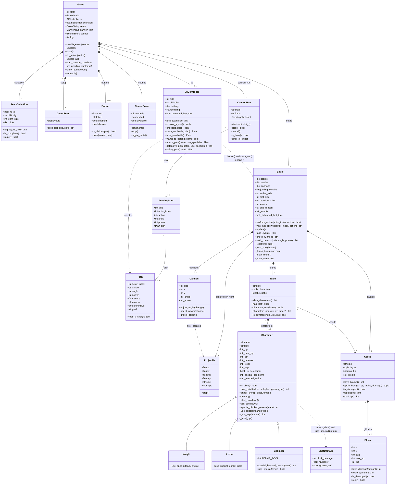
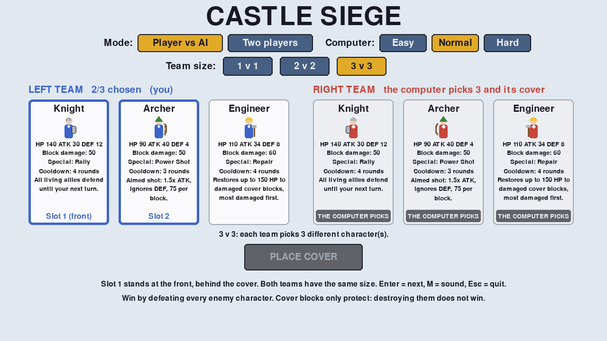
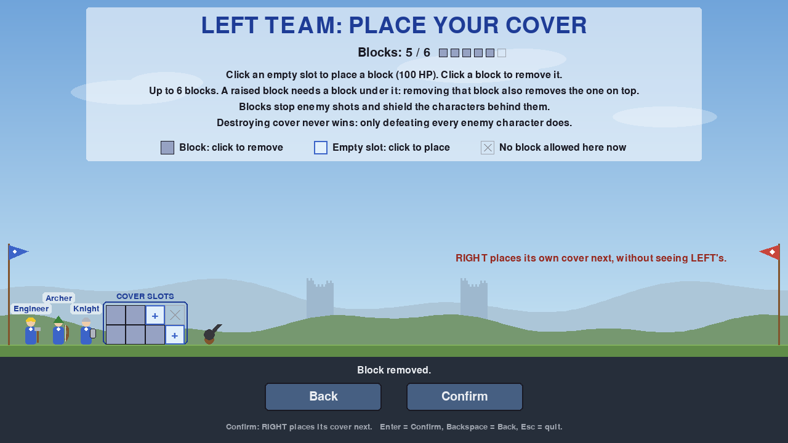
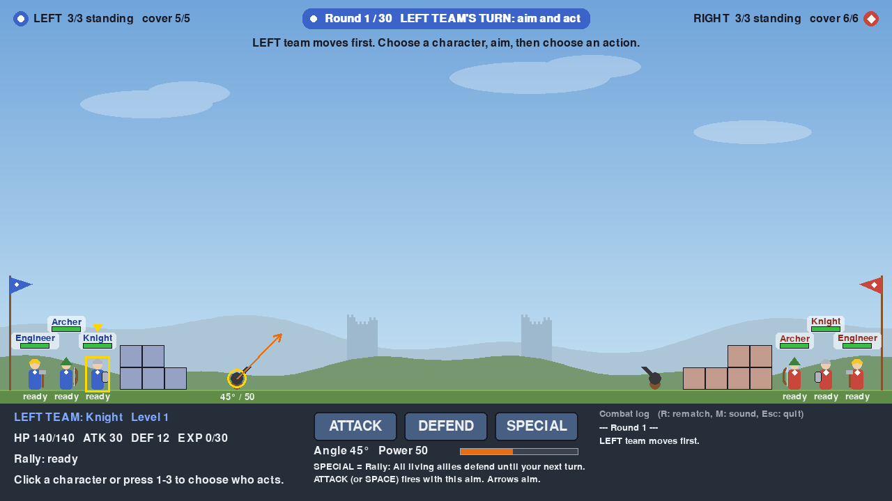
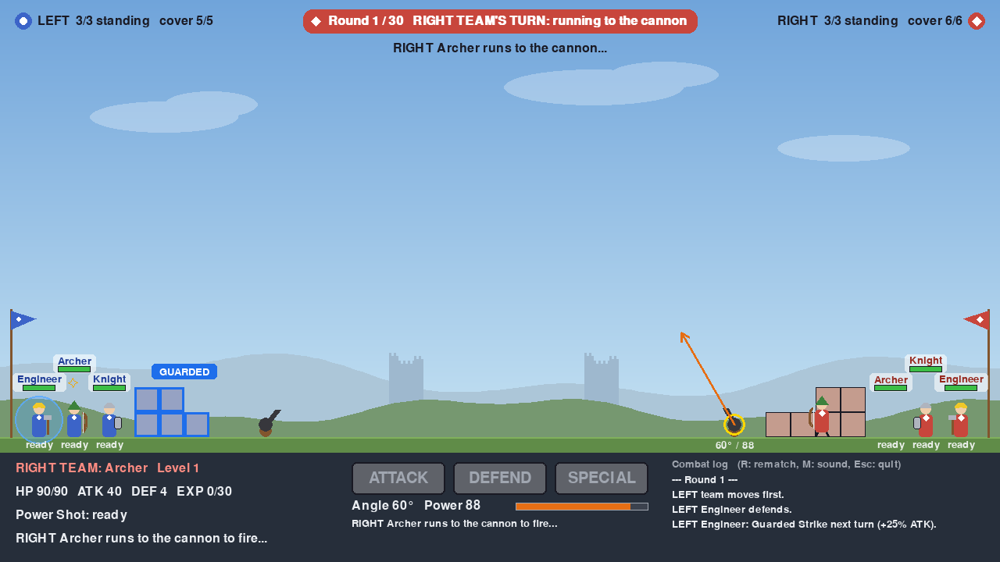
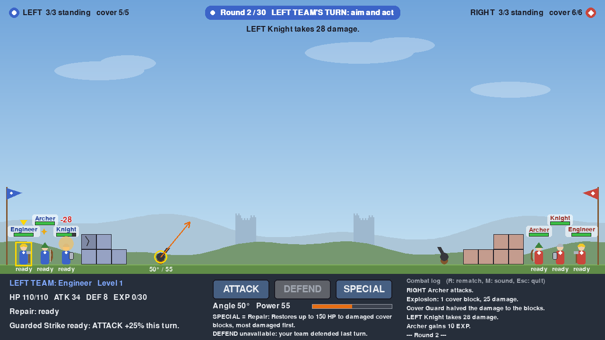
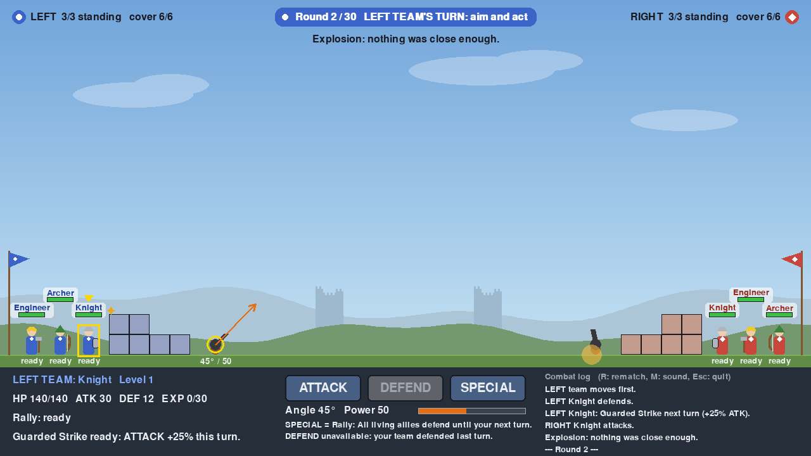
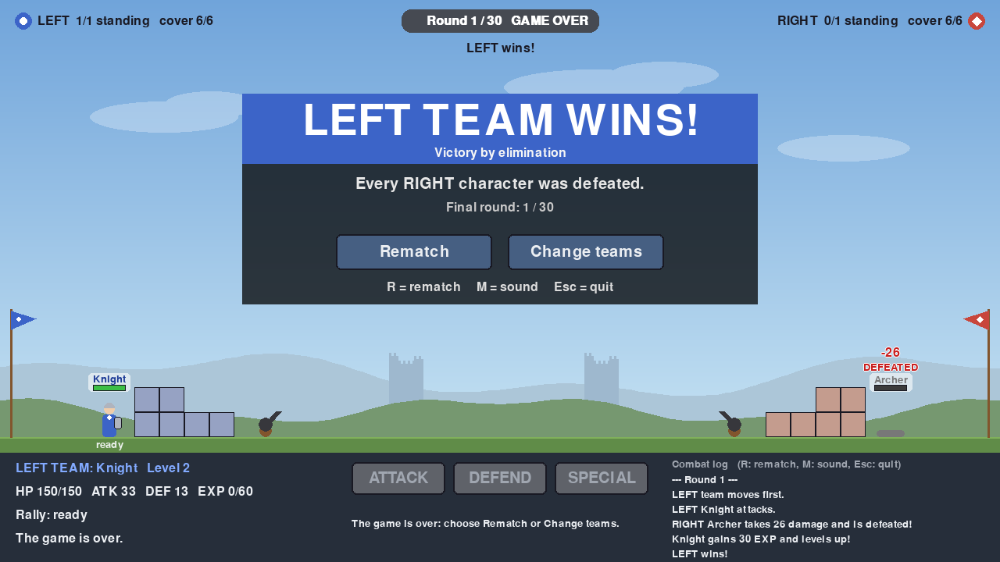
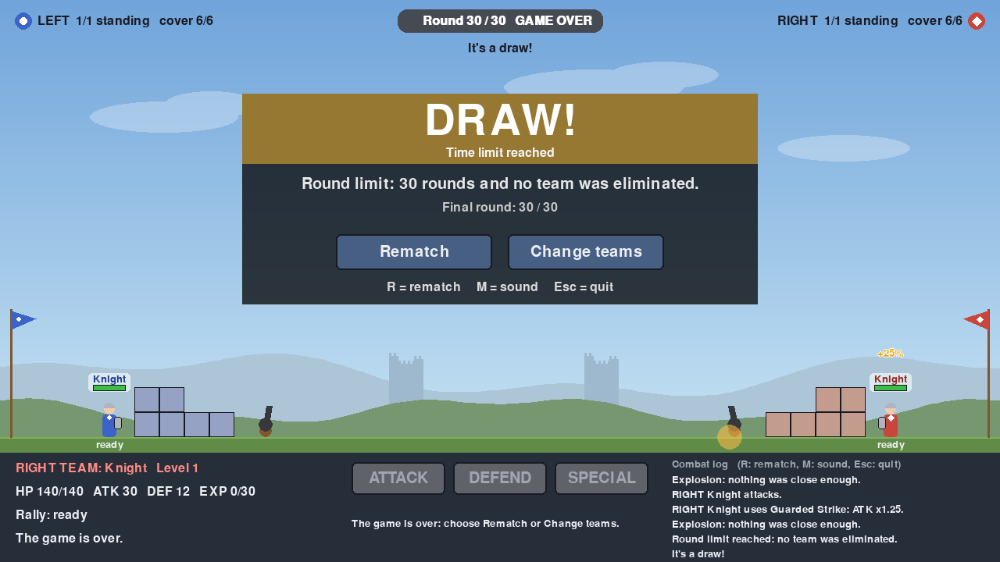

# Castle Siege — CS5001 Final Project Report (draft)

> **Draft (M5.1), for project-manager review. Not the final submission.**
> - Author: *[student name]*. Course: CS5001. Code version: commit `f09ac80`.
> - The instructor's own project documents ("CS5001 Final Project Games based Project" and
>   "CS5001 final project rubrics updated") were **not available** while this draft was written.
>   The requirements used here come from the project's notes (`docs/M0_design.md` §8–§10 and
>   `docs/M3.3_course_compliance.md`). They must be checked against the instructor's documents
>   before submission (see `docs/M5.1_submission_audit.md`).
> - Text in *[square brackets]* is a placeholder for the student.
> - The PDF or Word version, the demo video and the source-code appendix come in M5.2.

---

## Part A — Short explanation (300–500 words)

*This part is separate from the full report below, for a short-explanation requirement of
300 to 500 words. Word count: **471** (`docs/M5.1_submission_audit.md` §3 explains how it was
counted).*

<!-- explanation:start -->
Castle Siege is a turn-based artillery game written in Python with Pygame. Two teams of one to
three characters face each other across a battlefield, and the goal is simple: defeat every
character on the enemy team.

The game has two modes. In Player vs AI, the player controls the left team and the computer
controls the right team at Easy, Normal or Hard difficulty. In local two-player mode, two
people share one computer and take turns. Each team chooses its characters from three roles.
The Knight has the most HP and defense and can Rally, which makes every ally defend. The Archer
has the highest attack and can fire a Power Shot that ignores defense. The Engineer is
balanced, does extra damage to blocks and can Repair damaged cover. Every character has HP,
ATK, DEF, EXP and a level. Successful shots earn EXP, and each level-up raises HP, ATK and DEF.

Before the battle, each team places up to six cover blocks on eight fixed slots in front of its
characters. During the battle the teams take turns. On its turn a team picks one living
character and one action. Attack fires the team's shared cannon: the player sets the angle and
power, the character runs to the cannon, and the cannonball flies under gravity until it
touches an enemy block, an enemy character or the ground. The explosion damages nearby enemy
blocks and characters, but a block standing between the explosion and a character shields that
character. Damage is ATK minus DEF, with a minimum of 1. Defend halves the damage a character
takes until its team's next turn. As our own additions, a Defend also makes that character's
Attack in the team's next turn 25 percent stronger, and a team cannot Defend two turns in a
row. Special abilities have cooldowns counted in rounds. If no team has been eliminated after
30 rounds, the match is a draw; this time limit is our own safety rule.

The code uses object-oriented design. Knight, Archer and Engineer inherit from a Character base
class, and each one overrides the use_special method, so the battle calls one method and each
role behaves differently. Values such as health, level and cooldown are private attributes
that change only through methods. A Battle object owns the two teams, their cover and their
cannons, and reports everything that happens as events. The Pygame interface turns those
events into drawings, sounds and combat-log lines. The computer opponent tries possible shots
on a copy of the battle, scores what each one would do, picks one of the best, and then adds an
aiming error that depends on the difficulty.

The project has 405 automated unittest tests covering the rules, the computer opponent and the
interface, and scripted runs played 72 complete matches through the real interface without
errors.
<!-- explanation:end -->

*[Before submission: if the human play-test has been done, a sentence about it can be added;
re-count the words.]*

---

## Part B — Full report

## 1. Project title and overview

**Castle Siege** is a 2D side-view, turn-based artillery game for one player against the
computer, or for two players on one computer. Each team has 1–3 characters (Knight, Archer,
Engineer) standing behind cover blocks it placed itself, and one shared cannon. The teams take
turns choosing a character and an action. **A team wins by defeating every enemy character.**

- **Language and libraries:** Python 3 (developed and tested with 3.11.9 on Windows) and Pygame
  2.6.1; nothing else. The sound effects are generated in code with the standard library and
  played with Pygame. There are no image or sound files.
- **How to run:** `pip install -r requirements.txt`, then `python main.py`. Tests:
  `python -m unittest discover tests`.
- **Size:** 8 source files, 3,596 lines; 8 test files, 5,117 lines.

| File | Lines | Contents | Uses Pygame? |
|---|---|---|---|
| `main.py` | 1,415 | `Game`: screens, input, the computer's turn, drawing, main loop | yes |
| `battle.py` | 575 | `Battle`, `Team`, `Cannon`, `Projectile`: physics, collision, explosions, turns, victory | no |
| `ai.py` | 485 | `AIController`, `Plan`: the computer opponent | no |
| `characters.py` | 331 | `Character`, `Knight`, `Archer`, `Engineer`, `calculate_damage`, `ShotDamage` | no |
| `drawing.py` | 299 | Colours, figures, cover blocks, `Button` | yes |
| `castle.py` | 213 | `Block`, `Castle`, cover-layout rules | no |
| `sound.py` | 148 | Sound effects made in code, `SoundBoard` | yes |
| `animation.py` | 130 | `CannonRun`, `PendingShot`: the run to the cannon | no |

## 2. Game description

**Goal.** Defeat every character of the enemy team. Destroying cover never wins by itself.

**Modes.**
- **Player vs AI** (the default): you play the LEFT team; the computer picks, places and plays
  the RIGHT team at Easy, Normal or Hard.
- **Two players** (local "hot seat"): both teams are played on one computer, taking turns.

**One match, step by step.**
1. **Team selection:** choose the mode, the computer's level, the team size (1 v 1, 2 v 2 or
   3 v 3) and the characters. A team can't have the same role twice.
2. **Cover placement:** each team places 0–6 blocks on its 8 cover slots. Against the computer,
   the computer places its own.
3. **Battle:** the teams alternate turns until one team is eliminated or 30 rounds have been
   played.
4. **Result:** the winner, or DRAW, why the match ended, and the final round. **Rematch** keeps
   the teams and cover and swaps which side moves first; **Change teams** goes back to
   selection.

**Controls:** the mouse for everything; 1/2/3 choose a character; Up/Down change the angle
(5°–80°); Left/Right change the power (10–100); Shift changes by 5; Space = ATTACK; R =
rematch; M = sound on/off; Esc = quit.

**Required functionality and our additional design.** The left column is the course
requirements *as recorded in our notes*; they must be confirmed against the instructor's
documents.

| Course requirement (as recorded) | How Castle Siege meets it |
|---|---|
| Turn-based combat | Teams alternate; one living character and one action per turn |
| Characters with HP, ATK, DEF, EXP and Level | `Character` and its three subclasses |
| Attack, Defend, Special | The three action buttons |
| Defend reduces damage by 50 % | Halved after DEF, minimum 1, until the team's next turn |
| Special abilities with cooldowns | Rally (4 rounds), Power Shot (3), Repair (4) |
| Character selection | The team-selection screen (1–3 different roles per team) |
| An AI opponent that defends more below 50 % HP | Higher Defend chance when a character is below half HP |
| Victory by defeating every enemy character | The only way to win |
| Health bars, action buttons, combat log, result screen | All on screen |

| Our additional design (not required) | Notes |
|---|---|
| Artillery aiming: angle, power, gravity; shots can miss | The core of the game's skill |
| One shared cannon per team; the character runs to it | The acting character's stats set the damage |
| Cover placement (6 blocks, 8 slots) and the cover rule | Blocks shield characters; they never decide the winner |
| Cover Guard | While a team defends, its blocks take half damage |
| Guarded Strike | A Defend gives that character ATK × 1.25 on its Attack in the team's next turn |
| Anti-stall rule | A team can't Defend two turns in a row |
| Round-30 timeout draw | A safety rule so every match ends |
| Repair (Engineer) | Restores up to 150 HP to damaged cover |
| Rematch alternates the first mover | Fairer over a series of matches |
| Local two-player mode | Player vs AI is the course mode |

Two items could belong to either table: **the Easy/Normal/Hard difficulty levels** and **sound
effects**. Our notes list them with the requirements, but whether the instructor requires them
is not confirmed. Both are built.

**None of the additional rules has been approved by the instructor.** The damage formula also
differs from the instructor's sample (section 3).

## 3. Character design and attributes

| | Knight | Archer | Engineer |
|---|---|---|---|
| Role | Defender | Damage | Support / siege |
| HP | 140 | 90 | 110 |
| ATK | 30 | 40 | 34 |
| DEF | 12 | 4 | 8 |
| Damage to each block | 50 | 50 | 60 |
| Special | **Rally:** every living ally (the Knight too) defends until the team's next turn | **Power Shot:** an aimed shot; ATK × 1.5, ignores DEF, 75 per block | **Repair:** up to 150 HP back to damaged standing blocks, most damaged first |
| Cooldown | 4 rounds | 3 rounds | 4 rounds |

**Damage to a character** (`characters.calculate_damage`):

```
damage = int(ATK × multiplier)     # multiplier 1.0 for Attack, 1.5 for Power Shot,
                                   # 1.25 for Guarded Strike
if the shot does not ignore DEF:  damage = damage − DEF
damage = max(1, damage)            # a hit always does at least 1
if the target is defending:       damage = max(1, damage // 2)
```

Examples at Level 1:
- Archer Attack on a Knight: 40 − 12 = **28**; on a defending Knight, **14**.
- Archer Power Shot on a Knight: int(40 × 1.5) = **60** (DEF ignored).
- A Knight's Guarded Strike on a Knight: int(30 × 1.25) − 12 = **25**, instead of 18.

*Difference from the course:* the instructor's sample formula is ATK − DEF + a random number
from −5 to +10. Ours leaves out the random part, so the same hit always does the same damage
and the tests can check exact numbers. On average the sample formula does 2.5 more damage per
hit. We do not claim to match it.

**EXP and levels** (`Character.gain_exp`):
- +10 EXP when the character's shot damages at least one enemy block or character, +20 more for
  each enemy it defeats, +5 for Rally or Repair. Defend and a miss earn nothing. A defeated
  character earns nothing.
- The next level needs 30 × the current level EXP (30, 60, 90, 120); leftover EXP carries over,
  and one award can give several levels.
- Each level-up: +10 max HP and +10 HP, +3 ATK, +1 DEF. The maximum is Level 5.
- EXP and levels start again in every match.

## 4. Rules and gameplay flow

**Battlefield.** From each edge of the 1280 × 720 window inward: the team's characters (slots
1–3), its 8 cover slots (4 columns × 2 rows), then its cannon. The two sides are mirror images.

**Cover.** Each block has 100 HP. A team may place 0–6 blocks; a raised block needs a block
under it. Blocks stop enemy shots, and a standing block on the straight line between an
explosion and a character shields that character from the whole blast.

**A turn.**
1. Choose a living character (click it, or press 1–3).
2. Aim the cannon (arrow keys).
3. Choose an action:
   - **ATTACK** (or Space): the character runs to the cannon (1/3 s), fires, and runs back
     while the shot flies. The turn ends when the shot has landed and its damage is applied.
   - **DEFEND**: the character takes half damage until the team's next turn, and the team's
     blocks take half damage too (Cover Guard). It also gives that character Guarded Strike for
     the team's next turn.
   - **SPECIAL**: Rally or Repair happen at once; Power Shot is fired like an Attack.
4. The other team's turn starts. The computer waits 2/3 s, then plays by itself.

A greyed-out button can't be used now, and the panel says why: for example, a special that is
recharging, Repair with nothing to repair, or Defend right after the team's own Defend.

**Rounds.** A round is complete when both teams have acted. Cooldowns go down by 1 at the start
of each round. LEFT moves first in the first match; every rematch swaps the first mover.

**Explosions.** A shot explodes where it first touches an enemy block, an enemy character or
the ground. Then:
- every enemy block whose centre is within 50 px loses that character's block damage (halved,
  rounded down, while that team defends);
- the character hit directly, and every other enemy character within 50 px that no block
  shields, takes damage (section 3).

Everything is decided at the moment of impact, so a block destroyed by this explosion still
shields against this explosion. There is no friendly fire.

**Guarded Strike and anti-stall** (added in Milestone 4.2-B, after a design review):
- After a basic Defend, that character's normal Attack in the team's next turn uses
  ATK × 1.25. It is used up by that Attack, or lost at the end of that turn if another
  character acts or the defender uses its special. It never stacks; Rally doesn't give it;
  block damage doesn't change.
- A team can't Defend two turns in a row (Rally doesn't count), so a team that is behind can't
  defend every turn until the round limit.

**End of the match.**
- A team with no living characters loses at once, even on the last turn of round 30.
- If both teams were defeated at the same moment it would be a draw; in play this can't
  happen, because only one team acts at a time.
- If round 30 ends with both teams alive, the match is a **draw** (a timeout). HP and cover
  never decide the winner.

## 5. Algorithms and game loop

### 5.1 The main loop (`main.main`)

```python
while game.running:
    for event in pygame.event.get():
        game.handle_event(event)     # mouse and keyboard
    game.update()                    # one frame of the game
    game.draw()                      # draw the current screen
    pygame.display.flip()
    clock.tick(FPS)                  # 60 frames per second
```

`Game.update()` does one frame in this order:
1. if a character is running to the cannon, move it one frame (and fire on arrival);
2. otherwise, if it is the computer's turn, count down its pause, then let it act;
3. move the shot in flight by one physics step (`Battle.update`);
4. read the Battle's new events (`Battle.take_events`) and show each one: explosion effects,
   floating damage numbers, sounds, combat-log lines, and the result screen at the end;
5. age the explosions and floating numbers, and enable or disable the buttons.

`Game.draw()` draws the screen for the current state: `"select"`, `"cover"`, `"battle"`, or
`"result"` (the battlefield with the result overlay).

### 5.2 Event handling

`Game.handle_event` sends key presses to `handle_key` and left clicks to `handle_click`, which
pass them on according to the current screen.
- Esc (quit) and M (sound) work on every screen; R (rematch) works in battle and on the result
  screen.
- During a battle, aiming keys, number keys, Space and the action buttons work only when
  `controls_locked()` is False: no character is running, no shot is flying, the game isn't over
  and it isn't the computer's turn.
- Space acts once per press: it must be released before it works again.
- Before every click and every frame, `refresh_buttons` asks `Battle.why_not_allowed` about
  each action, so a button is enabled exactly when the rules allow it. A click on a greyed-out
  button shows the reason.

### 5.3 Character selection (`main.TeamSelection`)

`toggle(side, role)` adds a role to a team, or removes it if it is already there. It refuses a
pick if the team is full or if it is the computer's team. Roles can't repeat, so a team never
has duplicates. `is_complete()` is True when each team that is picked by people has exactly
`team_size` characters; only then can PLACE COVER be pressed. The computer picks its team with
`AIController.pick_team(size)`: `size` different roles at random.

### 5.4 Cover placement validation (`castle.py`)

One function, `layout_problem(layout)`, decides whether a layout is legal. It returns `None`,
or the reason:
1. every slot number is an integer from 0 to 7;
2. no slot is used twice;
3. at most 6 blocks;
4. no raised block floats: slot 4 needs slot 0, slot 5 needs slot 1, and so on
   (`floating_blocks`).

Every other part uses it:
- a click on an empty slot calls `place_block`, which builds the new layout and keeps it only if
  `layout_problem` accepts it;
- a click on a block calls `remove_block`, which also removes any block left floating on top;
- the computer places its blocks with `place_block` too;
- Confirm checks `layout_problem` again, and `Castle(side, layout)` raises an error for an
  illegal layout.

So an illegal layout can never reach a battle. There are exactly 76 legal layouts, and a test
checks all of them.

### 5.5 Turn state transitions

Screens (`Game.state`): `select → cover (LEFT) → [cover (RIGHT), two players only] → battle →
result`, with Back on the cover screens and Rematch / Change teams on the result screen.

Inside the battle, `Battle.perform_action(actor_index, action)` is the only way to act. The
buttons, the keyboard and the computer all use it:

```
perform_action ── refused? ──► "invalid" event; nothing changes
      │
      ├─ Attack or Power Shot ─► _launch: a Projectile leaves the cannon
      │                           update() once per frame ... until impact ─► _end_shot
      │                                                                        │
      └─ Defend, Rally, Repair ──────────────────────────────────────────────►│
                                                                               ▼
_finish_turn: give EXP ─► drop an unused Guarded Strike ─► check_winner ─► game over?
      │ no
      ▼
round complete and round 30? ─► draw (timeout)
      │ no
      ▼
switch to the other side ─► if a new round: _start_round (round + 1, cooldowns tick)
      ─► _start_turn (that team's Defend ends; its Guarded Strike becomes ready)
```

In the interface, an Attack has one more step before `perform_action`: the `CannonRun`
animation (IDLE → RUN_TO_CANNON 20 frames → FIRE 12 → RETURN_TO_SLOT 20). `perform_action` is
called exactly once, on the frame the character reaches the cannon. The Battle keeps every
character in its slot, so the animation can't change any hit or rule.

### 5.6 Projectile physics (`battle.Projectile`)

The cannonball starts at the cannon's pivot with speed `power × 7` px/s:

```
vx = direction × speed × cos(angle)      # direction +1 for LEFT, −1 for RIGHT
vy = −speed × sin(angle)                 # screen y grows downward, so up is negative
every step (DT = 1/60 s):
    vy = vy + 400 × DT                   # gravity: 400 px/s²
    x  = x + vx × DT
    y  = y + vy × DT
```

This is the semi-implicit Euler method with a fixed time step. The same aim always gives the
same flight, which the tests and the computer opponent rely on. There is no wind or air
resistance. A shot still flying after 600 steps (10 s) counts as a miss; a test checks that no
legal aim gets that far.

### 5.7 Projectile collision (`battle.segment_entry`, `Battle._touches`)

Each step, the shot moves along a short straight segment. Instead of testing only where it
ends, the game checks the **whole segment** against every standing enemy block and every
living enemy character (each a rectangle). `segment_entry` finds, for x and for y, the part of
the move during which the shot is inside the rectangle's range. The segment touches the
rectangle exactly when those two parts overlap, and it enters where the later part begins.
This gives a fraction from 0 to 1 along the move. The ground (y = 560) and the edges of the
field are checked too. All touches are sorted by fraction, so the **first** thing touched is
the one hit, and the impact point is exactly where it was touched. A fast shot can't jump over
a thin target, and the shooter's own blocks and characters are never checked (no friendly
fire).

### 5.8 Explosion and damage (`Battle._end_shot`)

1. A shot that left the field sideways, or took too long, is a miss: no explosion, 0 EXP.
2. **Read everything first, before any damage:** is the enemy team defending (Cover Guard)?
   Which living enemy characters are within 50 px (the directly hit one always counts)? Which
   of them, other than the directly hit one, have a standing block on the straight line from
   the explosion to their centre (`Team.is_covered`, again with `segment_entry`)?
3. Damage each enemy block within 50 px (`Castle.apply_blast`): the shooter's block damage,
   halved and rounded down under Cover Guard.
4. Damage each character in the blast that is not shielded (`Character.take_hit`, which uses
   `calculate_damage`).
5. Record an `"explosion"` event with everything that happened, then give EXP: +10 if anything
   was damaged, +20 for each defeated enemy.

### 5.9 Defend and Guarded Strike

- `Character.defend()` sets a private `_is_defending` flag. `calculate_damage` halves the
  damage while it is set. `_start_turn` clears it when the defender's team moves again, so a
  Defend protects against exactly one enemy action.
- Guarded Strike is a small state machine on each character (`_guarded_strike`):
  `None` → `"pending"` (granted by a basic Defend) → `"ready"` (`arm_guarded_strike`, at the
  start of the team's next turn) → `None`, when it is used (`use_guarded_strike`: the Attack
  gets multiplier 1.25 from `attack_shot`) or dropped (`expire_guarded_strike`, at the end of
  that turn).
- Anti-stall: `Battle._defended_last_turn[side]` is set after every action (True only for
  Defend). `why_not_allowed` refuses a Defend while it is True.

### 5.10 AI action selection (`ai.AIController.choose`)

1. Roll whether specials (Rally, Power Shot, Repair) may be considered this turn: 25 %, 50 % or
   100 % (Easy, Normal, Hard).
2. **Defend?** (`wants_to_defend`) Never right after its own defensive turn. If any of its
   living characters is below half HP, it defends with probability 40 / 50 / 60 %; otherwise
   10 / 5 / 0 %. A defensive turn is a Rally if specials are considered this turn, the team has
   at least two living characters and a Knight's Rally is available; otherwise the weakest
   character (by HP share) defends.
3. **Otherwise attack** (`attack_plan`):
   - **Imagine shots.** For angles 30°, 45° and 60° and powers 100, 98, 96, ..., it copies the
     battle (`copy.deepcopy`), fires on the copy with the real rules, and looks at the result.
     At each angle it stops once a shot lands on its own half of the field.
   - **Score each shot** (`shot_value`): the share of the enemy's remaining HP removed, +0.25
     for each defeat, +10 for a win, plus 0.5 × how much it opens a shot at a protected enemy.
     To measure that, for shots that end on a block it traces the rest of the path
     (`Battle.path_contacts`). If a living enemy stands behind those blocks, breaking them is
     worth part of a hit on that enemy. Blocks in nobody's way are worth nothing.
   - **Allow for its own error** (`expected_score`): each aim is rated by the average score of
     the powers it might really fire, within its power error. A narrow gap counts for less than
     a wide one.
   - **Choose:** one of the best 4 / 3 / 1 targets at random (Easy / Normal / Hard). Then it
     imagines that aim fired by each living character (Attack, or an Archer's Power Shot) and
     picks one of the best 4 / 3 / 1 of those. A Repair is chosen instead if it scores higher.
   - **Add the aiming error:** up to ±4° / ±5 power (Easy), ±3° / ±4 (Normal), ±1° / ±2 (Hard).
4. **Safety net:** if the chosen plan would be refused, it defends if allowed, otherwise it
   attacks with a fixed aim, so its turn can never get stuck.

The computer only acts through `Battle.perform_action`, like a person, so it can't break a
rule. The difficulty changes only its choices and its aim, never the rules.

### 5.11 Cooldowns and win checking

- Using a special sets the character's counter to its cooldown (`start_cooldown`).
  `_start_round` lowers every counter by 1, never below 0 (`tick_cooldown`). The special is
  available at 0. So a special used in round *r* is ready again in round *r + cooldown*: for
  example, a Power Shot used in round 2 is ready in round 5.
- `check_winner` runs at the end of every action. A team with no living characters
  (`Team.has_lost`) loses; if both had lost it would be a draw. After that, `_finish_turn`
  ends the match as a draw when round 30 is complete.

## 6. Object-oriented architecture

**Separation of rules and interface.** The rules (`battle.py`, `castle.py`, `characters.py`),
the computer opponent (`ai.py`) and the animation timing (`animation.py`) never import Pygame;
a test checks this. The Battle reports what happens as a list of small dictionaries (events),
which `Game` reads once per frame. So the rules can be tested without a window, and the
interface never repeats a rule.

### 6.1 Class diagram

Editable source: [`docs/M5_class_diagram.mmd`](M5_class_diagram.mmd) (Mermaid). GitHub draws the
copy below. For the PDF, an image will be exported in M5.2.

Legend: `<|--` inheritance; `*--` composition (owns); `-->` association (keeps a reference it
doesn't own); `..>` dependency (uses or creates, doesn't keep). `-` marks private-by-convention
members (a leading underscore).

<!-- class-diagram:start -->

<!-- class-diagram:end -->

Notes on the relationships, so none is overstated:
- **Team → Castle is an association, not composition.** `Battle.reset` creates each `Castle`
  and keeps it in `Battle.castles`; the `Team` only receives a reference to the same object.
- **The projectile:** `Cannon.fire()` creates a `Projectile`; the `Battle` keeps it in
  `projectile` while it flies and drops it when the shot ends.
- **The AI doesn't store the Battle:** `choose(battle)` and `carry_out(battle, plan)` receive it
  as an argument. The Battle doesn't know whether a person or the computer is playing.
- Functions that are not methods (`calculate_damage`, `layout_problem`, `segment_entry`,
  `describe_event`, `imagine`, ...) are not drawn.

### 6.2 Inheritance

`Knight`, `Archer` and `Engineer` are subclasses of `Character` (`characters.py`). Health,
damage, defending, cooldowns, EXP and levels are written once, in `Character`. Each subclass
only sets its numbers (`BASE_HP`, `BASE_ATK`, `BASE_DEF`, `BLOCK_DAMAGE`, `SPECIAL_COOLDOWN`,
...) and its special ability. This is the only inheritance in the project.

### 6.3 Encapsulation

- `Character` keeps `_hp`, `_max_hp`, `_atk`, `_defense`, `_level`, `_exp`, `_is_defending`,
  `_special_cooldown` and `_guarded_strike` private. Other code reads them through read-only
  properties (`hp`, `level`, ...) and changes them only through methods that keep them valid:
  `take_damage` never goes below 0, `gain_exp` is the only way to level up (`_level_up` is
  private), and `tick_cooldown` never goes below 0.
- `Block._hp` changes only through `take_damage` and `restore`, which never go below 0 or
  above the maximum, and a destroyed block can't be restored.
- `Cannon._angle` and `_power` change only through `adjust_angle` and `adjust_power`, which
  clamp them, so an illegal aim can't exist.
- `Castle.blocks` returns a tuple, so callers can't add or remove blocks.
- `Battle._events` is emptied only by `take_events()`.

### 6.4 Polymorphism

`Battle.perform_action` handles every special with the same two lines:

```python
actor.start_cooldown()
message, shot = actor.use_special(team)
```

The object decides what happens: a `Knight` makes its allies defend, an `Archer` returns a
stronger `ShotDamage` for the cannon to fire, and an `Engineer` repairs the team's cover. The
base `Character.use_special` raises `NotImplementedError`, and a test checks that every role
overrides it. `special_blocked_reason` is polymorphic too: `Engineer` extends the base version
(through `super()`) with "nothing to repair".

### 6.5 Composition and object relationships

- A `Battle` owns two `Team`s, two `Castle`s and two `Cannon`s, and keeps a reference to the
  `Projectile` in flight.
- A `Team` owns its 1–3 characters and refers to its `Castle`.
- A `Castle` owns its 0–6 `Block`s.
- A `Game` owns the selection and cover choices, the buttons, the `SoundBoard`, the
  `CannonRun`, the current `Battle` and, against the computer, an `AIController`.

A rematch calls `Battle.reset`, which builds new characters, castles and cannons from the same
roster and layouts, so nothing from the previous match carries over.

## 7. Testing methodology

- **Automated tests:** Python's standard `unittest`, 405 tests in 8 files:
  `python -m unittest discover tests`. They call the real game classes.
  - **Logic tests** (rules, AI, animation timing) don't need Pygame.
  - **Interface tests** (`test_main`, `test_sound`) need Pygame and run without a visible window
    or sound (SDL "dummy" drivers). They click and press keys through the real `Game` methods.
    Without Pygame they are skipped, not failed.
- **Repeatable randomness:** the computer opponent takes a seed, so AI tests give the same
  result every run.
- **Test-first fixes:** a defect is first reproduced by a test that fails, then fixed. The
  test stays as a regression test (for example the M4.2-B.1 AI safety net).
- **Scripted gameplay checks (M4.3):** throwaway scripts, not part of the project, drove the
  real `Game` through complete matches by clicking and pressing keys, with a seeded AI deciding
  the moves for the "human" side. **These are automated checks, not human play-testing.**
- **Human acceptance testing:** done by a tester on earlier versions. The interface polish
  (M4.1) passed 8 of 8 items. The sound and atmosphere version (M4.2-A) passed 6 of 8, and the
  other two were not checked. The final version (with Guarded Strike) has not been play-tested
  by a person yet (`docs/M5.1_submission_audit.md` §7).

| Test file | Tests | Representative test classes | What they cover |
|---|---|---|---|
| `test_characters.py` | 45 | DamageTest, ExperienceTest, InheritanceTest, SpecialAbilityTest, GuardedStrikeStateTest | Stats, the damage formula and its minimum, Defend, cooldowns, levels, specials |
| `test_castle.py` | 28 | LayoutTest, PlacementTest, BlastTest, RepairTest | Cover rules (all 76 legal layouts), blasts, Repair |
| `test_battle.py` | 32 | ProjectileTest, SegmentEntryTest, ShotTest, PathContactsTest, PygameIndependenceTest | Physics, collision along the path, mirror symmetry, events |
| `test_combat.py` | 78 | AttackTest, CoverTest, DefendTest, VictoryTest, RoundLimitTest, GuardedStrikeTest, AntiStallTest | Whole turns, cover, Cover Guard, specials, EXP, victory, the round limit |
| `test_ai.py` | 54 | DefensiveBehaviourTest, AccuracyTest, CoverAwarenessTest, MatchTest, AntiStallAndGuardedStrikeAITest | The computer's choices, difficulty, whole AI-vs-AI matches |
| `test_animation.py` | 16 | StatesTest, MovementTest, SeparationTest | The run to the cannon |
| `test_sound.py` | 8 | SynthesisTest, SoundBoardTest | The sound effects and the silent fallback |
| `test_main.py` | 144 | TeamSelectionTest, CoverPlacementScreenTest, ActionButtonTest, KeyboardTest, ResultScreenTest, PlayerVsAIBattleTest, CannonRunTest, SoundEventsTest, GuardedStrikeUITest | Screens, buttons, keys, the computer's turn, the result screen, sounds |

## 8. Test results

Results from the final stabilization (M4.3, `docs/M4.3_stabilization_report.md`), on the same
game code as this draft:

- **Automated tests:** 405 of 405 pass with Pygame. Without Pygame, 253 pass and 152 are
  skipped (`test_main`, `test_sound`), with no failures.
- **Scripted complete matches:** 72 matches through the real interface: Player vs AI at each
  difficulty and two-player mode; 1v1, 2v2 and 3v3; default, empty and custom cover; LEFT and
  RIGHT moving first. There was no error, no refused action and no stuck turn. 71 ended by
  elimination and 1 by the round-30 timeout.
- **Critical interaction checks:** 11 of 11 passed. They include R during the run, the flight
  and the explosion, M during play, the computer moving first after a rematch, Guarded Strike
  expiring, the anti-stall refusal and the Rally exception, and Rematch clearing everything.
- **Difficulty:** in 200 seeded computer-vs-computer matches, Normal beat Easy 28–9 (3 draws)
  and Hard beat Normal 37–3. Mirror matches finished before round 30 in 92 % (Easy), 95 %
  (Normal) and 100 % (Hard) of games. These numbers describe the built-in AI, not human
  players.
- **Victory and timeout:** an elimination on the very last turn still wins
  (`test_an_elimination_on_the_last_turn_beats_the_timeout`); a timeout is a draw even when one
  team is far ahead; both are tested with either side moving first.
- **Rematch and Guarded Strike:** a rematch resets HP, EXP, levels, cooldowns, cover, Guarded
  Strike and the anti-stall memory, and swaps the first mover. Guarded Strike is tested from
  granted to used or expired, for people and the computer.
- **Boundary cases tested:** damage never below 1 and HP never below 0; halving rounds down;
  Level 5 cap and several levels from one award; defeated characters earn no EXP and aren't
  revived; Repair never overheals or rebuilds; every legal cover layout leaves every character
  reachable; no legal aim reaches the 600-step timeout; a missing audio device leaves the game
  silent but playable.

**Defects:** M4.3 found no gameplay defect. The last defect found and fixed was in M4.2-B.1: the
computer's turn could get stuck if its fallback plan was a refused Defend. A regression test
now covers it.

## 9. Screenshots and figure captions

All eight pictures are real frames of the game (`main.Game`), saved during scripted headless
runs that click and press keys through the game's own input handling. No picture was edited or
drawn by hand. Figures 6–8 were set up by the script, as each caption says.


**Figure 1.** Team selection in Player vs AI, 3 v 3, Normal. The LEFT team has picked a Knight
and an Archer; the computer's cards say "THE COMPUTER PICKS".


**Figure 2.** LEFT team's cover screen (two-player mode): "Blocks: 5 / 6", an empty slot ("+")
and a slot that can't take a block ("×").


**Figure 3.** The start of a 3v3 battle: turn banner, HP bars, the chosen Knight, the aim arrow,
the action buttons and the combat log.


**Figure 4.** The RIGHT Archer runs to its cannon. LEFT's Engineer defended last turn, so its
cover shows GUARDED and a hollow star marks its Guarded Strike.


**Figure 5.** Just after an explosion: "-28" over the LEFT Knight, a cracked block, and the
combat log explaining Cover Guard. DEFEND is greyed out (anti-stall).


**Figure 6.** The LEFT Knight defended last turn: its Guarded Strike is ready (filled star,
"ATTACK +25% this turn" in the panel) and DEFEND is unavailable, with the reason.


**Figure 7.** The result screen after a win by elimination. *Staged:* the script lowered the
RIGHT Archer's HP before the shot, so that one hit defeats it.


**Figure 8.** A draw after the round limit (round 30 / 30). The script passed every turn (a
Defend, or a harmless shot when Defend wasn't allowed) to reach it.

*[M5.2: replace Figure 7 with a natural win from a real match, and add the screenshots listed
in `docs/M5.1_submission_audit.md` §5.]*

## 10. Conclusion

Castle Siege meets the course requirements as we recorded them:
- turn-based combat between teams of characters with HP, ATK, DEF, EXP and levels;
- Attack, Defend (−50 %) and special abilities with cooldowns;
- character selection;
- a computer opponent that defends more when hurt;
- victory by eliminating the enemy team;
- a graphical interface with health bars, buttons, a combat log and a result screen.

On top of that it adds an artillery layer (aiming, a shared cannon, deployable cover), sound
effects made in code, three difficulty levels and a local two-player mode. The rules are
separated from the interface and covered by 405 automated tests.

**Limitations:**
- The damage formula is deterministic, unlike the instructor's sample.
- The custom rules (cover, Cover Guard, Guarded Strike, anti-stall, the round-30 draw) have not
  been approved by the instructor.
- `main.py` is large (about 1,400 lines).
- Balance was measured with the built-in AI, not with human players.
- The final version still needs a human play-test.

**Possible future work:** a trajectory hint for beginners, splitting `main.py` into one class
per screen, and saving match statistics.

## References and AI assistance

- Pygame documentation: https://www.pygame.org/docs/
- Python documentation (`unittest`, `copy`, `random`, `math`, `array`): https://docs.python.org/3/
- [ryonsherman/pygame-rebound](https://github.com/ryonsherman/pygame-rebound) (MIT License):
  studied as an *idea* reference only (`docs/Rebound_reference_review.md`). No code or assets
  were copied.
- *[AI assistance statement, written by the student according to the course's policy: this
  project was planned with ChatGPT acting as project manager and implemented with Claude Code.
  Check what the course requires to be disclosed and how.]*

## Appendix — Complete source code

*[Placeholder. If the instructor expects the complete Python source code inside the report, it
goes here in M5.2, generated from the submitted commit; see `docs/M5.1_submission_audit.md` §4.
It is not pasted into the short explanation (Part A).]*
